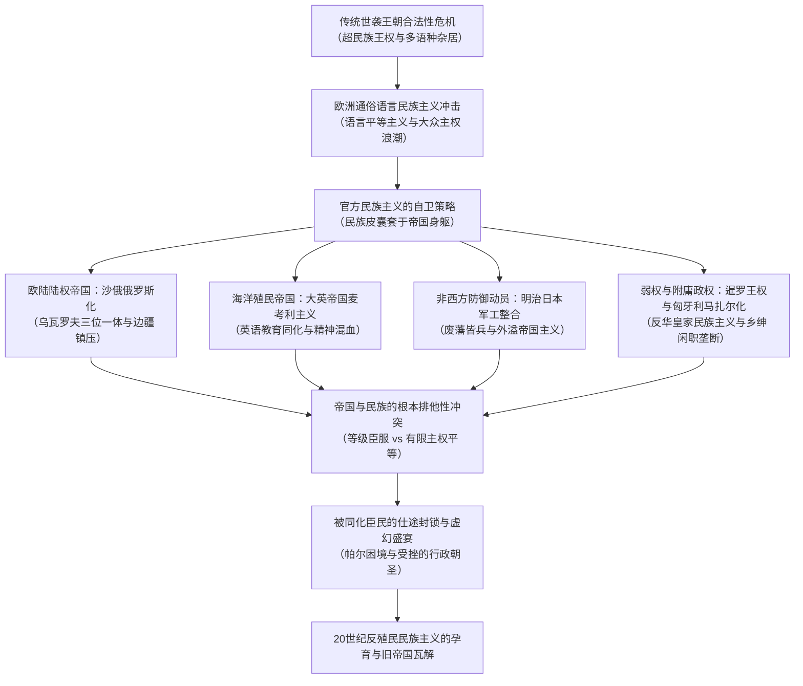

---
authors:
  - "[[Benedict Anderson|Anderson, B.]]"
source_language: en
summary: "系统剖析19世纪中叶以降欧洲与亚非世袭王朝为抵御大众民族主义浪潮自上而下发起的官方民族主义。阐明沙俄俄罗斯化、英国麦考利主义、日本明治维新、暹罗王权同化与匈牙利马扎尔化等历史案例，揭示统治集团将民族皮囊强套在庞大帝国身躯之上的防御机制，论证帝国无限层级与民族有限平等之间的排他性矛盾，揭示殖民同化精英遭遇仕途封锁的虚幻盛宴本质。"
type: argument
subtype: monograph
publication_type: book-chapter
title: "Argument_Anderson_2016_Verso_Ch06"
argument_key: "Argument_Anderson_2016_Verso_Ch06"
argument_display_title: "Imagined Communities: Reflections on the Origin and Spread of Nationalism · Ch06"
argument_kind: "book-chapter"
argument_related_count: 0
argument_related_level: 0
argument_related_stars: "☆"
argument_related_color: "#fef3c7"
book_title: "Imagined Communities: Reflections on the Origin and Spread of Nationalism"
publisher: "Verso"
year: 2016
isbn: "9781781683590"
citation: ""
citation_aliases: []
tags:
  - source/book-chapter
  - theme/nationalism
  - theme/imperialism
  - theme/political-philosophy
part_of: "[[Argument_Anderson_2016_Verso]]"
sources:
  - "[[books/Anderson_2016_Verso/Anderson_2016_Verso|Anderson_2016_Verso]]"
status: draft
created: 2026-11-12
updated: 2026-11-12
---

---

> [!question]
> 为什么在19世纪后半叶，古老合法性与民族毫无关联的欧洲世袭君主王朝，会竞相自封为特定民族的代表？面对1820年代以降自下而上蔓延的大众通俗语言民族主义，传统统治寡头如何通过“把民族短小紧绷的皮囊强套在帝国庞大的身躯之上”发起先发制人的制度自卫？沙皇俄国的强制俄罗斯化、大英帝国的麦考利同化体制、明治日本的防御性军工动员、暹罗王室的反华皇家民族主义以及匈牙利乡绅的残酷马扎尔化，遵循了何种共同的自上而下演进机制？当帝国试图用统一语言和教育同化异族臣民时，为什么帝国无限扩张的层级统治原则与现代民族有限平等的主权原则会爆发剧烈冲突，使殖民地被同化精英的仕途攀升沦为一场被永久封锁的“虚幻盛宴”，并反向催生了20世纪的反殖民民族主义浪潮？

> [!claim] 核心主旨
> 官方民族主义是19世纪中叶以降世袭王朝与统治寡头为应对大众通俗语言民族主义冲击、防止被新兴民族共同体边缘化而采取的先发制人自卫策略。这一机制本质上是将自下而上生成的通俗民族主义蓝图进行反动挪用，把原本有限且平等的民族概念暴力焊接到自中世纪积累而来的庞大多语种帝国身躯之上。在欧陆，罗曼诺夫王朝由最初抵制转为推行残酷的俄罗斯化，沙皇自命为大俄罗斯人的领袖；大英帝国走出东印度公司的商业掠夺阶段，通过麦考利主义推行全盘英语教育以塑造心智英格兰化的本土中介官僚。在东亚，明治维新精英以普鲁士为蓝本消灭武士特权并实施全民征兵与义务教育，将国内等级秩序横向平移为向外扩张的帝国主义；暹罗拉玛六世则以反华王权民族主义防御共和风潮。然而，帝国与民族存在根本排他性：帝国追求等级服从与无限疆界，民族坚持主权边界与平权同志情谊。宗主国本土民族的崛起促使统治阶层对殖民地臣民设立不可逾越的权力天花板，比平·钱德拉·帕尔等同化精英遭遇严重的行政朝圣封锁，使同化承诺沦为虚幻盛宴，最终成为瓦解帝国自身的催化剂。

> [!concept-lens] 阅读透镜
> - **对象** 19世纪中叶至20世纪初的官方民族主义与帝国主义同化政策，涵盖沙俄俄罗斯化、大英帝国麦考利主义、日本明治维新与对外国民扩张、暹罗曼谷王朝皇家民族主义、奥匈帝国马扎尔化与哈布斯堡解体。
> - **张力** 前现代君权神授的超民族合法性与现代大众主权民族代表性之间的张力；帝国内部多语种杂居现实与自上而下强制推行单一同化语言之间的张力；宗主国文明同化许诺与殖民地臣民行政晋升通道刚性阻断之间的张力。
> - **贡献** 引入[[Historical-Comparative Method|历史比较法]]穿透欧亚多个大国案例，拓展[[Hugh Seton-Watson|休·塞顿-沃森]]关于官方民族主义的论断，揭示帝国自卫性自然化策略的发生机理，确立殖民地受挫行政朝圣反向孕育反殖民民族主义的因果链条。

---

> [!stat-cards]- 官方民族主义与帝国同化核心数据与制度节点
> - **1832**
>   沙俄乌瓦罗夫伯爵提出帝国三位一体原则
>   乌瓦罗夫在官方报告中确立专制、东正教与民族性（*natsionalnost*），成为沙皇官方民族主义的思想雏形（p. 89）。
> - **1835**
>   麦考利起草《教育备忘录》确立全英语教育体制
>   英国议会确立每年拨付10万卢比专款，通过英语学校塑造血统为印度人但智识与品味全盘英国化的中介买办阶层（p. 93）。
> - **1887 & 1893**
>   沙皇亚历山大三世强推波罗的海省份全俄语教学并关闭多尔帕特大学
>   俄罗斯化政策打破对德意志贵族的传统宽容，全面接管司法与教育，将一所拥有数百年历史的德语名校强行关闭（pp. 89–90）。
> - **1872 & 1873**
>   明治维新颁布《学制》与《征兵令》
>   日本推行全民识字与普遍义务兵役制，废除武士特权阶级以适应国民军队建设，早于英国确立近代征兵体制（pp. 97–98）。
> - **2%**
>   1880年代末匈牙利关键部门官员中罗马尼亚人占比
>   罗马尼亚人占匈牙利总人口20%，但在地方与中央要职中仅占2%且均处于最底层，见证马扎尔乡绅对公职的垄断（p. 108）。
> - **8 / 413**
>   一战前匈牙利议会中非马扎尔少数族群议员席位
>   讲马扎尔语者仅占人口54%，但在413名议员中少数族群仅占8席，无地农民与工人阶级完全无代表权（p. 108）。

---

### 论证结构

---

> [!claim|step] 论证步骤一　世袭王朝面临大众民族主义合法性危机，自上而下将王室身份自然化为民族代表
> 传统欧洲大帝国的合法性与民族性并无内在联系。19世纪欧洲语文学革命确立了语言平等主义，大众民族主义浪潮席卷旧大陆，促使多语种王朝统治者竞相将自身家族自然化为特定优势民族的代表，以此换取君主政权的合法性延续。

> [!sub-claim] 1. 多语种帝国的非民族合法性在语文学革命与大众民族运动冲击下破产

> [!warrant]- 王权超民族合法性的解体机制
> 传统欧洲各大王朝（罗曼诺夫、哈布斯堡、汉诺威、霍亨索伦）统辖着极其繁复的多民族领土，其核心合法性立足于血统神圣、君权神授、领地联姻与征服积淀，与民族性毫无干系。罗曼诺夫统治着鞑靼人、拉脱维亚人、德意志人与芬兰人；哈布斯堡凌驾于马扎尔人、克罗地亚人、意大利人与斯洛伐克人之上；同一王室家族往往跨国分治敌对政权。伴随[[Philological Revolution|语文学革命]]将语言确立为日常使用者的集体财产，大众通俗语言民族主义在全欧崛起。多语种帝国选用单一语言作为行政语言不仅未能实现同质化整合，反而激化了其他语种使用者的离心倾向。面对神权天命在资本主义与理性时代遭遇的普遍怀疑，王朝统治者面临空前的被边缘化危机（pp. 85–87）。

> [!case] 罗曼诺夫、哈布斯堡与霍亨索伦王朝的多语种统治与自然化焦虑
> - **跨国联姻与超民族统辖** 18世纪圣彼得堡宫廷以法语为通用语言，地方贵族通行德语；霍亨索伦家族同时统治普鲁士与罗马尼亚；维特尔斯巴赫家族分掌巴伐利亚与希腊。君主统治完全超越民族边界（pp. 85–86）。
> - **约瑟夫二世德语整合的困局** 1780年代奥地利约瑟夫二世出于行政理性废除拉丁语并推行德语。德语随之获得双重属性：普世帝国语言与特定民族语言。帝国越是推行德语，非德语臣民越视其为德意志民族专政，而德语臣民则在朝廷做出任何让步时深感被出卖，使王朝陷入两头受敌的困局（pp. 86–87）。
> - **自然化的集体转向** 面对危机，欧洲君主纷纷转向民族身份认同：罗曼诺夫家族宣布自己是大俄罗斯人，汉诺威家族转为英格兰人，霍亨索伦家族自任德意志人领袖，开启了王室自然化（naturalization）进程（p. 87）。

> [!sub-claim] 2. 君主自封为第一国民带来政治代表性风险，使国王可能被判定为民族叛徒

> [!warrant]- 民族代表性与叛国罪指控的现代生成
> 在前现代王朝极盛时期，君主即为国家主权本身，叛国罪仅能施加于反抗王权的臣民，君主自身绝无可能犯下叛国罪。然而，一旦君主自封为“本国第一号公民”或特定民族的代表，他在法理上便默认了自身只是同质民族共同体中的一员，具有受委托的代表职能。这一转变赋予了国民依据民族利益审判君主的权利，使退位、流放或弑君在现代民族法理框架下获得了正当性（pp. 87–88）。

> [!case] 德皇威廉二世一战后遭流放与伊朗巴列维国王亲吻泥土
> - **第一号德意志人的反噬** 德皇威廉二世自封为“第一号德意志人”（No. 1 German）。当1918年德国在一战战败时，平民政治家与总参谋部以德意志民族的名义要求其承担罪责，将其放逐至荷兰小镇。君主身份的民族化彻底剥夺了其超脱于世俗政治成败之外的传统神圣庇护（pp. 87–88）。
> - **巴列维国王的戏剧流亡** 伊朗穆罕默德-礼萨·巴列维自命为“伊朗人的国王”而非单纯的传统沙阿，最终在革命中被判定为民族叛徒。在登机流亡时，他伏地亲吻泥土并带走一抔伊朗圣土，模仿现代民族英雄加里波第的姿态，证实其完全承认了现代民族法庭对君主合法性的审判管辖权（p. 88）。

---

> [!claim|step] 论证步骤二　官方民族主义作为先发制人的防御策略，在沙俄与大英帝国展现出差异化同化机制
> 官方民族主义是统治精英借用大众民族主义蓝图维系旧权力的自上而下逆向工程。沙皇俄国与大英帝国分别代表了欧陆连续领土与海外离散殖民地两种截然不同的同化整合逻辑。

> [!sub-claim] 1. 沙俄由抵制转向全盘推行俄罗斯化，激化边缘民族反抗并酿成革命危机

> [!warrant]- 乌瓦罗夫三位一体与亚历山大三世的强制同化
> 1832年沙俄教育大臣乌瓦罗夫提出“专制、东正教与民族性”三原则，试图在君主农奴制下拼凑民族合法性。沙皇政权在起初半个世纪内对这一民粹诱惑保持警惕，直至亚历山大三世（1881–1894）在各少数族群民族主义兴起后，正式将强制“俄罗斯化”确立为国策。俄罗斯化政策不仅未带来政治稳定，反而首先摧毁了历史上对沙皇最忠诚的特权阶层，激化了边疆族群的反抗烈度，并在1905年革命中全面爆发（pp. 89–90）。

> [!case] 波罗的海德意志人特权遭废除与多尔帕特大学停办
> - **波罗的海德意志人遭整肃** 波罗的海德意志贵族历来是沙皇最忠诚的廷臣与军官来源。1887年沙皇下令波罗的海省份公立与私立学校全部改用俄语教学，打破沿袭数百年的德语行政传统（p. 89）。
> - **多尔帕特大学被关闭** 1893年，因在讲堂中继续使用德语，帝国境内享有极高学术声望的多尔帕特大学被官方直接查封停办（pp. 89–90）。
> - **1905年革命的边疆驱动** 塞顿-沃森（Seton-Watson, 1977）指出，1905年俄国革命不仅是工人、农民反对专制政权的社会革命，更是波兰工人、拉脱维亚与格鲁吉亚农民反抗强制俄罗斯化的民族起义（p. 90）。

> [!sub-claim] 2. 大英帝国经由麦考利主义塑造文化英格兰化的本土中介，却封锁其行政朝圣通道

> [!warrant]- 商业公司向帝国官僚国家的转型与精神混血策略
> 大英帝国对印度的早期征服由东印度公司推行，本质上是前民族时代的商业特许掠夺。1857年大起义后，英国王室接管政权，维多利亚女王加冕为印度女皇，象征着民族与帝国金属层面的暴力焊接。早在1835年，[[Thomas Babington Macaulay|麦考利]]起草《教育备忘录》，推行[[Macaulayism|麦考利主义]]，旨在通过全英语教学体系消灭本土传统知识，塑造大批血统属于印度但文化、观念与思维完全英格兰化的中介官僚，以此实现深层精神混血（pp. 92–94）。

> [!case] 麦考利1835年《教育备忘录》与印度文官比平·钱德拉·帕尔的隔绝困境
> - **麦考利主义文化重塑** 麦考利宣称欧洲图书馆单个书架胜过印阿全部本土典籍，主张通过教育在三十年内消灭孟加拉上层的传统信仰，以英语教育培育效忠帝国的知识买办（pp. 93–94）。
> - **帕尔现象与双重孤立** 印度文官比平·钱德拉·帕尔（Bipin Chandra Pal, 1932）在回忆录中揭示，通过严苛考试并在英国留学的印度高级官员，在生活与思维上全盘英格兰化，在母国沦为同胞眼中丧失文化根基的“贱民”；在帝国体制内，他们遭遇无情的层级天花板，被永久封锁在副职与本土辖区之内（pp. 94–95）。
> - **朝圣路径的刚性断裂** 与18世纪苏格兰精英自由南下伦敦立法经商的畅通路径不同，英化印度官员既不能横向调动至其他英属殖民地，更被严禁向帝国首都伦敦攀登。这种晋升阻断不仅见于有色人种殖民地，同样出现在加拿大、澳大利亚等白人自治领（pp. 95–96）。

> [!contrast-table] 欧陆陆权帝国（沙俄）与离散海权帝国（大英）官方民族主义机制对比
> | 考察维度 | 沙皇俄国官方民族主义（俄罗斯化） | 大英帝国官方民族主义（麦考利主义） |
> |---|---|---|
> | **地理空间形态** | 欧亚大陆连续性陆权版图，可徒步连通各省 | 遍布全球各大洲的热带与温带离散海外殖民地 |
> | **文化族群纽带** | 与东欧斯拉夫群体共享语言亲缘，宗教历史交错较深 | 与绝大多数殖民地臣民缺乏长期语言、宗教与文化根基 |
> | **核心制度主体** | 统一常备军、沙皇专制官僚体制、东正教国教科层 | 东印度公司特许企业转型、殖民地文官体系、传教学校 |
> | **教育同化策略** | 强制初等与高等教育改用俄语教学，取缔异族名校 | 创办全英语精英学校，培养精神混血的中介买办官员 |
> | **行政通道开放度** | 异族精英向圣彼得堡中央流动的壁垒相对具有渗透性 | 严格阻断殖民地臣民向大都会中枢的[[Administrative Pilgrimage\|行政朝圣]] |

---

> [!claim|step] 论证步骤三　明治日本借鉴欧洲官方模式实施自卫性军工动员，并将等级观念外溢为海外帝国主义
> 面临西方列强坚船利炮的侵略威胁，明治维新精英以普鲁士为蓝本构建官方民族主义。日本借助高度同质的族群文化与天皇象征迅速实现军工追赶，但长期锁国遗留的国内尊卑观念使这种民族主义迅速外溢为对外征服的帝国主义扩张。

> [!sub-claim] 1. 明治寡头以普鲁士为蓝本推行全民征兵与义务教育，迅速完成国家军工整合

> [!warrant]- 族群文化高度同质性与天皇万世一系象征的动员基础
> 1854年黑船事件击碎了德川幕府的内政合法性。萨摩与长州藩中下级武士在“尊王攘夷”旗帜下吸收西方军事技术推翻幕府。明治寡头掌权后面临巨大的地缘安全危机与统治合法性缺口，主动以霍亨索伦普鲁士为蓝本确立官方民族主义。明治政权通过三大有利条件迅速完成了现代整合：两个半世纪锁国形成的族群文化高度同质性与全境通行的汉字表意读写系统；万世一系的天皇象征权威消除了君主家族异质性争议；1860年代西方列强侵略迫近提供了全民防卫的紧迫共识（pp. 96–98）。

> [!case] 大村益次郎军制改革与废藩置县消灭武士特权
> - **西方军事技术吸收** 军制改革核心人物大村益次郎（Omura Masujiro）早年研习兰学医学与造船，翻译拿破仑战略战术著作，在长州藩内战中以7,300支近现代步枪彻底击溃传统武士冷兵器部队（p. 96, n. 25）。
> - **废藩置县与暴力垄断** 1868至1871年间日本废除地方封建武装，确立中央对暴力的绝对垄断；1872年颁布《学制》推行全民普及读写；1873年先于英国确立普遍国民征兵制（p. 97）。
> - **消灭武士阶级特权** 为适应现代“国民皆兵”的模块化公民模型，明治政府依法取缔武士阶级的世袭俸禄与佩刀特权，使农民摆脱封建藩镇依附，转为直接接受国家征税与军事动员，为军工工业化奠定基础（pp. 97–98）。

> [!sub-claim] 2. 国际社会平等意识的缺失将等级秩序平移为扩张霸权，在东亚推行同化政策

> [!warrant]- 丸山真男的国内等级投射假说与北一辉国际无产阶级帝国主义论
> 日本民族主义之所以迅速走向海外侵略，源于其锁国传统与欧洲官方民族主义模型的双重塑造。丸山真男（Maruyama, 1963）指出，欧洲民族主义诞生于均势的多国竞争体系，主权国家之间的交往以主权平等与国际法为默认前提；日本长期锁国导致缺乏国际社会平等意识，掌权精英将国内上下尊卑的封建等级伦理直接横向平移至国际舞台，导出“征服他人或被他人征服”的丛林法则。加之效仿19世纪欧洲大国必须拥有海外殖民地的帝国主义范式，日本迅速将防御性自保转为对朝鲜、台湾与中国大陆的侵略（pp. 99–101）。

> [!case] 甲午日俄战争胜利、朝鲜台湾殖民同化与本土仕途壁垒
> - **军工动员的历史收获** 1894–1895年甲午战争击败清朝并割占台湾、1905年日俄战争击败沙皇海军，极大地向日本国民灌输了明治寡头代表真正民族利益的自豪感（p. 99）。
> - **北一辉的国际无产阶级侵略理论** 激进民族主义理论家北一辉在1924年发表《日本改造法案大纲》，将国内阶级斗争理论改造为国际侵略说辞。他宣称大英帝国是全球大富翁，沙俄是大地主，而日本是岛屿无产阶级；正如国内无产阶级有权流血推翻压迫者，日本作为国际无产阶级完全有权发动正义战争夺取澳大利亚与东西伯利亚（pp. 100–101）。
> - **东亚殖民地的麦考利式日本化** 1900年以降日本在朝鲜、台湾与满洲里强推日语教育与“日本化”同化政策，却如同英属印度一般，严厉禁止同化原住民调往日本本土担任县知事，牢固封锁了被殖民者的政治攀升路径（p. 101）。

---

> [!claim|step] 论证步骤四　弱权与附庸统治阶层盗用官方蓝图，以反动同化抗拒共和民主与平民崛起
> 官方民族主义并不限于争霸的大国。在缺乏大国雄心但深感王权统治面临现代民族民主威胁的次级国家中，统治精英同样运用官方民族主义作为反动自保工具。

> [!sub-claim] 1. 暹罗曼谷王朝效仿殖民科层国家，以反华皇家民族主义抵御辛亥革命冲击

> [!warrant]- 朱拉隆功引进华人劳工与瓦栖拉兀反华话语建构
> 暹罗（泰国）在拉玛五世朱拉隆功（r. 1868–1910）时期处于英法殖民夹缝中，其现代化模型借鉴的是荷属东印度与英属马来亚的殖民科层国家（*beamtenstaat*）。朱拉隆功引进大量中国单身男性劳工修建运河铁路，使本土泰人农业社会保持不受触动。继任者拉玛六世瓦栖拉兀（r. 1910–1925）受晚期维多利亚英国教育熏陶，自命为“国家第一号民族主义者”，借曼谷华人劳工罢工与1911年中国辛亥革命颠覆帝制的契机，发起以排华为主轴的皇家民族主义，以此巩固摇摇欲坠的专制王权（pp. 101–104）。

> [!case] 瓦栖拉兀《东方犹太人》与“民族、宗教、国王”王权三位一体口号
> - **反华意识形态小册子** 瓦栖拉兀发表《东方犹太人》（1914）与《车轮上的暗障》（1915），将华人移民描绘成寄生且不忠的危险异己，以此转移民众对英法经济控制的关注（p. 103）。
> - **血统悖论与王朝自卫** 曼谷王室历史上频繁迎娶华裔女子，瓦栖拉兀自身在血统上拥有的华人血统甚至多于泰人血统；但面对共和主义对君主制的威胁，国王必须通过狂热的反华民族主义维系王室道统（pp. 103–104）。
> - **倒转乌瓦罗夫公式** 瓦栖拉兀铸造了“民族、宗教、国王”（*Chat, Sasana, Kasat*）的三位一体国家格言，直接倒转了沙俄乌瓦罗夫的公式，建立起由国家垄断的普及小学、官方历史编纂与王室阅兵机制（p. 104, n. 39）。

> [!sub-claim] 2. 匈牙利没落乡绅独占官僚闲职，推行严酷马扎尔化压制非马扎尔多数臣民

> [!warrant]- 1848年革命妥协后的乡绅自保与奥地利二元妥协
> 匈牙利在1848年革命失败后废除了农奴制与贵族免税特权。失势的马扎尔中小贵族在经济上无法同大地产主及德意志、犹太资本家竞争，迅速沦为充满恐惧与敌意的乡村没落乡绅（*gentry*）。1867年奥匈折衷方案（*Ausgleich*）确立后，内政自治权使马扎尔乡绅找到了唯独留存的避难所：各级政府官僚网络与司法裁判所。为了给这批没有竞争力的乡绅阶层编造领薪闲职，统治者将占人口近半的非马扎尔少数族群描绘为危险动乱源头，推行极端残酷的马扎尔化同化政策（pp. 104–107）。

> [!case] 蒂萨父子寡头政权废弃《民族法》与奥托·鲍威尔大奥地利合众国构想
> - **乡绅闲职的世袭垄断** 历史学者雅斯（Jászi, 1929）与伊格诺图斯（Ignotus, 1972）指出，在卡尔曼·蒂萨（Kálmán Tisza, 1875–1890）与伊斯特万·蒂萨治下，“大地主世袭其不动产，小乡绅世袭其行政公职”。1868年安德拉希伯爵颁布的自由主义《民族法》被彻底撕毁（pp. 106–107）。
> - **政治选举的暴力操控** 乡绅政权通过严苛财产资格限制选举权、操纵选区与动用武装宪兵恐吓选民，将占人口46%的罗马尼亚人与斯洛伐克人彻底排斥在议会之外，一战前413名议员中少数族群仅占8席（pp. 107–108）。
> - **奥地利马克思主义的帝国合众国幻想** 面对马扎尔寡头的分裂行径，奥地利社会民主党人卡尔·伦纳与奥托·鲍威尔（Otto Bauer, 1907）甚至与哈布斯堡王室形成心照不宣的同盟，提出“大奥地利合众国”（USGA）构想，主张借助君主军队确立普选制并赋予各民族文化自治，试图用社会主义理念挽救庞大的世袭帝国，反映了诞生于帝国首都的左翼知识分子难以摆脱的帝国想象残余（pp. 110–111）。

---

> [!claim|step] 论证步骤五　帝国与民族的内在排他性宣告了官方民族主义同化神话的最终破产
> 官方民族主义在世界范围内的破产，根源于民族与帝国的内在不相容性。强制同化掩盖了帝国疆域与民族边界的根本断裂，被同化臣民遭遇的仕途封锁不仅瓦解了帝国的统治根基，更反向孵化了现代反殖民民族主义。

> [!sub-claim] 1. 宗主国本土民族的成型严防外族统治，使殖民臣民的同化承诺沦为虚幻盛宴

> [!warrant]- 虚幻盛宴的结构根源与本土排他性
> 官方民族主义要求斯洛伐克人马扎尔化、印度人英格兰化、朝鲜人日本化，但绝不允许他们获得对等参与管理马扎尔人、英格兰人或日本人的行政权力。这种限制不仅源于种族主义，更源于在这些庞大帝国的统治核心内部，英国、匈牙利、日本等现代民族共同体自身也在同步成熟。新兴的宗主国国民对任何“外族人”执掌本土政权展现出本能的强烈抵触。宗主国向被征服者许诺的文明同化宴席，在现实中始终是一场看得见却吃不到的“虚幻盛宴”（*Barmecide feast*）（pp. 112–113）。

> [!sub-claim] 2. 官方民族主义反向提供反抗语言与组织蓝图，成为催生20世纪反殖民运动的孵化器

> [!warrant]- 殖民地知识精英的逆向觉醒机制
> 帝国主义官方民族主义是一场脆弱的意识形态魔术。当亚非殖民地在二战后纷纷独立时，宗主国本土大众以惊人的平静接受了殖民领地的丧失，唯有旧贵族统治阶层在舞台上表现出做作的哀悼。更关键的是，帝国通过官方同化教育与现代行政规制在殖民地培养出的同化精英阶层，在看穿了帝国仕途的种族天花板之后，正是利用在帝国学校中掌握的标准印刷语言、历史编纂法与主权公民权蓝图，动员底层民众构筑起现代反殖民解放运动，最终在帝国废墟之上建立起独立主权国家（pp. 112–113）。

---

> [!contrast-table] 官方民族主义在主要帝国的同化策略、动员载体与治理矛盾对比
> | 帝国/政权 | 核心同化口号与意识形态 | 关键制度推行载体 | 动员与服务对象 | 遭遇的内在结构矛盾 |
> |---|---|---|---|---|
> | **沙皇俄国** | 专制、东正教与民族性（乌瓦罗夫三位一体，p. 89） | 强制俄语初等教育、关闭德语大学、东正教审查（p. 89） | 凝聚大俄罗斯官僚与新兴市场商贾（p. 90） | 激化波兰、芬兰、波罗的海边疆各族反抗，引爆1905年革命（p. 90） |
> | **大英帝国** | 麦考利主义：精神英格兰化与文明使命（pp. 93–94） | 全英语精英学校、孟加拉公共教育委员会、印度文官考试（p. 93） | 大英帝国海外中产职员、苏格兰商人与本土中介买办（p. 94） | 帕尔困境：同化精英沦为本土贱民，大都会仕途被永久封锁（pp. 94–96） |
> | **明治日本** | 尊王攘夷、国民皆兵与皇民化（pp. 96–97） | 废藩置县、全民读写学制、义务征兵令、帝国宪法（pp. 97–98） | 军工资本家、军官团与摆脱藩镇依附的国民农民（pp. 97–99） | 锁国等级思维导致对外侵略暴走，朝鲜台湾精英被排斥于本土政务（pp. 99–101） |
> | **暹罗王国** | 民族、宗教、国王（拉玛六世三位一体口号，p. 104） | 官办小学教育、官方历史重写、排华舆论宣传（pp. 103–104） | 曼谷王室统治集团与免受产业劳役触动的本土泰人（p. 102） | 王室血统华人化与官方排华的现实撕裂，强化专制抵御民主（pp. 103–104） |
> | **匈牙利王国** | 极端马扎尔化与反斯洛伐克/罗马尼亚同化（p. 107） | 操纵选举资格、乡村武装宪兵、垄断各级行政闲职（pp. 107–108） | 失去土地与免税特权的破落马扎尔乡村中小乡绅（pp. 106–107） | 54%人口压制46%少数族群，议会代表权清零导致帝国解体（pp. 108–110） |

---

> [!conclusion] 章节总结：官方民族主义的本质与历史终局
> 官方民族主义是19世纪中叶以降欧洲世袭君主与反动寡头面对自下而上的通俗语言民族主义冲击所采取的先发制人自卫策略。这一机制通过自上而下挪用现代民族蓝图，试图将狭小紧绷的民族皮囊强套在庞大帝国身躯之上。沙俄的强制俄罗斯化、大英帝国的麦考利同化体制、明治日本的防御性军工动员、暹罗王室的排华自卫以及匈牙利没落乡绅的马扎尔化，均体现了旧统治阶层借用民族外衣维系旧制度特权的共同逻辑。然而，帝国无限疆界的等级臣服原则与现代民族有限平等的主权原则存在无法化解的内在矛盾。宗主国向被殖民臣民许诺的文明同化，在现实中始终是一场看得见却无法触及的虚幻盛宴。这一结构性排斥不仅未能挽救旧帝国的解体命运，反而将现代民族蓝图与组织技术扩散至被征服领地，为20世纪亚非拉反殖民民族主义运动培育了掘墓人。（pp. 85–113）

> [!implication]- 理论启示：民族主义演进谱系的范式深化
> - **打破民族主义自发进步神话** 揭示民族主义不仅包含自下而上的民主解放维度，同样能被反动保守统治集团转译为强化专制统治与对外侵略的意识形态工具。（pp. 88–89）
> - **阐明现代文化帝国主义的教育机制** 麦考利主义揭示了帝国统治从粗暴商业掠夺向深层文化心智改造的升级，确立了语言教育政策在国际政治中的关键地位。（pp. 93–94）
> - **揭示反殖民民族主义的内在发生逻辑** 殖民地被同化精英之所以走向反叛，根源于官方民族主义许诺与帝国种族等级阻断之间的不可调和性，确立了行政朝圣受挫理论的解释力。（pp. 94–96, 112–113）

---

### 关键引用

> [!citation-card] 将民族皮囊强套于帝国身躯之上
> 这些“官方民族主义”最好被理解为一种将归化同化与维系王朝统治权力相结合的手段，特别是用于维系自中世纪以来积累起来的庞大多语种领域；换句话说，就是企图把民族那件短小紧绷的皮囊，硬套到帝国庞大的身躯之上。沙皇对异质臣民强制推行的“俄罗斯化”，代表着将两个根本对立的政治秩序——一个古老，一个全新——进行暴力而自觉的焊接。（p. 88）
>
> *These ‘official nationalisms’ can best be understood as a means for combining naturalization with retention of dynastic power, in particular over the huge polyglot domains accumulated since the Middle Ages, or, to put it another way, for stretching the short, tight, skin of the nation over the gigantic body of the empire. ‘Russification’ of the heterogeneous population of the Czar’s subjects thus represented a violent, conscious welding of two opposing political orders, one ancient, one quite new.*

> [!citation-card] 麦考利论殖民地文化改造与英语教育长远目标
> 任何接受过英国教育的印度教徒，都不会再真诚依附于其固有宗教。我坚信，如果我们的教育计划得以贯彻执行，三十年之后孟加拉的体面阶层中将不再存在一个偶像崇拜者。（p. 93）
>
> *No Hindu who has received an English education ever remains sincerely attached to his religion. It is my firm belief that if our plans of education are followed up, there will not be a single idolater among the respectable classes in Bengal thirty years hence.*

> [!citation-card] 帕尔论被同化文官的文化异化与贱民地位
> 在那些日子里，土生印度文官实际上脱离了其本土社会，生活、行动并沉浸在深受英国同僚喜爱的氛围之中。在思想与举止上，他和任何英国人毫无二致。对他而言这是沉重的代价，因为通过这种方式，他将自己与自身族群的社会彻底隔绝开来，并在社会和道德层面上沦为同胞当中的贱民……他在自己出生的母国土地上，变得同居住在此地的欧洲人一样陌生。（p. 95）
>
> *In those days the India-born Civilian practically cut himself off from his parent society, and lived and moved and had his being in the atmosphere so beloved of his British colleagues. In mind and manners he was as much an Englishman as any Englishman. It was no small sacrifice for him, because in this way he completely estranged himself from the society of his own people and became socially and morally a pariah among them. . . . He was as much a stranger in his own native land as the European residents in the country.*

> [!citation-card] 官方民族主义的虚幻盛宴与帝国和民族的内在冲突
> 在几乎每一个案例中，官方民族主义都掩盖了民族与王朝领域之间的脱节。由此产生了一个世界范围的矛盾：斯洛伐克人应当被马扎尔化，印度人应当被英格兰化，朝鲜人应当被日本化，但他们却绝不允许加入那些使他们能够管理马扎尔人、英格兰人或日本人的朝圣队伍。他们受邀参加的宴席，到头来总是一场虚幻的盛宴。这一切的原因不仅仅是种族主义；更是由于在帝国的核心内部，民族本身也在破土而出——匈牙利民族、英格兰民族和日本民族。而这些民族对“异族”统治同样具有本能的抗拒。（p. 113）
>
> *In almost every case, official nationalism concealed a discrepancy between nation and dynastic realm. Hence a world-wide contradiction: Slovaks were to be Magyarized, Indians Anglicized, and Koreans Japanified, but they would not be permitted to join pilgrimages which would allow them to administer Magyars, Englishmen, or Japanese. The banquet to which they were invited always turned out to be a Barmecide feast. The reason for all this was not simply racism; it was also the fact that at the core of the empires nations too were emerging – Hungarian, English, and Japanese. And these nations were also instinctively resistant to ‘foreign’ rule.*

---

## 来源

- [[books/Anderson_2016_Verso/Anderson_2016_Verso|Anderson_2016_Verso]]
