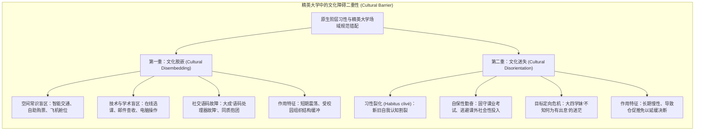

---
authors:
  - "[[Yajun Zheng|郑雅君（Zheng, Y.）]]"
source_language: zh
summary: "系统提炼名校大学生出路分化的文化社会学解释，反思地位获得与理性选择理论忽视能动性的局限，阐明工具理性的阶层不均衡性及价值理性在二元职业路径下的导引功能。解构寒门学子遭遇的二重文化障碍，区分表层短期的文化脱嵌与深层长期的文化迷失、习性裂化与自保性勤奋。提出包含认知去病理化、拓展异质网络、个人神话叙事重构与原生文化使者转化的四重突破路径，明确高校与教师的守门者支持责任，并呈现质性生活史反思与推断边界。"
type: argument
subtype: monograph
publication_type: book-chapter
title: "Argument_Zheng_2023_ShanghaiSanlian_Ch06"
argument_key: "Argument_Zheng_2023_ShanghaiSanlian_Ch06"
argument_display_title: "金榜题名之后：大学生出路分化之谜"
argument_kind: "book-chapter"
argument_related_count: 0
argument_related_level: 0
argument_related_stars: "☆"
argument_related_color: "#fef3c7"
book_title: "金榜题名之后：大学生出路分化之谜"
publisher: "上海三联书店"
year: 2023
isbn: "9787542677815"
citation: "郑雅君 (2023). 金榜题名之后：大学生出路分化之谜. 上海三联书店."
citation_aliases: []
tags:
  - source/book-chapter
  - higher-education
  - social-stratification
  - cultural-sociology
  - cultural-barrier
  - habitus-clive
  - narrative-identity
  - qualitative-research
  - region/china
  - level/higher-ed
sources:
  - "[[books/Zheng_2023_ShanghaiSanlian/Zheng_2023_ShanghaiSanlian|Zheng_2023_ShanghaiSanlian]]"
part_of: "[[Argument_Zheng_2023_ShanghaiSanlian]]"
status: draft
created: 2026-11-17
updated: 2026-11-17
---

---

> [!question]
> 主流地位获得研究与[[Rational Action Theory|理性选择理论]]为何难以充分解释名校弱势学子毕业出路的深层劣势？工具理性的阶层分化与高等教育中的价值信念如何共同形塑学生的出路抉择？寒门学子在精英大学[[Champ|场域]]中所遭遇的[[Cultural Barrier|文化障碍]]具体包含哪些维度，各具有怎样的生成机制与作用时效？身处劣势的弱势学子能够通过何种自反性实践与叙事重构突破文化障碍？高校教育者与制度环境应当承担怎样的守门者与支持性责任？[[Qualitative Research|质性研究]]在追踪这一复杂现象时存在哪些方法论边界？

> [!claim] 核心主张
> 大学生毕业出路的生成是结构性[[Cultural Capital|文化资本]]、目的-手段行动策略与价值信念驱动力综合作用的产物。通过对精英大学毕业出路机制的整体理论反思与生活史追踪，全书确立了如下核心判断：
> 1. 主流理论将行动者简化为追求物质利益的工具理性人，忽视了行动策略能力的阶层差异与多样的价值追求。弱势家庭学生往往在无意识中陷入目标失焦，而优势家庭学生更早确立职业方向并掌握多样求助策略。学生的出路抉择建立在“赋值”过程之上，包含后果主义的工具理性与非后果主义的价值理性 (Boudon, 2001; Gambetta, 1987; pp. 358–360)。
> 2. 寒门学子在名校遭遇的[[Cultural Barrier|文化障碍]]具有二重结构。第一重为短期的[[Cultural Disembedding|文化脱嵌]]，表现为对大都市与精英大学物理空间及人际交往语码的全面疏离，受校园[[Organizational Culture|组织文化]]缓冲（北方大学中心化集体整合缓解了脱嵌震荡，南方大学松散结构强化了个体孤独感）；第二重为长期的[[Cultural Disorientation|文化迷失]]，场域剧烈转换引发[[Habitus|习性]]裂化与自我认同冲突，导致行动目标失向与自我封闭 (Bourdieu, 1999; Reay et al., 2009; Stephens et al., 2012; pp. 361–366)。
> 3. 突破文化障碍需要个体发挥自反性能动性。弱势学子可通过将困境认知为普遍社会事实、确立跨出舒适区的自反性信念、广泛学习隐性游戏规则并拓展异质社交网络、借助[[Personal Myth|个人神话]]的生命故事再创作维持[[Self-Continuity, Self-Distinctness, and Self-Agency|自我连续性]]，以及激活原生文化的坚韧意志与回馈乡土信念，实现文化身份的主动整合 (Eribon, 2009; McAdams, 1993; 余秀兰, 2010; pp. 366–370)。
> 4. 文化障碍源于大学制度与组织文化的隐性偏向。高校管理者与教师应承担守门者责任，将生涯辅导前移至新生阶段，消除人为制度壁垒，提供包容性的组织赞助 (Lareau, 2015; Trow, 1976; pp. 370–371)。
> 5. 质性探索历程展现了从经验迷茫到概念[[Typification|类型化]]的突破，同时也具有明确的[[Research Scope|研究边界]]：未能对全样本开展全景跟踪、缺乏跨校与性别的系统对比、样本集中于学业前 50% 优等生，未来需要结合大[[Sample Size Determination|样本量]]化测量深化检验 (pp. 372–375)。

> [!concept-lens] 阅读透镜
> - **核心对象** 两所顶尖名校（南方大学与北方大学）弱势阶层学生在大学场域与出路竞争中遭遇的文化障碍，以及突破该障碍的微观实践路径与制度支持体系 (pp. 357–375)。
> - **广义理性与价值赋值视角** 借鉴[[Raymond Boudon|雷蒙·布东]]（Raymond Boudon）的广义理性理论与[[Max Weber|马克斯·韦伯]]（Max Weber）的价值理性概念，将出路选择视为行动者在客观处境与主观信念互动下确立充分理由的过程 (Boudon, 2001; pp. 358–360)。
> - **文化障碍二重性模型** 区分表层短期的物理与社交疏离（[[Cultural Disembedding|文化脱嵌]]）与深层长期的自我认同撕裂与目标虚无（[[Cultural Disorientation|文化迷失]]），揭示习性裂化在高等教育场域的具体机制 (pp. 361–366)。
> - **叙事认同与自传重构视角** 引入[[Dan P. McAdams|丹·P·麦克亚当斯]]（Dan P. McAdams）的[[Personal Myth|个人神话]]概念与[[Didier Eribon|迪迪埃·埃里蓬]]（Didier Eribon）的阶级自传思想，论证自传叙事在整合断裂自我与发挥原生文化优势中的心理缝合功能 (Eribon, 2009; McAdams, 1993; pp. 367–370)。

---

> [!framework-table] 理论工具箱
> | 理论工具 | 代表学者与文献 | 解释功能 |
> |---|---|---|
> | **广义理性与价值理性** | [[Raymond Boudon\|Boudon (2001)]]；[[Max Weber\|Weber (1978)]] | 证明行动者的信念与行为建立在充分理由之上，解释非物质利益驱动与献身公共服务的合理性 (p. 359)。 |
> | **教育选择的多重理性** | Gambetta (1987) | 揭示学生运用多种理性权衡教育选择，其权衡过程受特定阶层文化视野引导 (p. 358)。 |
> | **高等教育中的理性失调与继承人批判** | [[Pierre Bourdieu\|Bourdieu & Passeron (1979)]] | 批判学校制度如何隐秘地割裂下层学生的学业与职业前途，而优势阶层则依据客观升学概率保持单一理性目的 (p. 359)。 |
> | **精英高等教育的责任伦理** | Trow (1976)；Mitford (2003)；阎光才 (2001) | 阐发顶尖大学传递的普遍主义关怀与精英责任（noblesse oblige），说明高校对学生价值图式的改写功能 (p. 359)。 |
> | **习性与场域错配的“离水之鱼”效应** | [[Pierre Bourdieu\|Bourdieu & Wacquant (1992)]] | 刻画底层习性突兀进入中产主导的精英大学场域时产生的不适、尴尬与疏离感 (p. 362)。 |
> | **文化错配理论** | Stephens et al. (2012) | 证明大学推崇的独立型规范与[[First-Generation College Student\|第一代大学生]]的互依型背景冲突，诱发心理压力与情绪负荷 (p. 361)。 |
> | **[[Habitus Divided Against Itself\|习性裂化]]与自我多重化** | [[Pierre Bourdieu\|Bourdieu (1999)]]；Jin and Ball (2019) | 揭示场域转换导致新旧生活史断裂，个体深陷自我认同不稳定、自卑与身份撕裂的困境 (pp. 363–364)。 |
> | **学校组织中的隐性文化知识** | Lareau (2015)；Calarco (2011) | 说明优势学生理所当然地掌握向教师求助的文化知识，弱势学生因缺乏语码[[Decodification\|解码]]能力而退守孤立 (p. 364)。 |
> | **[[Personal Myth\|个人神话]]与叙事认同** | [[Dan P. McAdams\|McAdams (1993)]] | 阐明行动者通过重构自传体生命故事缝合过去与现在，在向上流动中确立自我认同的连续性 (p. 368)。 |
> | **阶级自传与回归故里的精神和解** | [[Didier Eribon\|Eribon (2009)]] | 揭示厌弃原生阶层带来的精神折磨，论证通过与原生文化和解并发挥“文化使者”优势的重要性 (p. 369)。 |
> | **底层文化资本的正向转化** | 程猛和康永久 (2016)；余秀兰和韩燕 (2018) | 阐发寒门学子的坚韧自强精神与道德动力如何转化为突破阶层壁垒的独特资源 (p. 369)。 |

---

> [!contrast-table] 表 6-1　主流地位获得与理性选择理论 vs 文化社会学过程视角理论进路对比
> | 比较维度 | 地位获得与理性选择传统（工具人假定） | 文化社会学与广义理性视角（文化过程进路） |
> |---|---|---|
> | **行动者核心假定** | 单一追求私人效用最大化的理性人，具备完备的信息与收益计算能力 | 行动建立在充分理由之上，兼具工具理性与价值理性，受阶层文化图式规制 |
> | **教育功能定位** | 人力资本投资与劳动力市场信号工具，输出确定性的文凭与货币回报 | 塑造自我认同与社会化的文化场域，传递精英信念伦理并重构个体价值排序 |
> | **理性运作的阶层特征** | 假设全阶层行动者均具备同质的目标树立与策略手段调配能力 | 工具理性程度在阶层间高度分化，优势者熟稔游戏规则，弱势者易陷目标失焦 |
> | **行动目的与动力来源** | 外在物质回报驱动（薪水、职位级别、世俗声望与资本增殖） | 价值信念与赋值过程驱动（自我实现、求知探索、公共关怀与服务乡土） |
> | **弱势群体困境归因** | 归结为个人人力资本积累不足、努力程度欠缺或非理性教育决策 | 归结为习性与场域错配诱发的文化障碍（文化脱嵌与文化迷失），体现为关系性排斥 |
> | **实证解释限度** | 难以合理解释放弃高薪选择基层的行动者，亦无法透视优等生的内生迷茫 | 揭示能动性与文化工具箱的互动机制，展现个体突破结构再生产的可能路径 |

---

> [!contrast-table] 表 6-2　毕业出路获得机制的四类实践模式特征与个案速览
> | 实践模式类型 | 目的-手段行动力 | 价值信念驱动力 | 理性选择模型匹配度 | 典型行动特征与生涯去向 | 代表个案与经验写照 |
> |---|---|---|---|---|---|
> | **自主驱动者** | 极高（目标清晰且策略完备） | 极高（内在志趣与价值确立） | 多数符合（特殊非主流目标除外） | 自主探索劳动力市场或学术前沿，主动筹划多元实习与科研产出，斩获顶级外企、知名投行或海内外名校直博 | 清风、若谷等：大一即明晰职业航向，多方调动资源高效达成目标 |
> | **机会主义者** | 极高（娴熟调配制度工具） | 较低（随行就市、功利导向） | 完全符合（典型工具理性经济人） | 紧密跟踪就业市场风向与高回报热点，以获取物质收益与实用技能为行动指针，广泛网罗求职信息 | 熟练利用名校跳板与选调/求职信息，追求短期收益最大化回报 |
> | **迷失无从者** | 较低（缺乏方向与求助策略） | 模糊（目标遮蔽与动机悬置） | 完全不符（缺乏明确最大化目标） | 将全部精力局限于课堂考试与课业绩点，深陷目标失焦，毕业关头仓促申请推免直研以延缓就业决断 | 大四贫困专项学妹：从小被要求有出息，入学后面对信息鸿沟不知目标何在 |
> | **价值归顺者** | 中高（具备基础执行能力） | 极高（内化家国理想与责任） | 预测相反（主动放弃物质收益最大化） | 深刻内化大学倡导的普遍主义利他精神与奉献伦理，放弃市场高薪企业录用，投身基础学科、国家重点科研与基层选调 | 大成（转入边缘社科）、梓桐（立志基础文科）、浩凡（放弃30万年薪投身航天） |

---

### 步骤一：超越狭隘工具人假设，揭示工具理性的阶层分化与价值信念的导引功能

> [!claim|step]
> 主流地位获得研究与理性选择理论将行动者抽象为纯粹追求功利最大化的个体，忽略了目的-手段行动能力的阶层分化以及价值观念的方向导引功能。实证证据表明，名校学生的工具理性运作受原生家庭阶层习惯支配，同时其生涯抉择建立在包含工具理性与价值理性的广义理性基础之上。

> [!sub-claim] 工具理性的阶层不均衡性
> 在理性选择理论的经典分析中，行动者被预设为具备清晰目标并能精确计算成本收益的理性人 (Abell, 2000; Breen & Goldthorpe, 1997; Hechter & Kanazawa, 1997)。然而在名校的现实生活场景中，树立生涯目标的意识与调配行动手段的能力在不同阶层间呈现鲜明分化。优势背景学生熟稔劳动力市场与学术场域的运行规则，较早确立明确目标并采取多元求助策略；弱势家庭学生则容易陷入[[Intuition-Dependent Mode|直觉依赖模式]]，缺乏自主树立目标的意识，将专注课业考试视作唯一合理行动，在毕业关头陷入被动状态 (Yee, 2016; 张华峰等, 2017; pp. 358–359)。

> [!citation-card] 布迪厄论学校教育造成的工具理性失调
> 做一个大学生最合乎理性的方式就是根据未来职业的要求组织当前全部活动，利用所有合理的手段尽快尽好地达到这一目的。然而在现实中，通过将今天和未来隔绝，将手段和他们本应该实现的目的分开，学生们在无意识地掩饰自身活动的真实性。前途对不同阶层而言具有显著相异的确定性与乐观度。大学生与他们的前途和学业的关系，直接与本阶级人接受高等教育的客观机会有关。
>
> *The most rational way of being a student is to organize all current activity in terms of the requirements of the future occupation... By separating the present from the future, means from the ends they should realize, students unconsciously mask the truth of their activity.* (Bourdieu & Passeron, 1979; p. 359)

> [!sub-claim] 广义理性与价值赋值过程
> 顶尖高等教育不仅传递专业知识，还系统性地倡导普遍主义的利他关怀与责任伦理（noblesse oblige, Mitford, 2003; Trow, 1976）。面对体制与市场并存的职业选择，毕业生对金钱回报与社会价值的权重赋值展现出高度[[Heterogeneity|异质性]]。依循[[Raymond Boudon|雷蒙·布东]]（Raymond Boudon）的广义理性框架，行动者的抉择建立在充分的主客观理由基础之上。这些理由既包括后果主义的工具理性（instrumental rationality），也包括基于道德感与价值认同的价值理性（axiological rationality, Boudon, 2001; pp. 359–360）。

> [!case] 价值信念驱动下的非后果主义抉择
> 这种价值理性的导引功能在多位受访者的生涯抉择中得到了清晰体现：
> - **经纬的面试拷问** 在一次高规格求职面试中，考官抛出核心问题：“钱对你来说是什么？”这一提问触及所有毕业生的深层考量。在体制与市场二元分割的精英职业路径下，受访者对金钱的赋予权重截然相异。单纯的物质收益并不能完全解释名校毕业生的出路去向。
> - **大成的主动转系** 从全校闻名、就业回报丰厚的金融学院，大成主动申请转入处于相对边缘地位的社会科学专业。大成追求对社会现实结构的系统理解，放弃了最大化商业变现的既定道路。
> - **梓桐的学术立志** 克服家庭经济条件平平的现实压力，梓桐断然放弃高薪商业企业招聘机会，[[Establishing One's Will|立志]]投身收入清贫的基础文科学术研究，以求索学问作为自我实现的终极依托。
> - **浩凡的择业抉择** 浩凡面对某知名建筑咨询公司开出的年薪 30 万元优厚录用函，经过深思熟虑后选择放弃，最终入职国家航天科技研发部门，实际薪酬仅为外企的一半。
>
> 此类选择从狭隘的成本-效益工具人视角来看常被视作非理性，但一旦置于学生在[[College Process Model|大学过程]]中形成的理想信念与责任图式之中，其行动展现出高度的自洽性与充足理由 (pp. 360–361)。

---

### 步骤二：解构文化障碍的二重性，区分短期的文化脱嵌与长期的文化迷失

> [!claim|step]
> 寒门学子进入精英大学后遭遇的深层困境属于关系性的[[Cultural Barrier|文化障碍]]。这种障碍由外在物理与交往维度的[[Cultural Disembedding|文化脱嵌]]，以及内在认同与发展规划维度的[[Cultural Disorientation|文化迷失]]共同构成，呈现出从短期表层震荡走向长期慢性困惑的递进特征。

> [!row-contrast] 表 6-3　精英大学中寒门学子遭遇的二重文化障碍深度对比
> | 比较维度 | 第一重文化障碍：[[Cultural Disembedding\|文化脱嵌]] | 第二重文化障碍：[[Cultural Disorientation\|文化迷失]] |
> |---|---|---|
> | **核心概念与性质** | 外在环境与生活方式的表层脱节，属于入校初期急性的文化休克与空间疏离 | 内在自我认同撕裂与行动目标丧失，属于深层长期的[[Habitus Divided Against Itself\|习性裂化]]与定向危机 |
> | **主要表现领域** | 大都市公共设施使用盲区（智能交通、自助购票、航空常识）；大学技术工具盲区（在线选课、邮件沟通、电脑操作） | 自我认同危机（我是谁、我想要什么、我该干什么）；长期行动目标失焦，无法将文化工具转化为长远生涯规划 |
> | **人际交往特征** | “语码处理器故障”：读不懂师生互动暗号与同辈社交语境，退守同乡同质圈子；与原生家庭亲友渐行渐远 | 缺乏向优势师友寻求指导的文化资本与主动求助意识，在社会交往中感到自卑与无力，封闭于个人狭小天地 |
> | **典型应对策略** | 依靠老乡、室友陪伴与辅导员引导，逐步习得常识，被动适应新环境 | 采取“自保性勤奋”：专注熟悉的书本考试与课业绩点以维系优等生尊严，逃避社会性实践，仓促[[Recommendation-Based Graduate Admission System\|推免]]直研 |
> | **作用时效与演化** | 短期为主：入校一学期或一年后，随着日常生活经验的积累逐渐消退 | 长期慢性：困扰往往贯穿整个大学四年，甚至延续至毕业求职关头与未来发展阶段 |
> | **校园组织文化调节** | 受组织文化显著缓冲：北方大学中心化集体整合缓解孤立；南方大学个体化松散结构加剧脱嵌感 | 组织缓冲效果较弱：高度依赖个体自反性能动性的觉醒、叙事认同重构与制度化赞助支持 |

> [!sub-claim] 第一重障碍：文化脱嵌的表层疏离与组织缓冲
> [[Cultural Disembedding|文化脱嵌]]指弱势学子进入精英大学初期，因缺乏场域默认掌握的生活常识与社交技能而产生的物理与人际疏离。布迪厄将此状态比拟为“离水之鱼” (Bourdieu & Wacquant, 1992)。学生面临大都市公共设施使用盲区与大学数字操作障碍，并产生强烈的羞耻与边缘感。在社交层面，受访学生反映自身“语码处理器”失灵，无法准确解读教授与优势同辈的交往信号，退守于背景相似的同乡圈子，拉大了与大学主流资源的距离 (pp. 361–363)。
> 
> 此项障碍的消解速度受到校园组织文化的显著调节：
> - **南方大学** 学生文化崇尚自主与个体化社交，学院与班集体组织松散，归属感薄弱，寒门学子的文化脱嵌感更为强烈且持久。
> - **北方大学** 呈现中心化的组织秩序，班级与院系集体整合度高，活动高度组织化，有力缓冲了新生的孤立感，加快了脱嵌困境的缓解 (p. 363)。

> [!case] 空间常识盲区与语码处理器故障
> 访谈材料深刻记录了文化脱嵌带来的心理痛感：
> - **飞机舱位常识缺失的痛哭** 一位来自偏远农村的受访女生，在回忆大一初次接触外出交流活动时，因为从未乘过飞机、完全不懂机舱座位布局与登机常识而在同辈面前闹出笑话。在访谈过程中，她讲到此处禁不住失声痛哭，直言那种作为“极少数异类”的尴尬与自卑深深刺痛了自尊心。
> - **大成的“语码处理器故障”** 大成用形象的比喻描述自己初入名校时的社交障碍：自己的脑子仿佛安装了一台“出故障的语码处理器”，面对大都市同学谈论的流行文化、中产消费与教授在课堂内外散发出的隐性学术暗号，完全无法顺利解码。由于不知道如何与师长正常交流，大成只能长时期将日常交往严格局限在背景相似的几个老乡圈子内，切断了向外拓展高阶文化资源的可能性。

---

> [!contrast-table] 表 6-4　南方大学与北方大学组织文化对文化脱嵌的缓冲机制对比
> | 组织文化维度 | 南方大学（个体化与自由流动型文化） | 北方大学（中心化与集体主义整合型文化） |
> |---|---|---|
> | **组织结构与管理模式** | 学院与班集体功能弱化，学生自主选课与跨界流动度高，呈现去中心化特征 | 依托院系与固定行政班级开展精密管理，辅导员与班主任深入介入学生生活，中心化秩序清晰 |
> | **集体归属感与社会整合** | 班级凝聚力较弱，集体活动参与自愿，缺乏统一的集体仪式与生活共同体 | 班集体整合度高，党团活动、社会实践与集体评优高度组织化，集体归属感强烈 |
> | **同辈交往与资源分布** | 社交圈高度个体化与圈层化，中产优势同辈网络主导，寒门学子易陷入个体孤岛 | 宿舍、班级集体活动为学生提供了制度化融入通道，有效促成跨阶层同辈日常接触 |
> | **对文化脱嵌的调节效应** | 缺乏组织托底与缓冲垫，弱势学生容易长期体验孤独与冷漠，文化脱嵌感强烈而持久 | 强有力的集体组织结构有力稀释了初入名校的异乡感与自卑恐慌，脱嵌困境缓解速度显著更快 |

> [!sub-claim] 第二重障碍：文化迷失、习性裂化与自保性勤奋
> 相对表层且易随时间缓解的文化脱嵌，第二重障碍[[Cultural Disorientation|文化迷失]]则更为深刻且持久。由于原初阶层生活史与名校主流环境存在巨大鸿沟，行动者在新旧生活方式的拉扯中陷入习性裂化（habitus clivé, Bourdieu, 1999），产生自我认同撕裂、自卑与身份多重化的内耗。学生普遍面临“我是谁、我想要什么、我该干什么”的定向危机，导致使用文化工具树立长远目标的能动性受到削弱 (Lee & Kramer, 2013; 谢爱磊, 2016; pp. 363–364)。
> 
> 为应对这种自我认同危机，弱势学子普遍采取“自保性勤奋”策略：将精力完全局限于熟悉的应试[[Academic Achievement|学业成绩]]，以此维系“优等生”自尊，主动放弃参与课外社会性与实践活动。此种防御机制虽能获取一时的心理安全感，却掩盖了对真实[[Professional Interest|志趣]]的探索，促使学生在毕业关头未作审慎规划便仓促选择[[Recommendation-Based Graduate Admission System|推免]]直研以延缓就业决断 (pp. 364–365)。

> [!case] 迷失无从与自保性勤奋的微观展现
> - **大四贫困专项学妹的终极叩问** 在针对专项生补充访谈中，一位大四学妹在回顾四年大学生活时噙着泪水倾诉：“我从小的时候，我奶奶就一直跟我说，你以后要好好念书，要有出息。但是当我真的上了好大学了，对我这样一个入学前连电脑都不会玩的人，我真的不知道这个‘有出息’，到底是个什么样的出息。”这一心声深刻揭示了脱嵌之后的迷茫：学生空有勤奋的意愿，却因为对大学场域游戏规则的认知盲区，深陷目标失焦的困境。
> - **逃避决断的仓促保研** 多位受访的“直觉依赖者”在进入大三、大四时，面对求职市场上扑面而来的实习要求、面试技巧与多元去向，产生强烈的恐慌与无所适从。他们选择将全部心力继续投入到争夺期末考试高分与 GPA 排名中。一旦凭借优异的考分获得免试保研资格，他们便如释重负，甚至未曾考虑所保研专业是否符合个人志趣，仅仅以此延缓走出校园、直面社会出路选择的决断时刻。

---

### 步骤三：践行自反性认知转变与生命叙事整合，开辟突破文化障碍的能动路径

> [!claim|step]
> 突破文化障碍不能依赖消极等待，而需要行动者调动自反性能动性。通过认知去病理化、跨越舒适区反思、拓展异质网络、编织自传体[[Personal Myth|个人神话]]以及发挥原生文化优势，弱势学子能够实现文化身份的主动整合。

> [!pathways] 突破文化障碍的四重实践进路
> 1. **处境认知去病理化与审慎跨越** 认识到迷茫与不适源于客观阶层错配，消除个人化自责；建立自反性检验程序，克服习惯性防御排斥。
> 2. **构建异质网络与师生非正式互动** 走出同质老乡单一圈子，结识多元阶层同辈；主动向教师请教，习得隐性规则与策略常识。
> 3. **个人神话创作与生命故事叙事整合** 避免文化自杀与固守两难；挖掘生命史贯穿一贯的核心价值，缝合碎片化自我认同。
> 4. **与原生文化和解并激活文化使者优势** 摒弃自卑标签，将坚韧自强精神转化为内在动力；化身跨阶层沟通的文化大使，投身基层与公共服务。

> [!sub-claim] 路径一：处境认知的去病理化与[[Reflexivity|反思性]]跨越
> 走出困境的前提在于转变认知框架。弱势学子应当认识到入校初期的不适与迷茫源于结构性阶层错配，属于普遍存在的客观社会事实，无需归咎于个人能力或性格。卸下自我责备的心理包袱后，学生需要建立跨出舒适区的自反性信念。习性往往以不自觉的方式诱导行动者排斥陌生事物；弱势学子需要建立审慎的反思程序，在充分理解新规则运行机制的基础上批判性接纳有效策略，克服盲目拒斥心理 (pp. 366–367)。

> [!sub-claim] 路径二：构建异质社交网络与非正式师生互动
> 突破文化障碍需要摆脱同质老乡群体的单一庇护，结交不同阶层背景的朋友，在坦诚交流中观察并理解异质群体的思考与行动模式。更为关键的举措在于主动增进与教授、师兄师姐的非正式交往，充分利用学校的学术启航计划或读书会平台，向具备丰富场域知识的学术先行者请教，掌握隐性的制度常识与行动策略 (Calarco, 2011; Lareau, 2015; pp. 367–368)。

> [!sub-claim] 路径三：借助个人神话实现生命故事的叙事整合
> 为化解习性裂化带来的撕裂感，行动者需要避免走向要么彻底抛弃过去的“文化自杀”，要么拒绝新环境的“文化固守”。借鉴[[Dan P. McAdams|丹·P·麦克亚当斯]]（Dan P. McAdams）的叙事心理学洞见，个体可以通过创作自身的[[Personal Myth|个人神话]]来整合生活经验。通过书写或向他人讲述成长故事，提炼贯穿始终的价值信念与人生愿景，使过去、现在与未来在自传叙事中形成有机的连贯性，促成自我认同的扩展与重构 (McAdams, 1993; 余秀兰, 2010; p. 368)。

> [!case] 叙事重构中的自我缝合
> 访谈中一位来自普通家庭的受访男生分享了自我整合的心路历程：进入大学前两年，在精英同学的对比冲击下，他曾极度怀疑过去的自己，觉得自己从前引以为豪的质朴习惯一文不值，内心四分五裂。直到大三阶段，他开始主动回顾从小到大的成长脉络，忽然意识到：“尽管自己发生了许多未曾料到的变化，但那些曾经珍视和引以为傲的纯粹、专注与坚韧，其实一直还在自己身上。这些品质不会因为学会了名校的社交语码而消失，反而可以在未来的发展中继续发光。”通过生命故事的再梳理，之前碎片化的自我就渐渐拼合在一起，整合为一个更具包容性与主体性的连贯自我。

> [!sub-claim] 路径四：与原生文化和解并激活文化使者优势
> 借鉴[[Didier Eribon|迪迪埃·埃里蓬]]（Didier Eribon）在《回归故里》中的反思，厌弃原生阶层只会导致精神的无所依归。寒门学子在经历文化拓展后，能够将昔日的自卑标签转化为独特的个性资产。坚韧自强的奋斗意志构成了内生的精神动力；更为重要的是，跨越阶层边界的学子能够化身为穿梭于底层大众与社会精英之间的“文化大使”。正如名校农村学生选择投身基层选调生事业，这一选择承载着服务乡土与促进社会公平的价值追求，使原初文化身份成为实现人生价值的思想资源 (Eribon, 2009; 程猛和康永久, 2016; 汪卫平、牛新春、郑雅君, 2020; pp. 369–370)。

---

### 步骤四：破除谴责受害者倾向，确立高校组织变革与教师守门者支持责任

> [!claim|step]
> 文化障碍植根于高等教育组织体系偏向优势阶层的制度设计。消除文化障碍需要高校管理层与一线教师积极承担制度变革与把关守门的责任，超越对弱势个体的单向归责。

> [!sub-claim] 大学组织中立神话的破除
> 揭示文化障碍的理论主旨在于反思精英大学在评价标准、资源配置和日常互动中默认采纳的中产阶级规范，避免滑入“谴责受害者”（blaming the victim）或贬抑弱势阶层文化的认知误区。这种组织制度使掌握特定文化资本的群体享有天然优势，而将文化不匹配的弱势群体置于隐性排斥之中 (Bourdieu & Passeron, 1977; Stephens et al., 2012; p. 365)。

> [!sub-claim] 制度干预与教师作为守门者的关怀转型
> 高校制度系统必须提供实质性的补偿与支持机制：
> 1. **前移生涯规划指导** 将职业探索与学术规划教育大幅前移至大一新生阶段甚至入学教育周，帮助弱势学生尽早打破信息壁垒，生成明确的生涯目标意识。
> 2. **优化非正式互动平台** 拓展贫困专项招生后的综合发展支持，制度化设立师生学术交流圈与跨背景同辈社区，增加[[Social Engagement|社会性投入]]资源。
> 3. **教师的守门者责任** 辅导员与一线教授作为把控评价权力与资源通道的“守门者”（[[Gatekeepers|gatekeeper]]），应当放下将自身常识视为普遍公理的优越预设，敏锐体察弱势学生的实际困难，提供具有包容性的制度引导与赞助支持 (Trow, 1976; pp. 370–371)。

---

### 步骤五：反思质性探索历程，明确理论概括边界与后续实证方向

> [!claim|step]
> 全书的后记通过对历时十余年质性研究历程的深刻自反，记录了从经验混沌到概念建构的学术突破，同时坦承了个案跟踪时效、样本学业层级与横向对比层面的局限性，指明了后续混合研究的发展方向。

> [!contrast-table] 表 6-5　质性生活史研究历程的关键转折与认识论跃进
> | 研究阶段与时点 | 核心田野现场与生活史经历 | 认识论冲突与经验意外 | 概念突破与理论产出 |
> |---|---|---|---|
> | **萌芽期（2009–2013）** | 从甘肃农村考入复旦大学，经历大一文化休克与学术自卑；大四交流港中大遭遇出路无从抉择 | 切身感受到家庭出身与见识局限带来的出路迷惘，推翻“唯奋斗论”的朴素认知，延毕一年转入学术探索 | 意识到迷茫属于结构性社会现象，开始研读布迪厄教育社会学理论，萌生研究动机 |
> | **探索期（2014–2015）** | 进入复旦高教所任研究助理；在南方大学与北方大学开展首轮 38 例深度访谈 | 2015 年 1 月在北方大学严寒中遭遇预设崩塌：家庭背景与职业偏好的简单线性对应关系彻底不成立 | 陷入理论建构的巨大模糊感，在导师熊庆年开导下直面质性田野意外，放弃机械因果推导 |
> | **突破期（2016 年底）** | 2016 年 12 月重返北方大学开展补充访谈，并在旁听预答辩中捕获核心灵感 | 发现南北两校受访者深层行动逻辑的内在共通性，“自我主导”（self-authority）概念跃入脑海 | 提炼出“目标掌控”与“直觉依赖”两类实践模式，完成硕士毕业文稿（全书第 2–4 章基础） |
> | **深化期（2017–2018）** | 博士阶段与牛新春合作，在南方大学针对农村生与贫困专项生开展多轮追访 | 接触到更多典型直觉依赖者，倾听大四学妹“不知何为有出息”的痛感倾诉，反思纯粹再生产批判的悲观局限 | 引入价值信念驱动力与中国体制-市场二元职业路径，揭示广义理性与四类出路机制，拓展完成第 1 章与第 5 章 |
> | **成熟期（2019–2021）** | 赴香港大学攻读博士学位，在白杰瑞（Gerard Postiglione）与张丽芳指导下打磨书稿 | 进一步深化关于文化障碍二重性与突破路径的理论提炼，系统反思质性推断边界与量化检验方向 | 形成专著最终书稿《金榜题名之后》，完成对自身十年迷惘的心灵和解与学术致敬 |

> [!sub-claim] 研究生活史的自反性叙事
> 后记结合从农村家庭考入复旦大学的切身经历，剖析了大一初入名校时的文化震荡与自卑困顿。这种切身痛楚构成了探究大学生出路分化问题的原始动力。在经历南方大学与北方大学的田野访谈时，初期预设的家庭背景与职业偏好之间的简单对应关系被实证材料彻底推翻。直至引入“自我主导”（self-authority）概念并提炼出[[Goal-Controlled Mode|目标掌控]]与[[Intuition-Dependent Mode|直觉依赖]]两类实践模式，理论框架方才真正建立。这一历程证明了质性研究直面模糊性与经验意外的[[Epistemic Value|认识论价值]] (pp. 371–373)。

> [!limitations] 研究局限与实证边界
> 后记明确总结了本项研究的四项主要边界条件，为后续学术探索设定了推断前提：
> - **个案跟踪的非全景性** 受访谈周期限制，部分个案在受访时已确定毕业去向，未能实现对四年大学生活全周期的实时追踪。
> - **材料提炼的代表性取舍** 篇幅限制导致未能对全部 70 名受访个案进行均等展开，主要依托典型个案进行深度类型剖析。
> - **高校类型与性别比较的欠缺** 受成书篇幅与资料调度限制，未能对南方大学与北方大学的组织文化差异以及性别机制展开系统性的横向对比。
> - **样本学业层级带来的效度局限** 研究受访对象严格限定在成绩排名前 50% 的学生群体中，排除了学业濒危的学生，可能在一定程度上降低了理论结论向低学业表现群体的外推效度。
> - **后续量化检验方向** 针对提出的“文化障碍”与“实践模式”[[Construct|构念]]，亟需开发标准化的量化[[Scale of Measurement|测量量表]]，结合大规模全国性追踪调查数据，检视实践模式的实证区分度及其对长程流动结果的[[Predictive Validity|预测效度]] (pp. 373–374)。

---

## 来源

- [[books/Zheng_2023_ShanghaiSanlian/Zheng_2023_ShanghaiSanlian|Zheng_2023_ShanghaiSanlian]]
- 原文节选：`raw/Zheng_2023_ShanghaiSanlian_txt/Ch06_Conclusion.txt`
