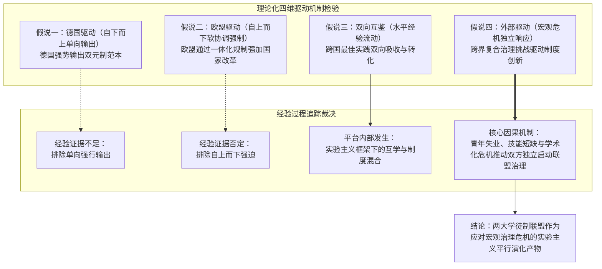

---

> [!question]
> 在缺乏强制性跨国立法权的传统主权敏感领域，何种因果机制促成了欧洲学徒制联盟（2013 年启动）与德国职前与继续培训联盟（2014 年签约）在时间序列与组织形态上的高度同步与平行演进？

> [!claim] 核心主张
> 两大学徒制联盟的平行演化根植于欧盟与德国分别应对跨界宏观治理危机的独立政策创新，证实了外部挑战驱动假说在解释多层治理变革中的主导效力。以自愿承诺、议程编排与中介平台为特征的实验主义治理架构为跨情境经验互鉴提供了制度载体；国家间制度传统的异质性决定了外部最佳实践在落地时必须通过情境化混合吸纳，消解了单一范本机械单向移植的可能。

> [!concept-lens] 阅读透镜
> - **对象** 欧洲联盟（European Union, EU）层面的[[European Alliance for Apprenticeships|欧洲学徒制联盟]]（European Alliance for Apprenticeships, EAfA）与德国国家层面的[[Alliance for Initial and Further Training|职前与继续培训联盟]]（Allianz für Aus- und Weiterbildung, AAW）在 2004 至 2021 年间的制度演进。
> - **张力** 经验现象上两大多边联盟在一年之内相继问世且组织结构高度同构，传统政策转移理论在解释这一现象时陷入了“德国模式单向输出论”与“欧盟软协调自上而下规制论”的经验对立与实证脱节。
> - **贡献** 引入[[Experimentalist Governance|实验主义治理]]理论并构建四维驱动因果分析网格，运用过程追踪法打开了多层职业技能形成治理变革的因果黑箱，确立了外部治理危机作为分散化政策创新原生动力的理论定位。

---

> [!framework-table] 理论工具箱
> | 理论工具 | 解释功能 |
> |---|---|
> | **实验主义治理模式** [[Experimentalist Governance]] | 阐释多层治理中中央协调中枢如何通过宽泛目标编排与中介平台运作，将基层多元行动者的自愿承诺与高位基准互学相结合，有效应对复杂不确定性。 |
> | **去中心化协作技能形成模型** [[German Dual Education System]] | 阐明以双元制为代表的社团主义法治传统、劳资共商集体物品供给机制及制度不可直接全盘移植性。 |
> | **多层治理驱动机制分析框架** [[Government to Governance Shift]] | 确立四种竞争性假说作为分析坐标：德国驱动假说（自下而上输出）、欧盟驱动假说（自上而下推进）、相互借鉴假说（双向水平互学）与外部驱动假说（跨界宏观危机驱动）。 |

> [!warrant]- 理论如何支撑论证
> 实验主义治理理论为剖析现代职业教育多边平台提供了核心分析框架。传统科层命令无法跨越欧盟与成员国之间的教育主权壁垒，纯粹的自由市场又无法解决技能投资中的搭便车困境。实验主义架构通过中介平台设立、自愿承诺认领与同行基准互学，在维系国家自主权的同时创造了政策创新与经验交流空间。通过构建包含单向输出、自上而下传导、水平互学与外部冲击的四维因果分析网格，实验主义治理被操作化为可检验的实证机制，支撑过程追踪法对竞争性假说的经验裁决。

---

> [!method-panel] 研究设计
> | 模块 | 材料与处理方式 |
> |---|---|
> | **路径案例与嵌套子案例过程追踪** [[Process Tracing]] | 采用路径案例（Pathway case）与双嵌套案例比较设计，运用实践模式（Practices）审视与因果过程观察（CPOs），对四种理论化驱动假说进行严格的案例内经验检验与排他性裁决。 |
> | **精英深度访谈** [[Elite Interview]] | 于 2019 年底至 2021 年底期间，对 8 位直接参与或主管欧洲学徒制联盟与德国联盟事务的高级文官实施半结构化深度访谈，挖掘组织传记（Organisational Biography）与决策内幕。 |
> | **跨期政策档案考证与主题编码** Qualitative Thematic Analysis | 系统搜集并编码 2004 至 2021 年间欧盟指令、理事会建议书（EFQEA）、公报及德国国家培训公约、联盟协议文本与官方评估白皮书，实现口述实录与公开档案的三角互证。 |

> [!sample-panel]- 样本与材料快照
> | 样本层面 | 构成 |
> |---|---|
> | **文本样本** | 涵盖 2004 至 2021 年间欧盟委员会 2012 年《重新思考教育》公报、2013 年莱比锡联合宣言、2018 年《高质量和有效学徒制欧洲框架》理事会建议书、2020 年《欧洲技能议程》；德国 2004 至 2014 年《国家培训与青年专业人才公约》、2014 与 2019 年两轮《职前与继续培训联盟协议》及联邦职业教育研究所（BIBB）年度数据白皮书。 |
> | **访谈样本** | 8 位核心决策高级文官：德国层面 3 位（Interview_1, Interview_2, Interview_4，涵盖联邦经济部、联邦教育部）；双重治理层面 3 位（Interview_3, Interview_5, Interview_6）；欧盟层面 2 位（Interview_7, Interview_8，涵盖欧洲委员会就业总司）。 |
> | **材料情境** | 德英双语档案考证与匿名访谈实录，重点结合非公开谈判脉络与政策修辞进行三角核验，有效排除受访者事后理性化与公关说辞干扰。 |

---

> [!row-contrast] 职业教育治理改革四种理论化驱动机制与过程追踪检验结果
> | 驱动机制假说 | 传导方向与核心预设 | 预期经验证据 | 过程追踪经验检验与实证裁决 |
> |---|---|---|---|
> | **假说一：德国驱动** （German-driven） | 自下而上；德国凭借双元制标杆优势，向欧盟输出本国最佳实践模式。 | 访谈与档案显现德国官方在欧盟联盟筹备中充当主导游说者与方案设计者。 | **证据不足排除** 莱比锡启动仅为各方借势发布的公关节点；欧委会主导议程，德国对外职教合作长期以双边为主。 |
> | **假说二：欧盟驱动** （EU-driven） | 自上而下；欧盟为推进一体化产生治理需求，通过软协调自上而下塑造国家政策。 | 德国联盟的签署体现对欧盟指令、建议书或欧洲联盟设立的依从性响应。 | **证据否定排除** 德国联盟脱胎于 2004 年《国家培训公约》，重组核心在于吸纳工会共治以化解内生协商失衡，借用“联盟”仅为标签借用。 |
> | **假说三：相互借鉴** （Cross-fertilisation） | 双向水平；欧盟与国家在平台内持续双向互动，共同探索并吸收最佳实践。 | 双方在政策制定中显现明确的相互吸收与制度学习痕迹。 | **部分确证但属从属机制** 未构成联盟创立的原生动力，但在联盟常态化运作中成为经验流动与标杆展示的重要平台载体。 |
> | **假说四：外部驱动** （External mega-challenges） | 外部冲击；宏观危机超出既有治理承载能力，推动双方在多层架构中独立启动创新。 | 双方访谈与文本均高频指向青年失业、技能错配与产业转型危机，并采纳实验主义治理应对。 | **核心主导机制确证** 欧债危机、青年失业高企、技能短缺、学术化浪潮与双重转型，独立激发了双边的实验主义平台构建。 |

---

---

> [!contrast-table] 欧洲联盟（EAfA）与全德联盟（AAW）两套实验主义治理机制系统对比
> | 比较维度 | 欧洲学徒制联盟（EAfA） | 德国职前与继续培训联盟（AAW） |
> |---|---|---|
> | **正式启动时点** | 2013 年 7 月（莱比锡世界技能大赛宣布成立，2020 年深化更新） | 2014 年 12 月（联合声明签署成立，承接 2004–2014 年国家培训公约） |
> | **协调统筹中枢** | 欧洲委员会（就业、社会事务与包容总司，DG EMPL）充当议程编排者 | 联邦经济事务与气候保护部（BMWK）牵头主持，联邦教育部（BMBF）协同推动 |
> | **核心参与主体** | 欧洲委员会、理事会主席国、欧洲社会伙伴（ETUC、BusinessEurope、CEEP、UEAPME） | 联邦政府（经济部、教育部、劳动部）、联邦各州（KMK）、雇主商会（BDA、DIHK、ZDH）、工会（DGB） |
> | **纵向多层结构** | 超国家欧盟中枢连接 37 个成员国政府承诺及地方企业、商会、职校 | 联邦全国性联盟全面对接全德 16 个联邦州设立的州级学徒制联盟（Landesallianzen） |
> | **核心治理工具** | 37 项国家行动承诺（National commitments）与 362 项利益相关者自愿认领质押（Pledges） | 联合决议政治承诺、一对一学徒辅导资助（AsA）、跨企业培训中心现代化升级（ÜBS） |
> | **科学监测依托** | 欧洲职业培训发展中心（Cedefop）与联盟学徒制支持服务体系（Apprenticeship Support Services） | 德国联邦职业教育研究所（Federal Institute for Vocational Education and Training, BIBB）年度数据白皮书 |
> | **战略议程演进** | 从最初应对欧债危机青年高失业，转向 2018 年《高质量学徒制框架》与 2020 年绿色数字双重转型 | 从解决学徒岗位短缺，转向治理岗位错配、学术化学历膨胀、移民融入及 2019 年《国家继续培训战略》 |
> | **跨国借鉴特征** | 推崇双元制工作本位学习为欧洲基准，成员国依本国体制发生深度混合化重塑 | 借用欧洲“联盟”政治词汇标签，借助欧盟多边平台展示德国双元制标杆权威 |

---

### 论证步骤一　德欧两大学徒制联盟各自独立发起，排除单边输出与行政强制

> [!claim|step]
> 过程追踪检验表明，德欧两大学徒制联盟均由各自内部动力促成，排除了德国单向输出模式或欧盟强制下达政策的假说。

> [!sub-claim] 欧洲学徒制联盟由欧盟委员会自主创立，德国仅借势参与发布活动
> 针对假说一（德国驱动论），经验考证发现，尽管[[European Alliance for Apprenticeships|欧洲学徒制联盟]]于 2013 年 7 月选在德国莱比锡举行的世界技能大赛上正式宣布成立，且这一地理选择极易形成德国主导设立的表象，但深入的档案考证与内部访谈推翻了这一推论。受访的欧盟官员明确证实，莱比锡启动仪式本质上是各方借势举办的宣传契机，事前并无详尽的后续制度安排，德国官方在欧盟决策层保持低调，没有积极游说或强推特定机制。欧洲委员会自主设定议程并统筹协调各项事务。德国官方文件（BMBF, 2013a）与欧盟理事会结论（Council of the European Union, 2013）均表明德国没有强推学徒联盟。此外，德国长期的对外职业教育合作主要通过联邦职业教育研究所（BIBB）开展双边合作（Bilateral cooperation），未在欧盟多边论坛推行其整体制度方案。

> [!sub-claim] 德国重组学徒制联盟旨在恢复劳资共治，延续了本土十年前的公约实践
> 针对假说二（欧盟驱动论），考证表明[[Alliance for Initial and Further Training|德国职前与继续培训联盟]]于 2014 年签署成立，在时间上紧随欧洲联盟之后，欧盟官方文本亦将其称为欧洲联盟的国家对应物。然而实证分析表明，德国早在 2004 年便设立了具有同等职能的《国家培训与青年专业人才公约》（Nationaler Pakt für Ausbildung und Fachkräftenachwuchs），并历经十年运作。2014 年更名为“联盟”主要借鉴了欧洲新倡议的标签表述，其实质改组动力在于纠正早期公约排斥工会组织的制度失衡，重新回归战后经典的四方社团主义协商传统。这一改革源于德国国内职业教育体系面对劳资协商失衡的内生调整，呈现自主演化轨迹，独立于欧盟超国家软法的规制传导。

> [!citation-card] 欧洲联盟初创时期的多方主体认知
> 一位受访的欧盟高级官员指出，社会伙伴声称是他们发起了联盟，内部同事也坚称是自身发起。德国等各方确实利用了 2013 年莱比锡世界技能大赛的机会来启动联盟，但这在当时实际上是一场尚未规划后续跟进步骤的发布活动。
>
> *An EU official interviewed argued that 'social partners say they initiated it, a colleague also says she initiated it. Germany and others have used [the] WorldSkills [competition in 2013] in Leipzig, the opportunity, to initiate the Alliance. That [Leipzig’s WorldSkills] was in fact a launch event without having planned a follow-up' (Interview_6).*

---

### 论证步骤二　青年失业与技能错配等宏观危机促成德欧各自搭建柔性协商平台

> [!claim|step]
> 青年高失业、岗位技能错配与学术化冲击构成了共同的外部压力，促使德欧分别采用柔性协商平台分担治理风险。

> [!figure]- 图1：职业教育治理改革迈向学徒制联盟的四种理论化驱动机制
> 

> [!challenges] 冲击职业技能形成体系的四大跨界宏观治理危机
> 1. **欧债危机与青年失业剧增** 2008 年金融危机与欧债危机导致欧洲外围国家（如西班牙、希腊）青年失业率超过 50%，形成全欧性社会震荡，迫切需要超越常规政策工具的紧急干预。
> 2. **劳动力市场结构性供需错配** 伴随技术变革与人口结构老龄化，企业岗位空置与青年求职困难并存，由最初的纯粹岗位短缺迅速演变为全欧中高级专业技能的结构性断层。
> 3. **高等教育大众化与学术化浪潮侵蚀** 综合大学入学人数历史性超过双元制学徒招募总数，实体工业面临技能工人社会声望流失与生源枯竭的严峻挑战。
> 4. **绿色与数字化双重转型对技能持续更新的紧迫需求** 工业 4.0 与欧盟绿色协议（European Green Deal）迫使职业教育跳出青年初次就学范畴，对全生命周期的在职培训与技能重塑提出系统性要求。

> [!sub-claim] 青年高失业与学术化缺工危机超出传统行政命令与劳资谈判的解决能力
> 欧洲职业技能形成体系在 2010 年代初面临前所未有的宏观治理大挑战（Governance mega-challenges）。在欧盟层面，金融危机与主权债务危机导致部分南欧成员国青年失业率飙升至 50% 以上，社会动荡与经济停滞迫切需要超国家层面的系统性应对方案。在德国国内，尽管青年失业率保持低位，但劳动力市场遭遇企业岗位空置与青年求职困难并存的严峻错配，同时综合大学入学人数首次持续超过双元制学徒招募总数。这种学术化扩张态势直接动摇了以[[German Dual Education System|双元制职业教育]]为支柱的实体工业技能基础。

> [!sub-claim] 德欧双方搭建非强制协商平台，动员企业和工会自愿认领任务分担风险
> 面对高度不确定的经济与转型压力，单一行政层级与刚性立法手段无法调和劳资分歧与多元利益。欧洲委员会依托[[Open Method of Coordination|开放协调法]]（Open Method of Coordination, OMC）经验，搭建了以自愿认领质押（Pledges）为核心的中介平台，动员 37 个成员国政府与 360 余家企业及工会提交阶段性承诺。德国联邦政府则依托联邦经济部建立涵盖联邦、州文教部长联席会议、行业商会与工会的四方联盟，以非正式政治协议与配套扶助计划重塑岗位供需平衡。这一双轨平行演变证实，外部治理危机作为共同的环境压力源，独立激发了双边在制度设计上的实验主义转向。

> [!citation-card] 宏观治理挑战催生跨界治理创新
> 在这种背景下，新的治理模式追求利用多样性，并将基层实地的创新空间与更高治理层级的基准比对相结合。针对跨越国界的宏观治理挑战，层级较低、弱科层化的路径在应对政策危机中发挥着日益重要的功能。
>
> *In this context, new modes of governance share the goal of utilising diversity and of combining space for innovation on the ground with benchmarking at higher governance levels... Here, less hierarchical and local approaches play an increasingly important role in addressing governance mega-challenges that transcend national borders.*

---

### 论证步骤三　联盟平台推动双元制经验交流，各国吸收时融入本土体制形成混合形态

> [!claim|step]
> 联盟平台促进了全欧互学并树立德国双元制标杆，但各国因体制差异只能选择性吸纳局部要素并形成混合制度。

> [!phase] 德欧两大学徒制联盟的战略议程演进轨迹
>
> - **2013–2015 · 危机应急动员期**
>
>   以应对欧债危机余波与青年高失业为唯一主线，集中动员跨国企业与本土雇主扩大培训名额供给，提供即时吸纳缓冲。
>
> - **2016–2019 · 质量标准确立与特殊群体融入期**
>
>   欧盟制定《高质量和有效学徒制欧洲框架》（EFQEA），建立学徒制支持服务体系；德国聚焦应对难民与移民潮融入，创设带辅助的学徒培训（Assistierte Ausbildung, AsA）与职业定向方案。
>
> - **2020 至今 · 技能重塑与终身继续教育拓展期**
>
>   欧盟将学徒制联盟正式纳入《欧洲技能协议》（Pact for Skills），主攻成人技能提升与双重转型；德国签署《国家继续培训战略》（Nationale Weiterbildungsstrategie, NWS），推动学徒制与应用型高等教育（Duales Studium）的立交贯通。

> [!sub-claim] 联盟将双元制树立为全欧标杆，德国借此扩大国际政策话语权
> 联盟平台的制度化运作显著拓宽了经验流动的通道。欧洲联盟不仅制定了《高质量和有效学徒制欧洲框架》，而且将德国等双元制国家的工作本位学习模式树立为全欧标杆，明确将其界定为化解劳动力供需断层的核心范本。德国政府亦充分利用欧洲联盟的多边展示窗口，将自身在终身技能培训与双元制办学上的经验向其他成员国推介，从而在巩固国内职业培训合法性的同时，扩大了其在全欧教育治理中的话语权威。

> [!sub-claim] 各国缺乏德国社团主义法治传统，只能零散吸纳实训模块形成混合制度
> 经验追踪表明，德国双元制深深根植于其特殊的法治化行会社团主义传统、劳资共商集体协议与广泛的公共监督网络。缺乏这一深厚历史制度遗产的其他欧洲国家（如西班牙、希腊或东欧国家），无法实现德国模式的完整落地。通过欧洲学徒制联盟引入的经验大多被截取为特定要素（如部分工作场所轮岗实训或企业补贴资助），并与受体国家原有的纯学校制职业培训体系发生对接，形成高度情境化的混合型职业教育架构。这表明实验主义治理在促进多边政策对话的同时，实质维系了主权国家技能形成体制的多样性格局。

> [!citation-card] 职业教育最佳实践的跨国混合与吸收
> 德国的双元职业培训系统被广泛视为标杆案例，并被欧盟委员会及学术界一致列为世界一流的职业教育体系。然而同样显而易见的是，若将其下沉推行至其他国家语境，该模式极有可能发生深度的混合化演变：鉴于其深植的特殊社团主义制度环境，直接一对一移植德国学徒制模式是极不可能的。
>
> *Germany’s VET system is regularly cited as a best-practice example and explicitly counted among 'world-class VET systems' by the EU as well as in the scholarly literature. However, it is also clear that it most likely gets highly hybridised if being downloaded to other national contexts: a one-to-one transfer of the German apprenticeship model is highly unlikely given the specific institutional corporatist environment in which it is embedded.*

---

> [!finding-cards] 核心实证结论
> 1. **宏观危机驱动的双轨平行创新** 欧洲学徒制联盟与德国职前与继续培训联盟作为超国家与主权国家分别应对外部青年失业与技能结构错配的独立实验主义制度探索，体现出去中心化的双轨治理特征。
> 2. **实验主义架构对传统科层壁垒的超越** 在缺乏硬性法案规制的政策领域，中介平台、自愿认领质押与同行基准互学构成了凝聚多元社会伙伴、分担经济不确定性风险的有效替代治理方案。
> 3. **跨国示范与本土制度混合的辩证共存** 德国双元制在欧洲多边平台中成功树立了工作本位学习的黄金标准，但在具体落地过程中被各国转化为情境化制度构件，维系了全欧技能形成体制的多样性。

> [!implication]- 理论与政策意涵
> - **扩展实验主义治理分析疆界** 将实验主义治理理论从传统的食品安全、环境或金融监管等技术性规制领域，成功推向主权敏感且高度制度黏性的职业教育与国家技能形成领域。
> - **修正欧洲化单向趋同假说** 打破了自上而下政策趋同与自下而上利益游说的二元框架，揭示出共同外部挑战下多层治理体系各自独立进行同构性创新的第三种路径。
> - **深化比较教育政策借用批判** 阐明跨国最佳实践经由实验主义平台的经验解构，在受体母国实现差异化的情境混合与制度重构。

---

> [!discussion] 讨论与拓展
> 茱迪丝·罗德-利贝瑙与卢卡斯·格拉夫的研究对比较教育学与超国家治理理论作出了三项理论推进：
>
> 此项研究从根本上拓展了实验主义治理理论的经验应用疆域。以往实验主义治理文献多聚焦于食品安全、环境标准或金融监管等技术性规制领域；该成果首次系统论证了在主权高度敏感、缺乏强制裁决权的职业技能形成体系中，实验主义中介平台同样能够有效协调多元主体并实现政策迭代。
>
> 该研究打破了传统欧洲化研究中关于自上而下政策趋同与自下而上利益上传的二元简化对立。通过确证外部宏观危机驱动的双轨平行创新，研究展示了超国家实体与民族国家在面对共同社会经济挑战时，如何在各自管辖边界内不约而同地采纳同构性的柔性协调架构。
>
> 研究深化了比较教育学关于政策借用（Policy borrowing）与制度变迁的批判性认识。全欧对德国双元制经验的借鉴在实验主义平台的软性互鉴中转化为局部的制度构件，通过差异化的混合化形态融入各国教育母体，生动诠释了全球教育治理中“同一旋律下的多声部乐器合奏”特征。

---

## 来源

[[sources/Rohde-Liebenau_Graf_2024_EERJ/Rohde-Liebenau_Graf_2024_EERJ|Rohde-Liebenau_Graf_2024_EERJ]]
