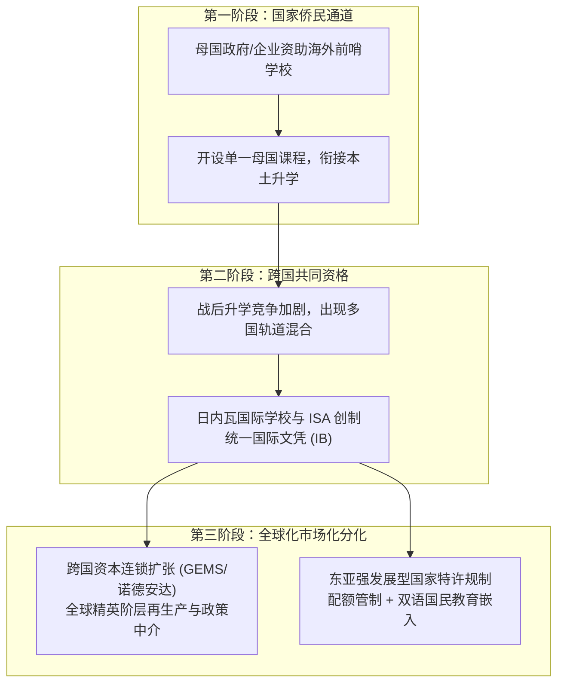

---

> [!def] International Schools
> 国际学校（International Schools）是指在一国境内服务跨国流动家庭、多国学生共同体或本地国际课程需求，并在课程设置、教学语言、升学资格及学校治理上跨越单一国家教育体系的学校形态。早期国际学校主要为特定国家侨民提供母国课程与回国升学通道；第二次世界大战后，跨国升学竞争推动学校协调多套国家课程，并催生出共同的跨国资格（如[[International Baccalaureate|国际文凭]] IB）；全球化时期以来，国际学校进一步演化出由[[Transnational Education|跨国教育]]财团主导的商业化连锁办学，以及东亚[[Developmental State|发展型国家]]为吸引外资与顶尖人才而特许推行的国家调控规制形态。[[Argument_Peterson_1987_OpenCourt_Ch02|(Peterson, 1987, Ch. 2, pp. 15–17)]]; [[Argument_Slethaug_2010_InternationalEducation|(Slethaug, 2010, pp. 20–25)]]; [[Argument_Gopinathan_2007_GSE|(Gopinathan, 2007, pp. 67–68)]]

> [!concept-lens|notitle] 概念透镜
> - **含义** 学校类型由服务对象、课程体系、授课语言、证书资格与治理权力共同界定，不能单纯以学生国籍比例或课程商业标签进行单一维度判定。
> - **用途** 用于分析跨国流动人员的教育安置、国家课程与跨国资格的协调机制，以及国际学校在全球精英阶层再生产与地方公共教育生态中所引发的社会分层。
> - **边界** 国际课程采用、[[United World Colleges|联合世界书院]]（UWC）成员资格、国家公共财政资助与国际理解教育各属独立范畴，互不必然包含或担保。

> [!citation-card] Peterson 与 Beech 论国际学校的功能演变
> 亚历克·彼得森（[[Alec Peterson]]）与[[Jason Beech|杰森·比奇]]（Jason Beech）分别从战后共同资格创制与全球化时期商业资本穿透两个关键节点揭示了国际学校的制度本质：
>
> 战后大学选拔竞争加剧，促使多国学生汇聚的国际学校必须打破重复配置的多套母国升学轨道，通过创制跨国统一认证的国际文凭（IB）解决教学消耗与学生国籍分隔；而在 21 世纪，以 [[GEMS Education|GEMS]] 和[[Nord Anglia Education|诺德安达]]为代表的跨国教育财团崛起，使国际学校转变为培育“全球精英”并将私立市场逻辑输入国家政策咨询的关键节点。([[Argument_Peterson_1987_OpenCourt_Ch02|Peterson, 1987, pp. 15–22]]; [[Argument_Beech_2009_GlobalGarden|Beech, 2009b, pp. 343–344]])

> [!boundary]- 概念边界
> - 不等于 **海外[[Boarding Schools|寄宿学校]]（[[Boarding Schools]]）** — 寄宿学校通常位于办学母国，海外学生需跨境流动前往就读；国际学校设立在学生家庭常住国，就地为跨国或多国共同体提供教育服务。
> - 不等于 **本地公立学校（Local Public Schools）** — 国际学校通常自负盈亏、收取高昂学费，采用国际或外国国家课程，多以英语为主要教学语言；公立学校由政府全额或大额资助，执行法定[[National Education|国民教育]]大纲。
> - 不等于 **大学[[International Branch Campus|海外分校]]（[[International Branch Campus]]）** — 海外分校专指高等教育机构在另一主权国家建立的实体校区（如[[Education City Doha|多哈教育城]]分校）；国际学校主要覆盖基础教育中小学学段。
> - 不等于 **国际文凭课程（IB）本身** — 一所国际学校可并行开设英、美、法多国课程；本地普通公立学校亦可经认证开设 IB 课程，学校组织形态与文凭资格不可混淆。

---

> [!contrast-table] 国际学校四种历史与治理构型的对比
> | 构型维度 | 早期传统侨民学校 | 战后现代国际学校 | 跨国营利连锁学校 | 发展型国家[[Charter Schools\|特许学校]] |
> | :--- | :--- | :--- | :--- | :--- |
> | **典型代表** | 法国海外中学、早期驻外使馆学校 | [[International School of Geneva\|日内瓦国际学校]]、[[United World Colleges\|UWC]] | [[GEMS Education\|GEMS]]、[[Nord Anglia Education\|诺德安达]] | 新加坡英华国际、华中国际 |
> | **创办主旨** | 服务特定国家侨民衔接回国通道 | 促进跨国理解，破除多国课程重复 | 资本跨国扩张与全球精英阶层生产 | 吸纳海外归国人才，丰富本土高中选择 |
> | **课程体系** | 办学母国单一国家课程与考试 | 国际文凭（IB）或多国协调课程 | 剑桥国际（CIE）、AP、IB 组合 | IB 或剑桥 A-Level 结合国家双语大纲 |
> | **国家规制关系** | 办学母国政府直接资助与监管 | 相对自主的非营利基金会运作 | 遵循市场准入与商业跨国法务 | 强国家调控（强制 50% 公民配额与[[National Education\|国民教育]]） |

---

## 命题与机制

### 命题一：跨国升学与大学选拔竞争推动国际学校创制共同跨国资格

战后高等教育扩张与大学准入门槛提升，迫使国际学校根据目标大学所在国的考试要求进行准备。在同一所学校内为不同国籍学生开设多套国家课程，既严重重复消耗师资力量，又按国籍重新隔离了学生群体，推动学校共同体寻求跨国通用的统一学历认证。

> [!evidence-grid-a|notitle]
> - 影响机制：跨国大学承认的共同课程（如 IB）克服了单校师资重复配置危机，通过统一的学术标准促进了多元文化背景学生的共同学习。
> - 证据支撑：亚历克·彼得森（[[Argument_Peterson_1987_OpenCourt|Peterson, 1987]], Ch. 2, pp. 15–22）记录，[[International School of Geneva|日内瓦国际学校]]高级物理课一度需同时应对瑞士联邦成熟证书、英国 [[Global Campaign for Education|GCE]] A-Level、法国业士文凭与美国 AP 四类考试；这一不可持续的教学危机直接催生了[[International Schools Examination Syndicate|国际学校考试辛迪加]]（ISES）与 IB 文凭。

### 命题二：跨国生源与国际课程不能自动保证学校与在地社会产生真实联系

国际学校的高学费与封闭校园环境容易使其沦为与所在地社区脱节的“特权飞地”；仅凭[[International Baccalaureate|国际文凭]]或多元生源构成，无法自然消除学生与周边社会的文化隔阂，必须通过显性的学术设计与社区服务建立联系。

> [!evidence-grid-b|notitle]
> - 影响机制：缺乏在地社会互动的[[International Education|国际教育]]容易滋生优越感与文化[[Alienation|疏离]]；将本地调查纳入正式学科大纲，促使学生跨越特权边界、直面发展中国家的现实困境。
> - 证据支撑：彼得森（[[Argument_Peterson_1987_OpenCourt|Peterson, 1987]], Ch. 8, pp. 204–207）记述，为防止远东国际学校成为脱离乡村与贫困城区的富裕飞地，[[United World Colleges|联合世界书院]]（UWC）将当地饮食调查正式纳入东南亚书院的营养科学课程大纲。

### 命题三：课程创新扩散取决于专业师资储备与资格制度的协同支撑

一项具备先进教育理念的国际课程即使获得广泛价值认同，若缺乏合格的专业师资支持体系以及在大学准入文凭中的法定科目位置，其推广实践依然会遭遇严重阻碍。

> [!evidence-grid-a|notitle]
> - 影响机制：国际教育的跨学科特征对教师综合素养提出了极高要求；若缺乏系统性的师资职前培训与学分认证，课程试验往往局限于个别先锋学校而难以规模化。
> - 证据支撑：彼得森（[[Argument_Peterson_1987_OpenCourt|Peterson, 1987, pp. 205–206]]）指出营养科学课程在远东多所国际学校推广受挫，核心症结在于缺乏胜任教师且推广预算匮乏；后续[[Science Technology and Social Change Curriculum Pilot|科学、技术与社会变迁]]试点（Science Technology and Social Change Curriculum Pilot）吸取教训，将教师培训与资格协调同步推进。

### 命题四：跨国教育管理财团的连锁扩张催生全球精英再生产并重塑政策咨询网络

21 世纪以来，国际学校的发展已从早期的外交侨民非营利理想主义试验，全面转向由跨国营利性教育管理集团主导的商业化连锁扩张。这些企业不仅通过高昂学费筛选并再生产具备全球流动资本的精英阶层，更组建专业智囊团直接向多国政府提供宏观政策咨询。

> [!evidence-grid-b|notitle]
> - 影响机制：跨国商业资本纵向穿透民族国家的教育主权，将私立市场的治理逻辑与[[Human Capital Theory|人力资本]][[Discourse|话语]]反向输入国家公共教育决策，重塑了全球[[Policy Borrowing|教育借用]]的中介网络。
> - 证据支撑：[[Jason Beech|杰森·比奇]]（[[Argument_Beech_2009_GlobalGarden|Beech, 2009b, pp. 343–344]]）与休·劳德（Lauder, 2007）实证揭示，[[GEMS Education|环球教育管理系统]]（GEMS）在 7 个国家运营逾 65 所学校，自诩为“教育变革催化剂”，直接充当多国政府的政策顾问，推动全球教育政策借贷的商业化重构。

### 命题五：强发展型国家通过配额准入与国民教育规范构建国家调控型国际学校

与西方完全放任的私立国际学校市场不同，东亚强[[Developmental State|发展型国家]]在利用国际学校吸引涉外科技人才与海外投资的同时，通过严密的准入配额与课程干预，防范本土精英阶层脱离国家认同与公共责任。

> [!case] 新加坡发展型国家对特许国际学校的双重调控
> 学术研究系统考察了新加坡在教育国际化进程中的规制创新：
> - 政策背景：为应对全球化[[Knowledge-Based Economy|知识经济]]竞争、吸引跨国顶尖科研人才并满足归国公民子女就学，[[Singapore Ministry of Education|新加坡教育部]]特许英华国际学校（ACS International）与华中国际学校（Hwa Chong International）等本土顶尖名校开办国际部；
> - 强力制度规制：与西方放任模式不同，国家明确规定此类学校的本地公民生源比例不得低于 50%，且本土学生必须严格遵守法定[[Bilingual Education Policy|双语教育政策]]（必修母语）并修读[[National Education|国民教育]]课程，成功将国际学校改造为服务于国家人力资本战略与国家凝聚力建设的受控制度载体。([[Argument_Gopinathan_2007_GSE|Gopinathan, 2007, pp. 67–68]]; [[Argument_Chua_2011_CILP|Chua, 2011]])

> [!proposition-summary] 国际学校核心命题推导
> | 命题阶段 | 核心机制 | 理论与循证依据 | 实践与分析价值 |
> | :--- | :--- | :--- | :--- |
> | **命题一：升学驱动** | 跨国大学准入竞争推动创制跨国统一认证资格 | [[Argument_Peterson_1987_OpenCourt\|Peterson (1987, Ch. 2)]] | 解释国际文凭（IB）等跨国资格的诞生动因 |
> | **命题二：社会脱节** | 国际课程与高学费无法自动消除阶层隔离飞地 | [[Argument_Peterson_1987_OpenCourt\|Peterson (1987, Ch. 8)]]; [[Argument_Slethaug_2010_InternationalEducation\|Slethaug (2010)]] | 提示国际学校重视地方社会服务与真实接触 |
> | **命题三：推广瓶颈** | 课程理念的扩散受限于师资储备与文凭科目位置 | [[Argument_Peterson_1987_OpenCourt\|Peterson (1987, Ch. 8)]] | 强调跨国课程改革必须配套教师专业发展支持 |
> | **命题四：商业精英** | 跨国财团连锁扩张加速全球精英生产与政策游说 | [[Argument_Beech_2009_GlobalGarden\|Beech (2009b)]]; Lauder (2007) | 揭示[[Transnational Education\|跨国教育]]资本对[[State Educational Sovereignty\|国家教育主权]]的渗透与重塑 |
> | **命题五：国家调控** | 发展型国家运用公民配额与国民双语规范防范去国家化 | 新加坡特许国际学校实践 ([[Argument_Gopinathan_2007_GSE\|Gopinathan, 2007]]; [[Argument_Chua_2011_CILP\|Chua, 2011]]) | 展现后殖民国家兼顾对外开放与国家认同的规制智慧 |

---

## 演进脉络

> [!dev-timeline] 国际学校的历史演进阶段
> - **两战之间 侨民升学通道的初步建立** 英、法、德等国海外中学分别服务本国侨民，1924 年[[International School of Geneva|日内瓦国际学校]]（Ecolint）创立，成为极少数面向多国共同体的先锋实践。
> - **二战后至 1960 年代 国家前哨站与共同资格探索** 海外学校多为本国公务员与商人子弟服务；高等教育扩张引发多轨国家课程并行的严重内耗，[[International Schools Association|国际学校协会]]（ISA）推动共同[[International Baccalaureate|国际文凭]]（IB）创制。
> - **1964–2005 年 规模爆炸性扩张与生源本土化** 全球国际学校从 1964 年约 50 所暴增至 2005 年 3,000 余所（学生超 200 万人）；创始国侨民学生占比由 70% 骤降至 30%，大量本地富裕家庭将国际学校视作通往西方名校的通道。
> - **2000 年代中叶 跨国财团连锁化与全球精英再生产** [[GEMS Education|GEMS]]、[[Nord Anglia Education|诺德安达]]等[[Transnational Education|跨国教育]]公司推动连锁化扩张，国际学校演化为兼具高端商业营利与国家政策咨询功能的跨国节点。
> - **2000 年代至今 [[Developmental State|发展型国家]]规制与公私混合治理** 新加坡等国通过 50% 公民配额、强制双语教育与[[National Education|国民教育]]大纲，开创了国家调控型特许国际学校治理[[Paradigm|范式]]。

---

## 实证数据记录

> [!ref-table]- 国际学校规模、生源演变与运营成本实证记录
> 
>
> | 研究 | 时期与情境 | 关键指标 | [[Document\|文献]]记录的原始统计数据 | 解释边界与方法说明 |
> | :--- | :--- | :--- | :--- | :--- |
> | [[Argument_Slethaug_2010_InternationalEducation\|Slethaug (2010, pp. 22–23)]] | 1964、1994、2005 年全球规模 | 学校、教师与学生体量 | 1964 年约 50 所；1994 年约 1,000 所（教师 5 万，学生 50 万）；2005 年约 3,000 所（学生 200 万人） | 宏观规模发展描述，呈现整体暴增趋势 |
> | [[Argument_Slethaug_2010_InternationalEducation\|Slethaug (2010, p. 23)]] | 2008 年亚洲地区分布 | 学校数量统计 | 香港 58 所、中国大陆 64 所、印度 76 所 | 地区绝对数量不代表各校内部治理模式同质 |
> | [[Argument_Slethaug_2010_InternationalEducation\|Slethaug (2010, pp. 23–25)]] | 1960–2005 年生源结构 | 创始国侨民比例 | 1960 年约 70%，2005 年降至约 30% | 证实国际学校由侨民服务转向服务本地及多国精英 |
> | [[Argument_Slethaug_2010_InternationalEducation\|Slethaug (2010, pp. 23–25)]] | 布鲁塞尔国际学校纵向追踪 | 美籍学生与雇主付费比例 | 美国学生比例由 70% 降至 29%；雇主全额资助比例由 98% 降至 89% | 单一典型校追踪，反映跨国福利补贴的削减 |
> | [[Argument_Slethaug_2010_InternationalEducation\|Slethaug (2010, p. 26)]] | 香港国际学校日常运营 | 年学费支出 | 10,000–20,000 美元区间 | 当期文献记录价格，凸显高昂的阶层经济准入门槛 |
> | [[Argument_Slethaug_2010_InternationalEducation\|Slethaug (2010, pp. 24–25)]] | 香港[[English Schools Foundation Hong Kong\|英基学校协会]]（ESF） | 本地华人学生占比 | 40%–50% | 反映大型外籍办学体系中本土生源的快速渗透 |
> | [[Argument_Beech_2009_GlobalGarden\|Beech (2009b, p. 344)]] | 2000 年代中叶跨国集团运营 | [[GEMS Education\|GEMS]] 集团办学网络 | 在 7 个国家（阿联酋、英国、印度、卡塔尔、德国、利比亚、约旦）运营逾 65 所学校 | 展现跨国商业资本连锁办学与政府咨询中介双重功能 |

---

## 争鸣与审思

> [!debates] 国际学校的关键学术争鸣
> - **本地学生的文化认同张力 vs 全球素养培养**
>   - 倡导者强调国际学校为本土学童提供了宽广的跨文化视野与卓越的英语流利度；
>   - 批判学者指出，本土学生在母国就读全盘西化的国际学校极易形成特异的“[[Fourth Culture|第四文化]]”（Deveney, 2005），与家庭和本土社会产生文化[[Alienation|疏离]]，且课程体系普遍缺乏本土传统道德教育（Li, 2009; Chan, 2009）。
> - **全球精英再生产与教育公平挤压**
>   - 市场主义者认为国际学校满足了多元化教育选择，丰富了社会教育资本供给；
>   - 社会学家与批判学者（Lauder, 2007; [[Argument_Beech_2009_GlobalGarden|Beech, 2009b]]）指出，高昂学费筑起了森严的阶层壁垒，国际学校成为跨国流动精英定向垄断全球优质大学通道的排他性工具，且吸纳本地优质生源与师资，对公立教育系统构成侵蚀。

---

## 边界与局限

> [!warning|notitle]
> - **专业国际师资培育体系的严重滞后** 全球 3,000 余所国际学校的庞大需求并未伴随相应的专业师资培育供给；绝大多数教师未经[[International Education|国际教育]]与跨文化教学的专门训练，容易无意识地将本国教学假设与文化偏见植入课堂。
> - **高额学费门槛造成的公共性边界** 除极少数获得企业基金会全额奖学金的学生外，国际学校本质上依赖家庭支付高昂学费维持，这一经济属性决定了其难以作为普遍性公共教育方案进行广泛推广。

---

## 关联图谱

> [!entry-map]
> - 核心资格与组织：[[International Baccalaureate|国际文凭]] · [[United World Colleges|UWC]] 联合世界书院 · [[International School of Geneva|日内瓦国际学校]]
> - 跨国扩张财团：[[GEMS Education|环球教育管理系统]] · [[Nord Anglia Education|诺德安达教育集团]] · [[English Schools Foundation Hong Kong|英基学校协会]]
> - 治理与国家规制：[[Developmental State|发展型国家]] · [[State Educational Sovereignty|国家教育主权]] · [[Bilingual Education Policy|双语教育政策]] · [[National Education|国民教育]]
> - 阶层与文化[[Construct|构念]]：[[Fourth Culture|第四文化]] · [[Transnational Education|跨国教育]] · [[Policy Brokerage|政策中介]]

---

> [!evidence-grid-a|notitle] 相关研究索引
> - [[Argument_Peterson_1987_OpenCourt|Peterson (1987)]] — 系统分析国际学校的国家课程并行与共同资格创制（[[Argument_Peterson_1987_OpenCourt_Ch02|Ch. 2]]），以及地方社会联系、创新课程实施与 UWC 多样化实践（[[Argument_Peterson_1987_OpenCourt_Ch08|Ch. 8]]）。
> - [[Argument_Slethaug_2010_InternationalEducation|Slethaug (2010)]] — 梳理国际学校全球规模增长、生源从侨民向本地精英的转变，以及第四文化认同与师资短缺问题。
> - [[Argument_Beech_2009_GlobalGarden|Beech (2009b)]] — 论述 GEMS 等跨国教育财团的连锁扩张，揭示国际学校作为全球精英再生产与政府政策咨询中介的深层机制。
> - [[Argument_Gopinathan_2007_GSE|Gopinathan (2007)]] — 剖析新加坡强发展型国家在特许名校创办国际学校时，运用 50% 公民配额、强制双语与国民教育大纲实施国家规制的制度逻辑。
> - [[Argument_Chua_2011_CILP|Chua (2011)]] — 阐述新加坡双语教育规划与英语[[Language-of-State|国家语言]]地位对国际涉外人才吸引及本土学校涉外延伸的宏观支撑。
