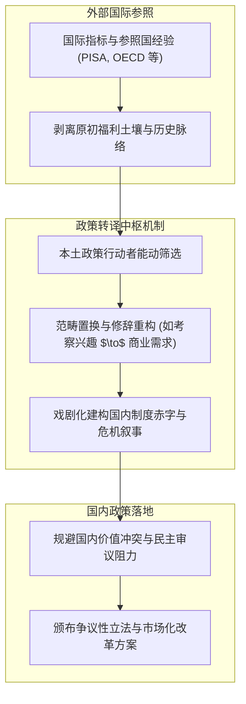

---

> [!def] Policy Translation
> 政策转译（Policy Translation）是指外来政策理念、跨国治理指标（如[[PISA|国际学生评估项目]] [[PISA]] 成绩）或国际参照经验在移入本土制度语境时，由本土政策行动者依据自身政治议程与合法化诉求，实施主动编码、语义改写与意义重构的[[Discourse|话语]]运作机制。比较教育学者[[Gita Steiner-Khamsi|吉塔·斯泰纳-哈姆西]]（Gita Steiner-Khamsi, 2014, 2016）系统确立了该范畴，用以超越传统比较教育学将“[[Policy Borrowing|政策借用]]与贷出”（Policy Borrowing and Lending）视为客观技术移植的实体主义倾向。金莫·库尔蒂（Kimmo Kuortti, 2025）将政策转译整合进福柯[[Post-structural Policy Analysis|后结构政策分析]]框架，揭示本土决策层如何将国际关注战略性偷换为市场需求，进而为激进的商业化改革奠定制度正当性。[[Argument_Kuortti_2025_JEdPolicy|(Kuortti, 2025, pp. 378, 387–388)]]; [[Argument_Chua_2011_CILP|(Chua, 2011, pp. 142–144)]]

> [!concept-lens|notitle] 概念透镜
> - **含义** 指向本土决策者将外部跨国话语、国际排行榜或外来模式，按本国利益诉求进行修辞再造与话语重塑的能动过程。
> - **用途** 帮助研究者透视国家在教育改革中高调援引国际经验的深层动因，揭示外部参照如何充当突破国内政治阻力、推行争议性改革的合法化工具。
> - **边界** 聚焦话语语义重构与战略性修辞操纵，区别于字面层面的语言翻译，亦不同于外部强力主导的硬性政策强加（Policy Imposition）。

> [!citation-card] Steiner-Khamsi & Kuortti 论政策转译的话语生产效能
> 政策借用中的政策转译是对外部参照的本土政治化再创造。在芬兰[[Education Export|教育出口]]政策话语中，政策制定者将海外对芬兰公立基础教育质量的学术关注，转译为国际市场对芬兰教育服务的商业需求，从而将缺乏商业出口界定为亟需通过市场化纠偏的体制缺陷：
>
> *Policy translation in [[Post-structuralism|post-structuralist]] policy analysis operates as part of the governmental rationalities... External references such as PISA and reference countries are part of the discursive construction of domestic policy, translating interest into market demand.* ([[Argument_Kuortti_2025_JEdPolicy|Kuortti, 2025, pp. 378, 387]])

> [!boundary]- 概念边界
> - 不等于 **政策借用（[[Policy Borrowing]]）** — 政策借用侧重宏观描述外来政策方案在国家间的流动路径与采纳结果；政策转译直指转移过程中本土行动者实施的微观语义再编码与修辞重塑机制。
> - 不等于 **结构性[[Recontextualization|再情境化]]（[[Recontextualization]]）** — 再情境化关注政策文本移入新[[Champ|场域]]时受本土深层文化与制度结构的客观制约；政策转译突显行动者为特定政治利益所实施的主动策略性调配。
> - 不适用于 **外部强制推行的政策强加（Policy Imposition）** — 在战后占领或[[World Bank|世界银行]]硬性结构调整贷款等外部强力干预下，本土行动者缺乏话语筛选与转译空间，此时概念解释力受限。

---

> [!contrast-table] 政策转译、政策借用与三T模型的对比
> | 对比维度 | 政策转译 (Policy Translation) | 政策借用 (Policy Borrowing) | 转移、转译与转化 (3T 模型) |
> | :--- | :--- | :--- | :--- |
> | **理论旨趣** | 解构行动者对国际符号的战略性改写与修辞赋权 | 描述外部政策模式的流动路径、采纳动机与实施成效 | 呈现跨国[[Policy Mobility\|政策流动]]全周期的宏观历史与结构变迁 |
> | **行动者角色** | 积极的话语生产者、修辞操盘者与政治合法化建构者 | 寻求现成[[Problem Solving\|问题解决]]方案的制度借鉴者 | 嵌入于特定[[Geopolitics\|地缘政治]]与制度脉络中的结构性主体 |
> | **核心焦点** | 外部指标被赋予了何种与原初情境不同的新意涵 | 为什么借、借什么、如何借以及借用后是否成功 | 空间转移（Transfer）、语义转译（Translation）与制度转化（Transformation）的系统演进 |
> | **实证案例** | 芬兰将 PISA 声誉转译为教育出口商业需求 ([[Argument_Kuortti_2025_JEdPolicy\|Kuortti, 2025]]) | 发展中国家直接引进西方优质科学课程大纲 | 新加坡将国际语言规划理论转化为本土双语工程 ([[Argument_Chua_2011_CILP\|Chua, 2011]]) |

---

## 命题与机制

### 命题一：政策转译是本土决策层用于规避民主阻力的外部合法化机制

当国内教育改革方案遭遇传统制度惯性、工会抵制或公众对公共性流失的质疑时，决策者往往通过战略性转译国际组织（如[[OECD|经合组织]]、[[World Bank|世界银行]]）的最佳实践或危机叙事，将本国高度争议性的[[Neoliberalism|新自由主义]]改革包装为顺应时代潮流的国际共识，以此规避本土价值冲突。

> [!evidence-grid-a|notitle]
> - 影响机制：外部参照物被赋予中立、科学的权威外衣，转译过程切断了国际指标与原产国特定历史条件的关联，从而将国内政治博弈简化为不可抗拒的外部制度推力。
> - 证据支撑：斯泰纳-哈姆西（Steiner-Khamsi, 2014, 2016）对[[Transnational Education|跨国教育]][[Policy Borrowing|政策借用]]的长程追踪表明，外来模式的引进往往发生在本土改革陷入政治僵局之时；库尔蒂（[[Argument_Kuortti_2025_JEdPolicy|Kuortti, 2025, p. 378]]）实证揭示转译充当了[[Post-structuralism|后结构主义]]治理理性的关键支撑工具。

### 命题二：政策转译将教育文化交流偷换为商业买卖契约以论证收费合理性

政策文本通过范畴挪用，将非商业性的文化探访与制度借鉴战略性重塑为商业贸易需求，为打破公立教育免费传统、推行营利性法人化制造舆论正当性。

> [!evidence-grid-b|notitle]
> - 影响机制：通过运用古典经济学常识，政策起草者将外国对本土教育公平的考察兴趣偷换为海外买家对教育服务的商品采购意向，进而将原有的公立非营利制度定性为错失经济红利的体制缺陷。
> - 证据支撑：金莫·库尔蒂（[[Argument_Kuortti_2025_JEdPolicy|Kuortti, 2025, pp. 387–388]]）对芬兰 16 份核心政策[[Document|文献]]的解构表明，芬兰官方在《从兴趣到需求与产品》战略中，正是通过将海外学者对北欧去商品化模式的考察转译为商业需求赤字，最终成功立法向非[[EU|欧盟]]学生强制征收大学学费。

### 命题三：宏观政策转译依托官僚控制网络穿透微观教学实践

在强国家治理模式下，政策转译不仅发生在国际与国家的跨国层级，还系统发生在国家宏观战略向微观课程教学的垂直转化中。国家通过将宏观经济生存与[[Geopolitics|地缘政治]]叙事转译为微观课堂的技能教学大纲与统考指标，实现对教育生态的全域重塑。

> [!case] 新加坡语言政策规划中的垂直政策转译
> 新加坡在建构懂英语双语体系时展现了典型的自上而下政策转译机制：
> - 宏观战略转译：执政党将国际经济生存竞争与主权确立诉求，转译为“英语作为[[Language-of-State|施政语言]]与第一教学媒介语、族群母语作为文化锚定”的法定政策；
> - 微观教学落地：通过教育部课程大纲、师资培训与统考规程，将国家地缘政治焦虑进一步转译为小学课堂的 [[STELLAR Program|STELLAR]] 读写教学法与 [[Primary School Leaving Examination|PSLE]] 考试考核标准，使宏观[[Discourse|话语]]深层嵌入微观教学实践。([[Argument_Chua_2011_CILP|Chua, 2011, pp. 142–144]]; Kaplan & Baldauf, 1997)

> [!proposition-summary] 政策转译核心命题归纳
> | 命题阶段 | 核心机制 | 理论与循证依据 | 实践与分析价值 |
> | :--- | :--- | :--- | :--- |
> | **命题一：外部合法化** | 借助国际指标中立权威规避本土民主审议争议 | Steiner-Khamsi (2016); [[Argument_Kuortti_2025_JEdPolicy\|Kuortti (2025)]] | 解释为何本土决策层偏好援引脱离语境的国际排名 |
> | **命题二：范畴挪用** | 将学术文化交流偷换为国际市场商业需求赤字 | 芬兰教育出口政策文献分析 ([[Argument_Kuortti_2025_JEdPolicy\|Kuortti, 2025]]) | 揭示公立高等教育学费制度与法人化改革的话语包装 |
> | **命题三：垂直穿透** | 将宏观国家经济生存战略转译为微观课程教学标准 | 新加坡语言规划与 STELLAR 改革实践 ([[Argument_Chua_2011_CILP\|Chua, 2011]]) | 展现跨国理念向国家规程与课堂实践的多标量转译链条 |

---

## 演进脉络

> [!dev-timeline] 政策转译概念的历史演进
> - **2000 年代中叶 比较教育政策借贷反思** [[David P. Phillips|戴维·菲利普斯]]（[[David Phillips]]）与[[Kimberly Ochs|金伯莉·奥克斯]]（Kimberly Ochs）提出[[Policy Borrowing|政策借用]]四阶段模型，奠定了审视跨国[[Policy Mobility|政策流动]]的宏观[[Analytic Framework|分析框架]]。
> - **2014–2016 年 转译理论的政治学深化** 斯泰纳-哈姆西（Steiner-Khamsi, 2014, 2016）借鉴社会学[[Actor-Network Theory|行动者网络理论]]与政治学[[Discourse|话语]]理论，正式确立政策转译范畴，将研究重心由政策流动结果转向本土行动者的能动编码与修辞操弄。
> - **2020 年代 [[Post-structural Policy Analysis|后结构政策分析]]与治理理性操作** 库尔蒂（[[Argument_Kuortti_2025_JEdPolicy|Kuortti, 2025]]）将政策转译与[[Carol Bacchi|卡罗尔·巴奇]]（Carol Bacchi）的 [[Bacchi's WPR Approach|WPR]]（What's the Problem Represented to be?）分析路径相融合，揭示政策转译如何充当[[Neoliberalism|新自由主义治理]]理性塑造[[Problematisation|问题表征]]的关键装置。

---

## 争鸣与审思

> [!debates] 政策转译的关键学术争鸣
> - **全球制度同质化[[Convergence Theory in Comparative Education|趋同论]] vs 本土能动转译论**
>   - **世界文化趋同论（[[Convergence Theory in Comparative Education|Convergence Theory]]，如 [[John W. Meyer|John Meyer]] et al.）** 强调跨国组织（如 [[OECD]]、[[World Bank|世界银行]]）通过全球标准、评估指标与趋同压力，强力塑造同质化的世界教育文化，民族[[Country Ownership|国家自主性]]趋于消解。
>   - **本土能动转译论（Steiner-Khamsi, 2016）** 主张主权国家具有积极能动性以改造外来模式；即便表面采纳完全相同的国际政策[[Discourse|话语]]标签，本土决策层在具体转译时也赋予其服务于本国特殊政治利益的异质功能。

---

## 边界与局限

> [!warning|notitle]
> - **对本土行动者[[Discourse|话语]]自主性的预设过高** 政策转译假定本土政策系统拥有充足的话语策略空间与反思能力；在极度依附外部经济援助或遭遇战后军事直接管制的极端情境中，政策选择往往受制于结构性强制，此时转译理论的解释力弱于[[Dependency Theory|依附理论]]。
> - **重话语修辞解构而轻物质实践追踪** [[Post-structuralism|后结构主义]]取向的政策转译分析侧重剖析文本中的[[Problematisation|问题表征]]与修辞策略，若缺乏对政策落地后微观物质分配与课堂权力关系的实地考察，容易陷入单纯文本主义的分析陷阱。

---

## 关联图谱

> [!entry-map]
> - 上位领域：[[Policy Borrowing|政策借用]] · 三T模型 · 比较教育学
> - 分析工具：[[Bacchi's WPR Approach|WPR]] 分析法 · [[Post-structural Policy Analysis|后结构政策分析]] · [[Discourse Analysis|话语分析]]
> - 核心实证案例：芬兰[[Education Export|教育出口]]改革 · [[Argument_Chua_2011_CILP|Chua (2011) 新加坡语言教育规划转译]]

---

> [!evidence-grid-a|notitle] 相关研究索引
> - [[Argument_Kuortti_2025_JEdPolicy|Kuortti (2025)]] — 运用政策转译概念剖析芬兰教育出口政策[[Document|文献]]，揭示官方如何将外部对 [[PISA]] 的学术探访转译为商业需求赤字，以此论证高等教育收费与职业教育法人化的正当性。
> - [[Argument_Chua_2011_CILP|Chua (2011)]] — 结合鲍尔道夫语言规划框架，展现新加坡如何将外部经贸[[Competitiveness|竞争力]]诉求与国内多民族维稳要求，转译为[[Bilingual Education Policy|双语教育政策]]与 [[STELLAR Program|STELLAR]] 课堂规程。
