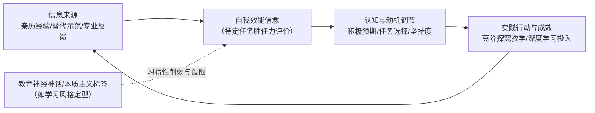

---

> [!def] Self-Efficacy
> 自我效能感（Self-Efficacy）是指个体在面对**特定任务情境**时，对自身能否成功调动认知、动机与行为资源以达成预期表现的主观胜任信念。[[Albert Bandura|阿尔伯特·班杜拉]]（Albert Bandura）在社会认知理论中强调，感到自我有效（feeling efficacious）是驱动个体走向积极探索与技能掌握的直接动力；反之，低自我效能感会引发任务逃避与[[Learned Helplessness\|习得性无助]]。[[Argument_Li_2012_Cambridge\|(Li, 2012, p. 58)]]；[[Argument_Bergeron_2015_TeachingTOK\|(Bergeron & Rogers, 2015, p. 9)]]

> [!concept-lens] 概念透镜
> - **含义** 指向个体对自身在具体情境与特定任务中行动效能的主观信念系统，涵盖学习者的学习自我效能与教师的教学自我效能（Teacher Self-Efficacy）。
> - **用途** 解释为何在具备同等客观知识与技能水平的条件下，不同个体在面临认知挑战或教学困境时会表现出截然不同的动机唤醒、努力持久度、应对韧性与任务表现。
> - **边界** 严格区别于跨情境的自尊（Self-Esteem）、一般能力感（General Competence）或客观能力水平。它始终回答“我在具体任务中能否做到”，而非“我整体是个怎样的人”。

> [!citation-card] 班杜拉论效能信念对技能习得的动力推动
> 班杜拉强调，如果一个人缺乏某项技能，只要其具备潜在的效能胜任信念，这个人就会被激发去主动获取该技能；因此，拥有良好的效能感是推动个体持续投入深度学习与技能掌握的核心心理基石。[[Argument_Li_2012_Cambridge\|(Li, 2012, p. 58)]]
>
> *Bandura stresses that if a person lacks the skill, that person is motivated toward getting the skill. Therefore, feeling efficacious moves people toward learning and mastery.*

> [!boundary]- 概念边界
> - **不等于一般自尊或一般能力感** — 自我效能感具有高度的任务特定性（task-specific）与情境敏感性。个体可能在数学推理上具有极高的效能感，但在学术写作或公开演讲上效能感极低；它关注具体任务层面的胜任信念，有别于对整体智力或人格价值的笼统评价。
> - **不等于客观实际能力水平** — 实际具备高技能的个体可能因过度焦虑或消极归因而表现出低效能感（导致主动放弃挑战）；而效能感适度高于实际水平则常能激发超越常规的努力与[[Creativity\|创造力]]。自我效能感调节的是从潜能向行动转化的中介动力机制。

---

> [!contrast-table] 自我效能感与相近心理[[Construct\|构念]]辨析
> | 比较维度 | 自我效能感（Self-Efficacy） | 自尊（Self-Esteem） | 实际能力水平（Objective Ability） | [[Epistemological Beliefs\|认识论信念]]（Epistemological Beliefs） |
> |---|---|---|---|---|
> | **分析对象** | 对特定任务行动胜任力的主观判断 | 对自我整体价值与身份的情感性评价 | 经客观测量确证的知识与技能储备 | 对知识本质、来源与确定性的深层认知结构 |
> | **核心机制** | 预期能否达成目标，调节努力与坚韧性 | 维持自我价值感，调节情绪安全与自尊防御 | 决定任务完成的技术上限与客观产出质量 | 影响对复杂问题、证据反驳与专业实践的理解方式 |
> | **适用情境** | 任务层面的[[Student Motivation\|学习动机]]、教师教学胜任力评估 | 全局性心理健康与人格发展研究 | [[Academic Achievement\|学业成就]]测量与标准化专业能力认证 | 教师教学决策、科学理解与教学法反思 |

---

> [!feature] 自我效能感的信息来源与行为调节机制
> - **四大核心信息源（Sources of Efficacy）** [[Albert Bandura\|班杜拉]]归纳了个体构建效能信念的四大基石：
>   1. **亲历掌握经验（Mastery Experiences）** 过去成功完成类似任务的直接经验，是塑造效能感最稳固的基础；
>   2. **替代经验（Vicarious Experiences）** 观察相似同伴或榜样成功示范所产生的“我也能做到”的信念；
>   3. **言语劝导（Verbal Persuasion）** 来自教师、导师或专家的鼓励与专业反馈；
>   4. **生理与情绪状态（Physiological & Affective States）** 面对挑战时的焦虑、兴奋或压力水平的主观解读。
> - **四大行为调节功能（Regulatory Mechanisms）** 自我效能感深刻塑造个体在学习与教学中的行为走向：
>   - **预期塑造（Expectation Shaping）** 高效能者将困难视为可克服的挑战并预期成功，低效能者倾向于预期失败并放大潜在阻碍。[[Argument_Li_2012_Cambridge\|(Li, 2012, p. 58)]]
>   - **努力与持久度（Effort & Persistence）** 效能感越高，面临阻碍时激发的努力越持久、越专注，不易因暂时挫折而放弃。
>   - **任务选择（Task Selection）** 主动倾向于选择具有适度挑战性的任务，回避自认无法胜任的领域。
>   - **目标设定与监控（Goal Setting & Monitoring）** 高效能感推动个体设定更高标准的近期目标与远期抱负，并维持高水平的[[Metacognition\|元认知监控]]。[[Argument_Li_2012_Cambridge\|(Li, 2012, p. 65)]]
> - **跨国治理与大规模测评中的非认知指标化（Non-Cognitive [[Operationalization]] in Global Governance）** [[Argument_Grek_2009_JEdPolicy|Grek (2009, p. 27)]] 揭示，国际大规模教育评价（如 [[OECD]] 的 [[PISA]]）将自我效能感、学习动机与自主规制策略等非认知心理[[Construct|构念]]，制度化为跨国度量空间中的关键政策指标，用于衡量青年学生面向未来生活与[[Knowledge-Based Economy|知识经济]]的通用胜任力。

> [!logic-map]- 自我效能感的双向交互决定与教学实践机制

---

## 围绕概念形成的命题

---

> [!concept-proposition] 命题一｜教学实践成效与教师[[Epistemological Beliefs|认识论信念]]之间存在双向重塑机制，成功的高阶探究教学显著提升教师自我效能感
> **探讨维度　[[Teacher Beliefs\|教师信念]]与实践经验的双向交互** 揭示教师自我效能感在真实课堂教学实践中与教学策略、[[Epistemological Beliefs\|认识论信念]]动态交互生成；面对复杂教学挑战取得的成功经验对提升教师教学效能具有驱动作用。

> [!claim] [[Argument_Bergeron_2015_TeachingTOK\|Bergeron & Rogers, 2015]]
> **探究教学经验对教师效能感与认识论信念的反向强化** 教师信念与教学实践之间存在深刻的双向重塑机制。全球跨国大规模调查显示，当教师长期承担高挑战性、注重[[Critical Thinking\|批判性思维]]与跨学科探究的复杂课程（如[[International Baccalaureate\|国际文凭]]项目的[[Theory of Knowledge\|知识论]]课程（Theory of Knowledge, TOK））并积累成熟经验时，其教学信心与自我效能感相较于新手教师显著提高（中等教龄组[[Effect Size\|效应量]] $d = 0.40$，资深组 $d = 0.51$），并反向推动其认识论信念向[[Constructivist Paradigm\|建构主义]]与审辩取向深化。[[Argument_Bergeron_2015_TeachingTOK\|(Bergeron & Rogers, 2015, pp. 9–10 引用 Buehl & Beck, 2015)]]

---

> [!concept-proposition] 命题二｜教学中的本质主义定型与[[Neuromyth|教育神经神话]]会系统性削弱学生的任务自我效能感并诱发回避行为
> **探讨维度　本质主义标签对学习效能信念的认知束缚** 阐明缺乏科学依据的伪科学教育神话（如[[Learning Styles\|学习风格假说]]）如何通过将学习者固化为单一感官类型，破坏学生在多通道任务中的胜任信念，形成人为的认知设限与动机抑制。

> [!claim] [[Argument_Besa_2024_UW\|Besa, 2024]]
> **本质主义分类定型对学习者自我效能感的习得性削弱** 在缺乏实证转译的课堂实践中广泛流行的[[Learning Styles\|学习风格神话]]（Lerntypenmythos），诱导教师、学生与家长将学习者划分为“视觉型”、“听觉型”或“动觉型”等孤立类别。这种本质主义分类（Nancekivell et al., 2020）诱使学生将特定感官通道的偏好错误等同于自身能力的不可变边界，极大地削弱了学生在非偏好通道或多模态深度学习任务上的自我效能感，导致其主动回避需要综合运用多元表征的复杂认知活动，在心理层面上造成自我设限与潜能抑制。[[Argument_Besa_2024_UW\|(Besa, 2024, p. 252)]]

---

> [!concept-proposition] 命题三｜自我效能感通过预期塑造、努力持久度与目标设定三大心理机制调节个体的深度学习与动机维持
> **探讨维度　社会认知动机调控机制** 阐明自我效能信念如何作为中枢心理[[Variable\|变量]]，直接支配学习者在面对学业挑战时的努力分配、目标导向与认知坚持度。

> [!claim] [[Argument_Li_2012_Cambridge\|Li, 2012]]
> **效能信念对[[Student Motivation|学习动机]]与抱负水平的决定性调控** 在语言习得与复杂学业任务中，自我效能感构成主动调控未来动机的主导力量。高自我效能感能够促使学习者主动设定更具挑战性的近端与远端目标，在遭遇挫折时保持更强的抗逆力与投入度；相反，低效能信念会使学习者在任务启动前即产生失败预期，大幅减少努力投入并诱发拖延与回避行为。[[Argument_Li_2012_Cambridge\|(Li, 2012, pp. 58–60, 65)]]

---

> [!concept-proposition] 命题四｜支架式科学探究与课堂[[Epistemic Practices|认识论实践]]通过具身掌握经验显著培育学生的学科自我效能感与知者身份认同
> **探讨维度　科学探究情境中的自我效能生成与[[Epistemology\|认识论]]动因** 探讨自主探究与微观[[Discourse|话语]]协商实践相较于单向[[Direct Instruction\|直接讲授]]，如何通过引导学生深度参与真实科学[[Knowledge Building Theory|知识建构]]，直接提供亲历掌握经验以提升其学科自我效能感，并建立合法的科学知者身份。

> [!claim] [[Argument_DeJong_2023_ERR\|De Jong et al. (2023)]]
> **探究体验对科学自我效能感与认识论动因的独特培育** 在科学教育与教学法争论中，教学成效的衡量不能窄化为孤立的概念性事实测验。实证研究明确表明，[[Inquiry-Based Learning\|探究式学习]]在激发学生的[[Nature of Science\|科学本质]]（Nature of Science, NOS）认知、探究实践素养、科学学习兴趣以及自我效能感等非认知与认识论维度上具有直接讲授无法替代的独特育人价值；依照[[Albert Bandura\|班杜拉]]的社会认知理论，亲历掌握经验（Mastery Experiences）是自我效能感最稳固的信息来源，在支架式探究中，学生通过自主提出假设、[[Design-Based Research\|设计实验]]并解决真实认知阻碍，亲身获得了作为“知识发现者与检验者”的具身掌握体验，从而显著强化了面对复杂科学挑战时的胜任信念与认识论动因（[[Epistemic Agency]]）。[[Argument_DeJong_2023_ERR\|(De Jong et al., 2023, p. 10)]]

> [!claim] [[Argument_Kelly_Licona_2018_EpistemicPractices\|Kelly and Licona (2018)]]
> **教师元话语与[[Epistemic Practices\|认识论实践]]对学生科学效能感与身份认同的建构** 在多元文化与包容性科学课堂中，学生的学科自我效能感在微观认识论实践中通过[[Legitimate Peripheral Participation|合法的边缘性参与]]逐步生成。实证[[Discourse Analysis\|话语分析]]表明，当教师运用显性元话语（meta-discourse，如引导学生“像科学家一样依据实测数据进行论辩与检验”）对探究过程进行支架式中介时，原本在课堂互动中处于边缘地位或缺乏自信的学生得以调用先前记录的数据参与知识主张的提出与评估。这种真实的认知参与赋予了学生强烈的知者地位，使其在意义协商中体验到自身言论对共同体知识建构的实际影响力，从而从根本上重塑其作为科学探究者的自我效能感与学术身份认同。[[Argument_Kelly_Licona_2018_EpistemicPractices\|(Kelly & Licona, 2018, pp. 146–147, 159 引用 Reveles et al., 2004)]]

---

> [!concept-proposition] 命题五｜大规模跨国测评将自我效能感制度化为[[Lifelong Learning|终身学习]]与[[Knowledge-Based Economy|知识经济]]的关键非认知胜任力指标
> **探讨维度　跨国治理中的非认知[[Construct|构念]][[Operationalization|操作化]]** 探讨国际评估体系如何将自我效能感从个体内在的心理动力构念，转换为衡量国家[[Human Capital Theory|人力资本]]潜力与学生应对未来生活挑战的标准化政策指标。

> [!claim] Grek
> **自我效能感在大规模测评中的制度化与非认知素养测度** 索蒂里亚·格雷克（[[Sotiria Grek]]）指出，[[OECD|经济合作与发展组织]]（[[OECD]]）推行的[[PISA]]测评将自我效能感确立为核心的非认知心理指标。PISA 聚焦于学生在面对现实生活挑战时的通用胜任力，摆脱了依附特定国家课程大纲的测验模式；[[Questionnaire|问卷]]系统测查学生的学习动机、自主规制策略以及对自身学术任务胜任力的信念（自我效能感）。通过标准化心理测量技术，学生内在的效能信念被转化为跨国可比的数据指标，成为界定现代[[Knowledge-Based Economy|知识经济]]中“有效[[Lifelong Learning|终身学习]]者”的核心判准[[Argument_Grek_2009_JEdPolicy|(Grek, 2009, p. 27)]]。

---

> [!contrast-table] 所有命题归纳
> | 命题类型 | 核心指向 | 适用情境 | 代表学者 |
> |---|---|---|---|
> | **实践双向重塑命题** | 复杂探究性教学实践能够反向提升教师教学自我效能感并重塑认识论信念 | 复杂课程教学、创新教学法实践与教师专业成熟度评估 | [[Argument_Bergeron_2015_TeachingTOK\|Bergeron and Rogers (2015)]]; Buehl and Beck (2015) |
> | **本质主义定型削弱命题** | 伪科学教育神话导致本质主义分类标签，系统性削弱学生多模态任务自我效能感 | 课堂[[Differentiated Instruction\|差异化教学]]、教育迷思破除与学习动机干预 | [[Argument_Besa_2024_UW\|Besa (2024)]]; Nancekivell et al. (2020) |
> | **社会认知动机调控命题** | 自我效能感通过预期塑造、任务选择与努力坚持支配深度学习与抱负达成 | 学业动机激发、二语习得与[[Learner Autonomy\|自主学习]]能力培养 | [[Argument_Li_2012_Cambridge\|Li (2012)]]; Bandura (1997) |
> | **科学探究与认识论动因命题** | 支架式探究与微观话语实践通过提供亲历掌握经验与知者身份，在自我效能感与认识论动因上展现出独特育人价值 | 科学探究教学法、多元文化包容课堂、非认知素养测评与科学身份建构 | [[Argument_DeJong_2023_ERR\|De Jong et al. (2023)]]; [[Argument_Kelly_Licona_2018_EpistemicPractices\|Kelly and Licona (2018)]] |
> | **非认知指标制度化命题** | 大规模跨国测评将学生自我效能感与自主规制策略操作化为跨国可比的非认知胜任力指标 | 跨国教育治理、政策指标建构、[[Lifelong Learning\|终身学习]]倾向测评与知识经济人力资本评估 | Grek |

---

> [!dev-timeline] 概念演变
> - **1977 — 社会认知理论奠基** [[Albert Bandura\|阿尔伯特·班杜拉]]发表《自我效能：迈向行为改变的综合理论》（*Self-efficacy: Toward a unifying theory of behavioral change*），正式确立自我效能感概念及其四大信息源与调节机制。
> - **1980s–1990s — 学业动机与[[Learning Strategies|学习策略]]领域广泛应用** 学界将自我效能感从临床心理治疗拓展至教育学与学习科学领域，实证揭示其对学生[[Academic Achievement\|学业成就]]、[[Metacognition\|元认知]]策略使用与成就归因的关键中介作用（Pintrich & De Groot, 1990; Bandura, 1997）。
> - **2000s–2010s — 教师自我效能感与[[Epistemological Beliefs\|认识论信念]]研究深化** 研究重点拓展至教师群体（Teacher Self-Efficacy），揭示教师效能感与[[Classroom Management\|课堂管理]]、[[Inquiry-Based Learning\|探究式教学]]实施及自身认识论信念的双向重塑机制（Buehl & Beck, 2015；[[Argument_Bergeron_2015_TeachingTOK\|Bergeron & Rogers, 2015]]）。
> - **2009 — 大规模跨国测评与非认知效能指标制度化** 索蒂里亚·格雷克（[[Argument_Grek_2009_JEdPolicy|Grek, 2009]]）论证指出，经合组织（OECD）推行的 PISA 测评将自我效能感等非认知构念制度化为衡量未来生活通用胜任力的跨国标准，把学生对自身学习胜任力的主观信念重构为支撑知识经济的终身学习指标（p. 27）。
> - **2018 — 课堂[[Epistemic Practices\|认识论实践]]与科学身份建构整合** [[Argument_Kelly_Licona_2018_EpistemicPractices\|Kelly and Licona (2018)]] 基于微观交互[[Discourse Analysis\|话语分析]]，揭示教师显性元[[Discourse|话语]]与认识论实践参与对多元文化课堂中边缘群体学生学科自我效能感与科学知者身份认同的动态建构机制。
> - **2020s — 认知迷思批判与科学传播视野拓展** 贝萨（[[Argument_Besa_2024_UW\|Besa, 2024]]）等学者将自我效能感引入[[Educational Science Communication\|教育科学传播]]与[[Neuromyth|神经神话]]批判语境，揭示本质主义标签对学生效能感的隐性侵蚀，强调通过循证[[Knowledge Mobilisation\|知识动员]]维护学习者与教师的专业效能。
> - **2023 — 科学探究实践与学科非认知效能整合** [[Argument_DeJong_2023_ERR\|De Jong et al. (2023)]] 明确确立了探究式学习在培育科学自我效能感、[[Nature of Science\|科学本质]]（NOS）认知与[[Epistemology\|认识论]]动因（[[Epistemic Agency]]）上的不可替代性，拓展了自我效能感在现代科学教育评价中的维度。

---

> [!debates] 学术争议
>
> > [!axis] 任务特定效能 vs 一般自我效能
> > 争论围绕自我效能感应当严格限定于微观特定任务情境（Bandura 经典取向），还是可以抽象为跨情境的一般自我效能感（General Self-Efficacy, GSE）特质。经典学者强调特定性才能精准预测因果行为，而人格心理学者主张一般效能感有助于评估个体的普遍适应性。
>
> > [!axis] 效能感过高导致的盲目自信风险
> > 极高的自我效能感通常被视作积极心理资本，但过度膨胀的效能信念可能导致个体低估任务难度、忽视[[Refutational Evidence\|反驳性证据]]与拒绝必要的方法调整，形成认知盲区与风险低估。

> [!critique] [[Voluntarism\|唯意志论]]倾向与结构性忽视批判
> 批判社会学者指出，过度强调自我效能感容易陷入“唯意志论（voluntarism）”的认知陷阱，将学生的学业落后或教师的教学倦怠完全归咎于个体心理胜任信念不足，掩盖了学校资源匮乏、家庭[[Socioeconomic Status|社会经济地位]]劣势及制度支持缺失等深层结构性矛盾。

> [!warning] 适用局限
> 自我效能感的提升必须以真实能力建设与合理的外部支持为支撑。脱离客观技能训练的虚假口头鼓励无法带来持久的效能提升，反而在遭遇真实挫折后引发更严重的效能崩塌。

---

> [!metax-divider]

> [!metax] [自我效能感 · Self-efficacy](https://www.visiblelearningmetax.com/influences/view/self-efficacy)
> 学生 › 自我
>
> | rate | ma | k | n | m | d | du | rob |
> | --- | --- | --- | --- | --- | --- | --- | --- |
> | ★★★★ 显著加速 | 17 | 808 | 1,381,152 | 1,319 | 0.69 | 0.71 | ●●●●● |
>
> > [!metax-ma]- 17 项
> > | ref | var | k | n | m | d | e |
> > | --- | --- | --- | --- | --- | --- | --- |
> > | Holden et al. (1990) | Self-efficacy | 25 | NA | 26 | 0.37 |  |
> > | Multon et al. (1991) | Self-efficacy | 36 | 4,998 | 38 | 0.76 |  |
> > | Silva et al. (2016) | Self-efficacy on achievement in Higher education | 20 | NA | 20 | 0.25 |  |
> > | Çikrikci (2017) | Self-efficacy | 231 | 242,023 | 231 | 0.72 |  |
> > | Unrau et al. (2018) | Reading self-efficacy | 30 | NA | 33 | 0.33 |  |
> > | Gegenfurtner et al. (2014) | Self-efficacy in simulation based learning | 15 | 2,274 | 15 | 0.72 |  |
> > | Robbins et al. (2004) | Self-efficacy | 13 | NA | 13 | 1.84 |  |
> > | Carpenter (2007) | Self-efficacy | 48 | 12,466 | 48 | 0.70 |  |
> > | Ciftci & Yildiz (2019) | Self-confidence | 76 | 1,028,567 | 76 | 0.59 |  |
> > | Sun, Wang, Lambert, et al. (2021) | Writing self-efficacy on L2 students | 76 | NA | 76 | 0.56 |  |
> > | Braithwaite & Corr (2016) | Self-efficacy on achievement in Higher education | 14 | NA | 14 | 0.26 |  |
> > | Rachmahana (2008) | Self-efficacy | 23 | NA | 23 | 0.95 |  |
> > | Muhtadi, Assagaf, et al. (2022) | Self-efficacy | 40 | 4,503 | 40 | 1.71 |  |
> > | Haidai et al. (2023) | Self-efficacy | 37 | 16,946 | 40 | 0.08 |  |
> > | Sun (2021) | Self-efficacy | 76 | 18,620 | 575 | 0.50 |  |
> > | Nunes et al. (2022) | Academic self-efficacy | 11 | 27,705 | 11 | 0.74 |  |
> > | Goetze & Driver (2022) | Self-efficacy in 2nd language | 37 | 23,050 | 40 | 1.04 |  |

> [!metax] [教师自我效能感 · Teacher self-efficacy](https://www.visiblelearningmetax.com/influences/view/teacher_self-efficacy)
> 教师 › 教师特质
>
> | rate | ma | k | n | m | d | du | rob |
> | --- | --- | --- | --- | --- | --- | --- | --- |
> | ★★☆☆ 正向影响 | 2 | 28 | 14,215 | 129 | 0.22 | 0.22 | ●●○○○ |
>
> > [!metax-ma]- 2 项
> > | ref | var | k | n | m | d | e |
> > | --- | --- | --- | --- | --- | --- | --- |
> > | Klassen & Tze (2014) | Teacher self-efficacy and achievement | 12 | NA | 31 | 0.24 |  |
> > | Kim & Seo (2018) | Teacher self-efficacy | 16 | 14,215 | 98 | 0.20 |  |

> [!empirical-divider]

> [!ref-table]- 其他实证结果（无效应量）
> 
>
> | 研究 | 样本与情境 | 研究设计 | [[Variable\|变量]]或指标 | 原始统计结果（无效应量） | 不确定性或显著性 | 解释边界 |
> | --- | --- | --- | --- | --- | --- | --- |
> | [[Argument_Bergeron_2015_TeachingTOK\|Bergeron and Rogers (2015)]] | 274 vs 289 | [[Theory of Knowledge\|TOK]]教龄：4-9年中等经验组 vs 1-3年新手组 | 教学信心量表得分（教师自我效能感代理指标） | 4-9年组 M=3.35(SD=0.42) vs 新手组 M=3.17(SD=0.47) | $p<.001$ | 量化横截面调查。未直接报告效应量。证明在教授复杂探究性课程时，长期的实践经验能提升教师自我效能。高度依赖自我报告数据。 |
> | 同上（Bergeron & Rogers） | 105 vs 289 | TOK教龄：10年以上资深组 vs 1-3年新手组 | 教学信心量表得分（教师自我效能感代理指标） | 10年以上组 M=3.40(SD=0.40) vs 新手组 M=3.17(SD=0.47) | $p<.001$ | 同上。未直接报告效应量。 |

---

> [!evidence-grid-a] 相关研究索引
> - [[Argument_DeJong_2023_ERR\|De Jong et al. (2023)]] — 系统阐明[[Inquiry-Based Learning\|探究式学习]]在培养学生科学自我效能感、[[Nature of Science\|科学本质观]]与[[Epistemology\|认识论]]动因（[[Epistemic Agency]]）上的独特育人机制，突破了将教学法成效窄化为单一事实概念测验的局限。
> - [[Argument_Kelly_Licona_2018_EpistemicPractices\|Kelly and Licona (2018)]] — 结合课堂[[Discourse Analysis\|话语分析]]案例，阐释微观[[Epistemic Practices\|认识论实践]]参与和教师显性元[[Discourse|话语]]如何帮助多元文化背景下的边缘学生构建科学知者地位与学科自我效能感（pp. 146–147, 159）。
> - [[Argument_Li_2012_Cambridge\|Li (2012)]] — 详细梳理了[[Albert Bandura\|班杜拉]]关于自我效能感如何通过预期、努力、任务选择和目标设定等四大机制调控学习者动机的基础心理学模型。
> - [[Argument_Bergeron_2015_TeachingTOK\|Bergeron and Rogers (2015)]] — 将自我效能感拓展至教师群体，通过跨国大样本调查证实教龄累积与复杂探究课程（如[[Theory of Knowledge\|知识论]]）的成功实施能够显著提升教师教学效能感。
> - [[Argument_Besa_2024_UW\|Besa (2024)]] — 揭示未经检验的[[Neuromyth|教育神经神话]]（如[[Learning Styles\|学习风格假说]]）通过本质主义标签对学生多通道任务自我效能感造成的习得性削弱与设限机制。
> - [[Argument_Grek_2009_JEdPolicy|Grek (2009)]] — 阐明经合组织（OECD）如何通过 PISA 将自我效能感制度化为跨国可比的非认知素养指标，将其作为衡量未来生活通用胜任力与自主规制学习能力的关键政策基准（p. 27）。

