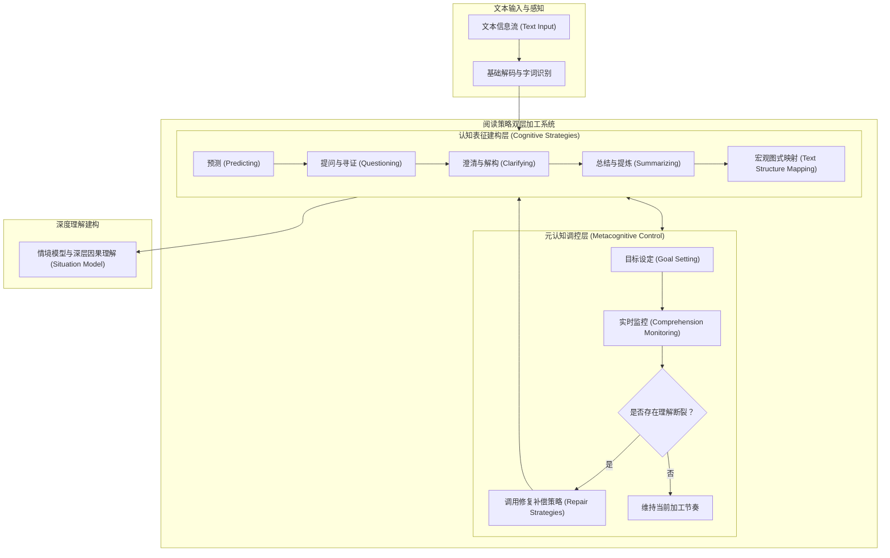

---

> [!def] Reading Strategies
> 阅读策略（Reading Strategies，在实证干预中常表述为阅读理解策略 Reading Comprehension Strategies）是指读者在阅读过程中，为建构文本意义、监控认知加工进程以及排除理解障碍而有意识调用的认知操作与[[Metacognition|元认知]]监控手段的总和。其核心操作包括预测（predicting）、提问（questioning）、澄清（clarifying）、总结（summarizing）、推论（inferencing）以及文本结构图式映射（text structure mapping）。实证综合表明，显性策略教学是提升中小学生阅读理解成效最具成本效益的教学干预之一。[[Argument_Chua_2011_CILP|(Chua, 2011)]]

> [!concept-lens] 概念透镜
> - **含义** 阅读策略兼具认知加工与元认知调节双重属性。[[Learning Strategies|认知策略]]直接操作文本信息以提取和重构[[Concept Mapping|命题网络]]；元认知策略则负责评估理解状态、侦测理解断裂并动态调用补偿手段。
> - **用途** 指导教师通过显性建模（explicit modeling）、出声思维（think-aloud）与渐退支架（gradual release of responsibility），帮助学童克服表层[[Decodification|解码]]瓶颈，迈向深度文本推论与批判性阅读。
> - **边界** 阅读策略是达成文本深度理解的[[Scaffolding|认知脚手架]]，本身非阅读目的；它依赖于基础字词解码与领域背景知识，不能脱离真实文本孤立演练为抽象套路。

> [!citation-card] 显性阅读策略教学的循证效应
> [[Education Endowment Foundation|教育捐赠基金会]]（EEF）与[[Visible Learning|可见的学习]]（[[Visible Learning Meta-X|Visible Learning MetaX]]）的全球证据库一致确证了阅读理解策略的显著增益：
>
> 显性教授预测、澄清、提问和总结等元认知阅读策略，能为中小学生带来平均 7 个月的额外学业进展（标准均差 SMD = 0.54），是基础教育阶段循证效益最高、实施成本最低的教学干预之一；将策略教学深度嵌入[[Whole Language|全语言]]真实语境与大书阅读，能同步达成高阶理解与标准化评估的高通过率。([[Argument_Chua_2011_CILP|Chua, 2011, pp. 142–144]]; EEF, 2026)

> [!boundary]- 概念边界
> - 不等于 **机械拼读技能（Phonics Decoding）** — 拼读关注字母与语音的低阶对应转换，解决“认读”障碍；阅读策略聚焦高阶语义整合与推论建构，解决“理解”障碍。
> - 不等于 **无意识的自动化阅读反应（Automatic Processing）** — 自动化熟练阅读依赖内化图式；阅读策略本质上属于在遭遇理解困难或面对复杂结构文本时有意识激活的审慎监控机制。
> - 不等于 **脱离文本的应试答题套路（Formulaic Test Drill）** — 策略教学以意义建构为导向，通过元认知监控赋能学习者自主阅读；应试套路则局限于特定题型的机械套用，无法迁移至开放真实阅读任务。

---

> [!contrast-table] 认知阅读策略、元认知策略与补偿性策略的对比
> | 策略维度 | 认知阅读策略 (Cognitive Strategies) | 元认知监控策略 (Metacognitive Strategies) | 补偿修复策略 (Compensatory Repair Strategies) |
> | :--- | :--- | :--- | :--- |
> | **核心机制** | 激活先验图式、提取主旨、构建命题网络 | 自我监控理解程度、设定阅读目标与加工速度 | 识别理解断裂、回读关键句段、借助工具破障 |
> | **典型操作** | 文本结构分析、关键信息摘要、因果推论 | 提问自测：“我是否真正读懂了这一段？” | 重读疑难句子、调整阅读速率、结合上下文推断词义 |
> | **心理负荷** | 占用[[Working Memory\|工作记忆]]进行语义表征建构 | 涉及[[Executive Function\|执行功能]]与高阶自我反思协调 | 触发认知控制，重组信息输入 |
> | **教学干预方式** | 概念图（Concept Mapping）、大纲提炼支架 | [[Reciprocal Teaching\|交互式教学]]（Reciprocal Teaching）、出声思维 | 引导自主纠错与多线索交叉验证 |

---

## 命题与机制

### 命题一：显性策略教学对中低年级阅读理解具有显著的因果促进效应

显性阅读策略教学通过教师示范建模、出声思维、结构化练习和渐进式支架撤除，直接降低了学习者在面对复杂文本时的认知加工阻抗。多项大规模[[Meta-analysis|元分析]]证实，显性策略干预不仅在[[Developer-Made Measures|研究者自编测验]]中表现出强效应，在标准化阅读评估中同样保持稳健增益。

> [!evidence-grid-a|notitle]
> - 影响机制：显性策略建模将不可见的[[Metacognition|元认知]]过程具象化，降低复杂语篇的[[Working Memory|工作记忆]]负荷，引导学生由被动接收转向主动意义求索。
> - 证据支撑：英国[[Education Endowment Foundation|教育捐赠基金会]]（EEF）涵盖 184 项[[Effect Size|效应量]]的元分析显示，阅读理解策略带来 +7 个月的进展（SMD = 0.54）；[[Visible Learning Meta-X|Visible Learning MetaX]] 汇总 13 项元分析（424 项研究，29,518 名学生），综合效应量达 $d = 0.45$。

### 命题二：元认知监控与多策略整合优于孤立单一策略训练

孤立操练单一策略（如仅做事实性提问）容易退化为机械程序套用；将预测、提问、澄清与总结融为一体的综合多策略教学（如[[Reciprocal Teaching|交互式教学]] Reciprocal Teaching），能有效激活不同认知层级之间的协同效应，促进元认知监控习惯的内化。

> [!evidence-grid-b|notitle]
> - 影响机制：多策略整合为学生提供了弹性的认知工具箱，促使学生依据文本类型（说明文、叙事文）与阅读目标动态切换策略，避免了单一策略失效时的认知瘫痪。
> - 证据支撑：Okkinga et al. (2018) 元分析（52 项干预，125 条效应量，平均 $d = 0.36$）表明，结合元认知自我调节的多策略干预效果显著优于孤立的技术性技能操练；在说明文阅读中，文本结构策略（Hebert et al., 2016, $d = 0.57$）与自我提问的结合展现出最高的因果乘数效应。

### 命题三：阅读策略与真实语境的嵌合能够破除机械应试并实现高标准化达标

传统应试导向将策略[[Alienation|异化]]为孤立的题型解题套路，导致学生在脱离练习册后丧失真实阅读能力。将策略教学有机嵌入[[Whole Language|全语言]]大书共享阅读与[[Language Experience Approach|语言经验法]]情境中，不仅能够唤醒儿童的文学兴趣与语用意识，而且在宏观标准化考核中能够保持高水平达标率。

> [!case] 新加坡 [[STELLAR Program|STELLAR]] 课程中的策略嵌入实践
> [[Singapore Ministry of Education|新加坡教育部]]在推行“[[Thinking Schools, Learning Nation|重思考的学校，好学习的国民]]”（TSLN）理念下，于 2006–2009 年全面实施小学英文“走向[[Active Learning|主动学习]]与阅读的英文学习”（STELLAR）改革。该方案破除以语法练习册为核心的[[Rote Learning|死记硬背]]模式，将显性阅读策略（预测、提问、图表组织、推论等）深度嵌入[[Shared Book Approach|大书共享阅读法]]（SBA）与修正语言经验法（MLEA）之中：
> - 教学实施：教师首先借助大书示范预测情节与文本结构分析，随后组织学生围绕共同生活经验开展写作与阅读迁移；
> - 评估结果：改革在彻底淡化传统试卷套路操练的同时，新加坡[[Primary School Leaving Examination|小学离校考试]]（[[Primary School Leaving Examination|PSLE]]）英文科及格率在全国推行期间保持在 97.5%–98.9% 的顶尖高位，证实了策略教学与语境阅读深度融合的高实效性。([[Argument_Chua_2011_CILP|Chua, 2011, pp. 142–144]])

> [!proposition-summary] 阅读策略核心命题推导
> | 命题阶段 | 核心机制 | 循证依据 | 实践价值 |
> | :--- | :--- | :--- | :--- |
> | **命题一：显性促进** | 显性建模降低认知负荷，外显元认知思维 | EEF SMD = 0.54 (+7月); MetaX $d = 0.45$ | 为困难读者提供可操作的理解[[Scaffolding\|脚手架]] |
> | **命题二：整合协同** | 预测-提问-澄清-总结四联操作激活动态调节 | Okkinga et al. (2018) $d = 0.36$; Hebert et al. (2016) $d = 0.57$ | 防止单一策略孤立操练导致的认知僵化 |
> | **命题三：语境嵌入** | 与大书共享及真实经验写作结合，实现高阶能力与应试表现双赢 | 新加坡 STELLAR 改革实践；PSLE 97.5%–98.9% 达标率 ([[Argument_Chua_2011_CILP\|Chua, 2011]]) | 打破“死记硬背提分 vs 综合素养育人”的二元对立假象 |

---

## 演进脉络

> [!dev-timeline] 阅读策略研究与实践的历史演进
> - **1970s–1980s 认知革命与[[Metacognition|元认知]]概念奠基** 从单纯的[[Behaviorism|行为主义]][[Decodification|解码]]转向认知信息加工观，Flavell 等确立元认知理论，Palincsar 与 Brown (1984) 开创[[Reciprocal Teaching|交互式教学]]，确立四大核心策略。
> - **1990s 策略教学的显性化与结构化** 直接解释模型（Direct Explanation Model）确立，策略由隐性顿悟转向可教、可学、可评估的系统教学干预。
> - **2000s 国家级读写工程与循证整合** 美国[[National Reading Panel|国家阅读委员会]]（NRP, 2000）将阅读理解策略列为早期阅读五大核心支柱之一；新加坡等国开展国家级课程改造（如 2006 年 STELLAR 试点）。
> - **2010s–2020s [[Meta-meta-analysis|二阶元分析]]与学科读写深化** [[Education Endowment Foundation|EEF]] 与 MetaX 完成大规模[[Meta-analysis|元分析]]汇总，证实策略干预的高效性；研究前沿转向学科特定阅读策略（Disciplinary Literacy）与数字多模态文本批判性加工。

---

## 争鸣与审思

> [!debates] 阅读策略教学的关键争鸣
> - **显性直接策略教学 vs 隐性文学浸润** 激进[[Whole Language|全语言]]派主张儿童在丰富文学体验中自然领悟阅读之道，反对将阅读拆解为策略步骤；认知心理学派与实证研究（如 [[Education Endowment Foundation|EEF]] 与 [[National Reading Panel|NRP]]）则明确反驳，缺乏显性策略支架会导致弱势背景学童陷入理解鸿沟。
> - **领域通用策略 vs 学科特定领域知识依附** 早期研究将总结、提问视为通用于所有语篇的“瑞士军刀”；认知科学家（如 Daniel Willingham）指出，策略只有在读者具备一定领域先验知识时才能生效，没有基础知识储备的纯策略操练往往收效甚微。

---

## 边界与局限

> [!warning|notitle]
> - **策略过度显性化的认知负荷反噬** 当教学将过多注意力集中在填写策略工作单（如机械填写预测表、[[Concept Mapping|概念图]]）时，[[Working Memory|工作记忆]]被策略外在程序占据，反而挤占了用于深层文本意义理解的心理资源。
> - **无法替代词汇量与广泛先验背景知识** 策略本质上是[[Scaffolding|认知支架]]与理解工具，而非输入材料。如果学习者对文本所涉关键术语及学科背景知识存在绝对盲区，任何[[Metacognition|元认知监控]]与推论策略均无法无中生有地产生理解。

---

## 证据与元分析

> [!metax-divider]

> [!metax] [阅读策略 · Reading strategies](https://www.visiblelearningmetax.com/influences/view/reading_strategies)
> 课程 › 读写与艺术
>
> | rate | ma | k | n | m | d | du | rob |
> | --- | --- | --- | --- | --- | --- | --- | --- |
> | ★★★☆ 加速 | 13 | 424 | 29,518 | 724 | 0.45 | 0.43 | ●●●●○ |
>
> > [!metax-ma]- 13 项
> > | ref | var | k | n | m | d | e |
> > | --- | --- | --- | --- | --- | --- | --- |
> > | Slavin et al. (2011) | Small group tutorials | 21 | 2,833 | 21 | 0.35 |  |
> > | Slavin et al. (2011) | Classroom Instructional Processes | 40 | 6,884 | 40 | 0.48 |  |
> > | Koufogiannakis & Wiebe (2006) | Teaching informational literacy | 8 | 408 | 8 | 0.09 |  |
> > | Slavin, Lake, Cheung, & Davis (2009b) | Instructional process programs in beginning reading | 44 | 14,556 | 44 | 0.32 |  |
> > | Taylor et al. (2006) | Explicit reading strategies in L2 | 23 | NA | 23 | 0.54 |  |
> > | Swanborn & de Glopper (1999) | Incidental word learning | 20 | 2,130 | 20 | 0.15 |  |
> > | Hebert et al. (2016) | Text structure on reading | 40 | NA | 170 | 0.57 |  |
> > | Filderman et al. (2018) | Data based decision making | 15 | NA | 46 | 0.24 |  |
> > | Bogaerds-Hazenberg et al. (2020) | Text structure on reading | 44 | NA | 44 | 0.30 |  |
> > | Okkinga et al. (2018) | Reading strategy interventions | 52 | NA | 125 | 0.36 |  |
> > | Tighe & Schatschneider (2016) | Reading skills | 16 | 2,707 | 74 | 1.04 |  |
> > | Filderman et al. (2022) | Reading comprehension interventions | 64 | NA | 64 | 0.59 |  |
> > | Maeng (2014) | Reading strategies | 37 | NA | 45 | 0.58 |  |

> [!eef-divider]

> [!eef] [阅读理解策略 · Reading comprehension strategies](https://educationendowmentfoundation.org.uk/education-evidence/teaching-learning-toolkit/reading-comprehension-strategies)
> EEF 教与学工具包 · 更新于 2026-07-22 · 小学 91 · 中学 80 · 阅读 179 · 科学 3
>
> | imp | cost | evi | n | smd | ci | i2 |
> | --- | --- | --- | --- | --- | --- | --- |
> | +7 个月 高影响 | ●○○○○ 极低 | ●●●○○ 中等 | 184 | 0.54 | 0.44 ~ 0.64 | 97% |
>
> > [!eef-studies]- 184 条效应量 · 166 项研究
> > | ref | type | smd | ci | w | e |
> > | --- | --- | --- | --- | --- | --- |
> > | Guastello (2000) | 期刊论文 | 5.92 | 5.09 ~ 6.74 | 0.4% |  |
> > | Pilten (2016) | 期刊论文 | 4.27 | 3.28 ~ 5.26 | 0.4% |  |
> > | Siregar (2020) | 期刊论文 | 3.57 | 2.36 ~ 4.77 | 0.3% |  |
> > | Gajria (1992) | 期刊论文 | 3.50 | 2.06 ~ 4.95 | 0.3% |  |
> > | Eissa (2012) | 期刊论文 | 3.21 | 2.44 ~ 3.98 | 0.4% |  |
> > | Çer (2016) | 期刊论文 | 3.06 | 2.33 ~ 3.79 | 0.4% |  |
> > | Othman (2014) | 期刊论文 | 2.69 | 1.97 ~ 3.41 | 0.4% |  |
> > | Yusuf (2013) | 期刊论文 | 2.62 | 1.92 ~ 3.31 | 0.5% |  |
> > | Bakken (1997) 1_a | 期刊论文 | 2.22 | 1.37 ~ 3.07 | 0.5% |  |
> > | Jitendra (2000) | 期刊论文 | 1.77 | 0.97 ~ 2.58 | 0.4% |  |
> > | Lovett (1996) | 期刊论文 | 1.57 | 0.73 ~ 2.40 | 0.4% |  |
> > | Nababan (2017) | 期刊论文 | 1.52 | 0.96 ~ 2.09 | 0.5% |  |
> > | Dimino (1990) | 期刊论文 | 1.41 | 0.62 ~ 2.20 | 0.4% |  |
> > | Wigfield (2008) 1_a | 期刊论文 | 1.41 | 1.06 ~ 1.75 | 0.9% |  |
> > | Bos (1990) | 期刊论文 | 1.40 | 0.70 ~ 2.10 | 0.5% |  |
> > | Miranda (1997) | 期刊论文 | 1.34 | 0.65 ~ 2.04 | 0.5% |  |
> > | Kula (2020) | 期刊论文 | 1.31 | 0.68 ~ 1.94 | 0.5% |  |
> > | Radcliffe (2008) | 期刊论文 | 1.30 | 0.68 ~ 1.92 | 0.5% |  |
> > | Payne (1992) | 期刊论文 | 1.29 | 0.48 ~ 2.10 | 0.4% |  |
> > | Williams (2016) | 期刊论文 | 1.26 | 0.24 ~ 2.28 | 0.4% |  |
> > | Dao (1993) | 学位论文 | 1.20 | 0.58 ~ 1.81 | 0.5% |  |
> > | Bakken (1997) 1_b | 期刊论文 | 1.19 | 0.48 ~ 1.91 | 0.6% |  |
> > | Tiruneh (2014) | 期刊论文 | 1.19 | 0.66 ~ 1.72 | 0.5% |  |
> > | Abu-Hamour (2013) | 期刊论文 | 1.11 | 0.58 ~ 1.64 | 0.5% |  |
> > | O'Hara (2007) | 学位论文 | 1.10 | 0.50 ~ 1.70 | 0.5% |  |
> > | Al-Alwan (2012) | 期刊论文 | 1.09 | 0.52 ~ 1.68 | 0.5% |  |
> > | Frances (1992) | 报告 | 1.09 | 0.42 ~ 1.76 | 0.5% |  |
> > | Kao (2015) | 学位论文 | 1.08 | 0.68 ~ 1.49 | 0.5% |  |
> > | Block (1993) | 期刊论文 | 1.04 | 0.81 ~ 1.26 | 0.6% |  |
> > | Hampson-Jones (2014) | 学位论文 | 1.03 | 0.41 ~ 1.65 | 0.5% |  |
> > | Berninger (2003) RC | 期刊论文 | 1.00 | 0.40 ~ 1.60 | 0.5% |  |
> > | Calhoon (2005) | 期刊论文 | 0.96 | 0.29 ~ 1.63 | 0.5% |  |
> > | King (1999) | 期刊论文 | 0.96 | 0.67 ~ 1.25 | 0.6% |  |
> > | Westera (1995) | 期刊论文 | 0.93 | 0.13 ~ 1.73 | 0.4% |  |
> > | Purwanto (2022) | 期刊论文 | 0.93 | 0.42 ~ 1.44 | 0.5% |  |
> > | Berkeley (2011) | 期刊论文 | 0.92 | 0.26 ~ 1.59 | 0.5% |  |
> > | Malone (1992) | 期刊论文 | 0.92 | 0.16 ~ 1.67 | 0.4% |  |
> > | Philbrick (2002) | 学位论文 | 0.88 | 0.43 ~ 1.32 | 0.5% |  |
> > | Somers (2010) | 报告 | 0.87 | 0.81 ~ 0.93 | 0.6% |  |
> > | Lederer (2000) | 学位论文 | 0.86 | 0.50 ~ 1.22 | 0.6% |  |
> > | Bossert (1996) | 期刊论文 | 0.85 | 0.12 ~ 1.58 | 0.4% |  |
> > | Munro (2011) 1_2 | 图书章节 | 0.85 | 0.43 ~ 1.27 | 0.5% |  |
> > | Stevens (1991) | 期刊论文 | 0.84 | 0.61 ~ 1.07 | 0.6% |  |
> > | Graham (1993) | 期刊论文 | 0.82 | 0.29 ~ 1.35 | 0.5% |  |
> > | Babuder (2015) | 期刊论文 | 0.82 | 0.20 ~ 1.44 | 0.5% |  |
> > | Putri (2018) | 期刊论文 | 0.82 | 0.19 ~ 1.45 | 0.5% |  |
> > | Loranger (1997) | 期刊论文 | 0.81 | 0.08 ~ 1.52 | 0.4% |  |
> > | Mason (2013) 1_a | 期刊论文 | 0.80 | 0.19 ~ 1.41 | 0.7% |  |
> > | Lightner (2010) | 学位论文 | 0.79 | 0.22 ~ 1.36 | 0.5% |  |
> > | Lau (2007) | 期刊论文 | 0.79 | 0.28 ~ 1.30 | 0.5% |  |
> > | Fuchs (1999) | 期刊论文 | 0.77 | 0.26 ~ 1.28 | 0.5% |  |
> > | Baumann (1992) | 期刊论文 | 0.77 | 0.15 ~ 1.38 | 0.5% |  |
> > | Kusriandi (2014) | 期刊论文 | 0.76 | 0.52 ~ 1.01 | 0.6% |  |
> > | Guthrie (2004) | 期刊论文 | 0.76 | 0.48 ~ 1.03 | 0.6% |  |
> > | Bos (1992) RC | 期刊论文 | 0.74 | −0.01 ~ 1.49 | 0.4% |  |
> > | Elbro (2013) | 期刊论文 | 0.73 | 0.45 ~ 1.02 | 0.6% |  |
> > | Moir (2020) | 期刊论文 | 0.72 | 0.24 ~ 1.19 | 0.5% |  |
> > | Aaron (2008) | 期刊论文 | 0.70 | 0.34 ~ 1.06 | 0.6% |  |
> > | Taylor (1992) | 期刊论文 | 0.70 | 0.36 ~ 1.04 | 0.6% |  |
> > | Griffin (1995) | 期刊论文 | 0.68 | 0.02 ~ 1.35 | 0.5% |  |
> > | Ng (2013) | 期刊论文 | 0.68 | 0.11 ~ 1.25 | 0.5% |  |
> > | Williams (1994) | 期刊论文 | 0.68 | 0.17 ~ 1.19 | 0.5% |  |
> > | Redford (2012) 1_2 | 期刊论文 | 0.65 | 0.15 ~ 1.16 | 0.5% |  |
> > | León (1995) | 期刊论文 | 0.65 | 0.15 ~ 1.15 | 0.5% |  |
> > | Nelson (2003) | 学位论文 | 0.65 | −0.01 ~ 1.30 | 0.5% |  |
> > | Houtveen (2007) | 期刊论文 | 0.64 | 0.47 ~ 0.81 | 0.6% |  |
> > | Keehn (2008) | 期刊论文 | 0.64 | −0.04 ~ 1.31 | 0.5% |  |
> > | Dole (1996) | 期刊论文 | 0.63 | 0.03 ~ 1.23 | 0.5% |  |
> > | Sason (2020) | 期刊论文 | 0.62 | 0.32 ~ 0.91 | 0.6% |  |
> > | Li (1996) | 学位论文 | 0.60 | −0.03 ~ 1.22 | 0.5% |  |
> > | Barth (2017) | 期刊论文 | 0.59 | 0.07 ~ 1.10 | 0.5% |  |
> > | Katims (1997) | 期刊论文 | 0.58 | 0.30 ~ 0.86 | 0.6% |  |
> > | Esser (2001) | 学位论文 | 0.58 | −0.05 ~ 1.21 | 0.5% |  |
> > | Unrau (1991) | 会议论文 | 0.56 | 0.13 ~ 0.99 | 0.5% |  |
> > | Alfassi (2004) | 期刊论文 | 0.54 | −0.04 ~ 1.12 | 0.5% |  |
> > | Gayo (2014) | 期刊论文 | 0.54 | 0.12 ~ 0.95 | 0.5% |  |
> > | Fuchs (2019) RC | 期刊论文 | 0.51 | 0.07 ~ 0.95 | 0.5% |  |
> > | Mason (2013) 1_b | 期刊论文 | 0.51 | −0.08 ~ 1.10 | 0.7% |  |
> > | Cash (2013) | 学位论文 | 0.50 | 0.16 ~ 0.84 | 0.6% |  |
> > | Klingner (2004) | 期刊论文 | 0.49 | 0.22 ~ 0.77 | 0.6% |  |
> > | Kim (2006) | 期刊论文 | 0.48 | −0.20 ~ 1.17 | 0.5% |  |
> > | Liu (2014) | 期刊论文 | 0.47 | −0.07 ~ 1.00 | 0.5% |  |
> > | Acmed-Ismael (2021) | 期刊论文 | 0.43 | −0.01 ~ 0.88 | 0.5% |  |
> > | Klingner (1998) | 期刊论文 | 0.43 | 0.09 ~ 0.77 | 0.6% |  |
> > | Tantowie (2022) | 期刊论文 | 0.42 | 0.03 ~ 0.82 | 0.5% |  |
> > | Fang (2010) | 期刊论文 | 0.42 | 0.16 ~ 0.69 | 0.6% |  |
> > | Lee (2014) | 期刊论文 | 0.42 | 0.04 ~ 0.81 | 0.5% |  |
> > | Lysynchuk (1990) | 期刊论文 | 0.42 | −0.04 ~ 0.89 | 0.5% |  |
> > | Sporer (2009) | 期刊论文 | 0.41 | 0.12 ~ 0.70 | 0.6% |  |
> > | McNamara (2006) | 期刊论文 | 0.40 | −0.23 ~ 1.04 | 0.8% |  |
> > | Burke (1992) RC | 学位论文 | 0.39 | −0.00 ~ 0.78 | 0.5% |  |
> > | Pečjak (2018) | 期刊论文 | 0.39 | 0.09 ~ 0.69 | 0.6% |  |
> > | Rauenbusch (1991) | 期刊论文 | 0.38 | −0.19 ~ 0.96 | 0.5% |  |
> > | Guthrie (2009) | 期刊论文 | 0.38 | 0.06 ~ 0.71 | 0.6% |  |
> > | Law (2008) | 期刊论文 | 0.38 | 0.11 ~ 0.64 | 0.6% |  |
> > | Ponce (2012) | 期刊论文 | 0.35 | 0.13 ~ 0.58 | 0.6% |  |
> > | Wijekumar (2013) | 期刊论文 | 0.35 | 0.16 ~ 0.54 | 0.6% |  |
> > | Guthrie (1998) | 期刊论文 | 0.35 | 0.06 ~ 0.64 | 0.6% |  |
> > | Janzen (2003) | 期刊论文 | 0.34 | −0.29 ~ 0.98 | 0.5% |  |
> > | Carriedo (1995) RC 1_1 | 期刊论文 | 0.34 | −0.38 ~ 1.07 | 0.4% |  |
> > | Boyle (1996) | 期刊论文 | 0.34 | −0.38 ~ 1.06 | 0.4% |  |
> > | Vaughn (2012) RC | 期刊论文 | 0.34 | −0.32 ~ 1.00 | 0.5% |  |
> > | McNamara (2006) | 会议论文 | 0.34 | 0.01 ~ 0.66 | 1.0% |  |
> > | Brand-Gruwel (1998) | 期刊论文 | 0.33 | 0.01 ~ 0.65 | 0.6% |  |
> > | Lovett (2012) | 期刊论文 | 0.33 | 0.08 ~ 0.58 | 0.6% |  |
> > | Carriedo (1995) RC 1_2 | 期刊论文 | 0.33 | −0.09 ~ 0.74 | 0.5% |  |
> > | Guthrie (1999) | 期刊论文 | 0.31 | 0.05 ~ 0.56 | 0.6% |  |
> > | Sato (1996) | 学位论文 | 0.30 | −0.02 ~ 0.62 | 0.6% |  |
> > | Peverly (2001) | 期刊论文 | 0.30 | −0.40 ~ 0.99 | 0.5% |  |
> > | Tomesen (1997) | 会议论文 | 0.29 | −0.42 ~ 1.00 | 0.5% |  |
> > | Meyer (2002) | 期刊论文 | 0.27 | −0.35 ~ 0.90 | 0.5% |  |
> > | De Corte (2001) | 期刊论文 | 0.26 | −0.01 ~ 0.54 | 0.6% |  |
> > | Uttero (1992) | 学位论文 | 0.26 | −0.03 ~ 0.56 | 0.6% |  |
> > | Chan (1991) | 期刊论文 | 0.26 | −0.25 ~ 0.77 | 0.5% |  |
> > | Armstrong (2000) | 学位论文 | 0.25 | 0.00 ~ 0.50 | 0.6% |  |
> > | McNamara (2006) | 期刊论文 | 0.24 | 0.01 ~ 0.48 | 1.1% |  |
> > | Cantrell (2010) | 期刊论文 | 0.24 | 0.01 ~ 0.47 | 0.6% |  |
> > | Redford (2012) 1_1 | 期刊论文 | 0.24 | −0.29 ~ 0.77 | 0.5% |  |
> > | Piercy (1997) | 学位论文 | 0.23 | −0.06 ~ 0.52 | 0.6% |  |
> > | Wijekumar (2014) | 期刊论文 | 0.22 | 0.14 ~ 0.30 | 0.6% |  |
> > | Vaughn (2000) | 期刊论文 | 0.22 | −0.16 ~ 0.59 | 0.5% |  |
> > | Takala (2006) | 期刊论文 | 0.21 | −0.47 ~ 0.90 | 0.5% |  |
> > | Johnson-Glenberg (2000) 1_a | 期刊论文 | 0.21 | −0.48 ~ 0.90 | 0.6% |  |
> > | Lubliner (2002) | 报告 | 0.21 | −0.20 ~ 0.61 | 0.5% |  |
> > | Wanzek (2011) | 期刊论文 | 0.21 | −0.15 ~ 0.57 | 0.6% |  |
> > | Villanueva (2014) | 学位论文 | 0.20 | 0.14 ~ 0.26 | 0.6% |  |
> > | Guthrie (2014) | 期刊论文 | 0.19 | 0.03 ~ 0.36 | 0.6% |  |
> > | Baumann (2002) | 期刊论文 | 0.18 | −0.42 ~ 0.78 | 0.5% |  |
> > | Souvignier (2006) | 期刊论文 | 0.18 | −0.07 ~ 0.43 | 0.6% |  |
> > | Faggella-Luby (2011) | 期刊论文 | 0.17 | −0.21 ~ 0.56 | 0.5% |  |
> > | Spires (1998) 1_1b | 期刊论文 | 0.16 | −0.37 ~ 0.69 | 0.5% |  |
> > | Jeffers (1990) | 学位论文 | 0.16 | −0.26 ~ 0.58 | 0.5% |  |
> > | Van Den Bos (1998) | 期刊论文 | 0.16 | −0.16 ~ 0.47 | 0.6% |  |
> > | Broer (2002) | 期刊论文 | 0.15 | −0.06 ~ 0.36 | 0.6% |  |
> > | Gee (1997) | 学位论文 | 0.15 | −0.34 ~ 0.64 | 0.5% |  |
> > | Thurston (2020) | 期刊论文 | 0.15 | −0.07 ~ 0.37 | 0.6% |  |
> > | Dehn (1997) | 报告 | 0.15 | −0.27 ~ 0.56 | 0.5% |  |
> > | Muijselaar (2016) | 学位论文 | 0.14 | −0.04 ~ 0.32 | 0.6% |  |
> > | Okkinga (2018) | 专著 | 0.14 | −0.07 ~ 0.35 | 1.0% |  |
> > | Anderberg (1996) | 学位论文 | 0.14 | −0.25 ~ 0.53 | 0.5% |  |
> > | Chamberlain (2007) | 期刊论文 | 0.13 | −0.06 ~ 0.33 | 0.6% |  |
> > | Vaughn (2010) | 期刊论文 | 0.12 | −0.11 ~ 0.36 | 1.0% |  |
> > | Cantrell (2016) 1_2 | 期刊论文 | 0.12 | 0.00 ~ 0.23 | 0.6% |  |
> > | Clarke (2010) RC | 期刊论文 | 0.12 | −0.49 ~ 0.72 | 0.5% |  |
> > | O'Connor (2017) | 期刊论文 | 0.11 | −0.29 ~ 0.51 | 0.5% |  |
> > | Vaughn (2011) | 期刊论文 | 0.11 | −0.03 ~ 0.25 | 0.6% |  |
> > | Crawford (2014) | 报告 | 0.09 | −0.04 ~ 0.22 | 0.6% |  |
> > | Karst (2022) | 期刊论文 | 0.09 | 0.07 ~ 0.11 | 0.6% |  |
> > | Cantrell (2014) | 期刊论文 | 0.09 | −0.05 ~ 0.22 | 0.6% |  |
> > | McCallum (2011) | 期刊论文 | 0.08 | −0.30 ~ 0.47 | 0.5% |  |
> > | Fogarty (2014) | 期刊论文 | 0.08 | −0.05 ~ 0.21 | 0.6% |  |
> > | Schünemann (2013) | 期刊论文 | 0.08 | −0.23 ~ 0.38 | 0.6% |  |
> > | Cantrell (2016) 1_1 | 期刊论文 | 0.08 | −0.04 ~ 0.20 | 0.6% |  |
> > | Bramlett (1994) RC | 期刊论文 | 0.08 | −0.12 ~ 0.27 | 0.6% |  |
> > | Simmons (2010) 1_b | 期刊论文 | 0.07 | −0.74 ~ 0.88 | 0.6% |  |
> > | Van Keer (2004) | 期刊论文 | 0.06 | −0.16 ~ 0.28 | 0.6% |  |
> > | Wigfield (2008) 1_b | 期刊论文 | 0.06 | −0.24 ~ 0.35 | 0.9% |  |
> > | van Keer (2010) | 期刊论文 | 0.05 | −0.18 ~ 0.28 | 0.6% |  |
> > | Spires (1998) 1_1a | 期刊论文 | 0.04 | −0.49 ~ 0.58 | 0.5% |  |
> > | Vaughn (2010) | 期刊论文 | 0.03 | −0.16 ~ 0.22 | 1.0% |  |
> > | Dynarski (2007) RC | 报告 | 0.03 | −0.05 ~ 0.11 | 0.6% |  |
> > | Rabren (1994) | 学位论文 | 0.02 | −0.60 ~ 0.64 | 0.5% |  |
> > | Bogaert (2023) | 期刊论文 | 0.00 | −0.09 ~ 0.09 | 0.6% |  |
> > | Simmons (2014) | 期刊论文 | −0.01 | −0.11 ~ 0.09 | 0.6% |  |
> > | Simmons (2010) 1_a | 期刊论文 | −0.03 | −0.56 ~ 0.51 | 0.7% |  |
> > | McKeown (2009) RC 1_2 | 期刊论文 | −0.03 | −0.48 ~ 0.42 | 0.5% |  |
> > | Denton (2017) | 期刊论文 | −0.10 | −0.78 ~ 0.59 | 0.5% |  |
> > | Johnson-Glenberg (2000) 1_b | 期刊论文 | −0.10 | −0.77 ~ 0.56 | 0.6% |  |
> > | McKeown (2009) RC 1_1 | 期刊论文 | −0.11 | −0.56 ~ 0.34 | 0.5% |  |
> > | Okkinga (2018) | 期刊论文 | −0.11 | −0.43 ~ 0.21 | 0.9% |  |
> > | Spires (1998) 1_2b | 期刊论文 | −0.11 | −0.54 ~ 0.32 | 0.5% |  |
> > | Andreassen (2011) | 期刊论文 | −0.12 | −0.41 ~ 0.17 | 0.6% |  |
> > | Munro (2011) 1_1 | 图书章节 | −0.14 | −0.38 ~ 0.10 | 0.6% |  |
> > | Bruce (2001) | 期刊论文 | −0.18 | −0.74 ~ 0.39 | 0.5% |  |
> > | Spires (1998) 1_2a | 期刊论文 | −0.22 | −0.65 ~ 0.21 | 0.5% |  |
> > | Alfassi (1998) | 期刊论文 | −0.23 | −0.73 ~ 0.27 | 0.5% |  |
> > | Leu (2005) | 报告 | −0.24 | −0.82 ~ 0.34 | 0.5% |  |
> > | Hedin (2008) | 学位论文 | −0.28 | −0.93 ~ 0.36 | 0.5% |  |
> > | Moore (1995) | 期刊论文 | −0.30 | −0.92 ~ 0.31 | 0.5% |  |
> > | Kärbla (2023) | 期刊论文 | −0.32 | −0.73 ~ 0.10 | 0.5% |  |
> > | Lucariello (2012) | 期刊论文 | −0.32 | −0.91 ~ 0.26 | 0.5% |  |
> > | Spires (1998) 1_2c | 期刊论文 | −0.36 | −0.82 ~ 0.10 | 0.5% |  |
> > | Jenkins (2009) | 学位论文 | −0.41 | −0.95 ~ 0.12 | 0.5% |  |
> > | Elledge (2013) | 学位论文 | −0.83 | −1.19 ~ −0.46 | 0.6% |  |

---

## 关联图谱

> [!entry-map]
> - 上位领域：[[Whole Language|全语言]] · [[Early Literacy Approaches|早期读写教学]]
> - 核心机制：[[Metacognition|元认知]] · [[Working Memory|工作记忆]] · [[Scaffolding|支架式教学]]
> - 教学模式：[[Language Experience Approach|语言经验法]] · [[Rote Learning|机械学习]]对比
> - 改革实践与评估：[[Thinking Schools, Learning Nation|TSLN]] · [[Primary School Leaving Examination|PSLE]] · [[Argument_Chua_2011_CILP|Chua (2011) 新加坡 STELLAR 政策]]
