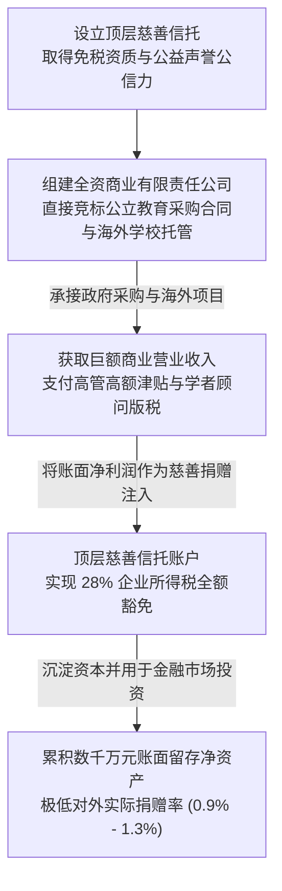

# Dual-Entity Legal Structure

## 概念内涵与制度起源

**双层法人架构（Dual-Entity Legal Structure）**，在教育政治经济学与非营利法研究中亦称**双层公司架构（Dual-Corporate Structure）** 或**慈善控股商业套利架构**，是指由顶层享有免税特权的非营利性“注册慈善信托”（Charitable Trust），全资控股底层一家或多家“营利性商业有限责任公司”（Commercial Company Limited by Shares）所形成的混合型法人治理形态。

该架构在战后西方福利国家向新自由主义治理转型的过程中逐步扩散，尤其在基础教育与公共服务外包领域被各类[[Educational Management Organisation|教育管理组织]]（Educational Management Organisations, EMOs）广泛采用。在新西兰梅西大学学者[[John O'Neill|约翰·奥尼尔]]等（[[Argument_ONeill_2016_Report|O'Neill et al., 2016]]）的系统实证审计中，双层法人架构被定性为现代教育管理组织借助慈善法漏洞，在免税与公益外衣掩护下实施制度套利、实现对公立学校公共财政资金“净抽取”（Net Extraction）的核心组织工具。

---

## 制度成因：法规漏洞与免税特权

双层法人架构之所以能够在公立教育领域大行其道，植根于特定国家非营利立法对教育类慈善实体的宽泛界定与规制滞后（以新西兰《2005年慈善法》与《1957年慈善信托法》为典型代表）：

1. **慈善宗旨的无限延伸** 法律将“促进教育”（Advancement of Education）列为法定四大慈善宗旨之一，但对何为“促进”缺乏严格的实体性标准，允许咨询、培训与技术研发等高度商业化的营利中介轻松注册为慈善信托；
2. **全资控股商业子公司的合法性** 法规允许注册慈善信托设立 100% 全资持股的营利性有限责任公司，只要该商业公司的章程宣称其最终利润将用于支持母体信托的慈善宗旨；
3. **缺乏法定强制最低支出比例** 与美国法律强制要求私人基金会每年必须支出至少 5% 资产用于公益资助不同，新西兰等国慈善法并未设立最低年度慈善支出率（Minimum Payout Rate），导致信托可以将巨额商业利润长期沉淀在账户中用于再投资或金融投机；
4. **信息披露的双重保护屏障** 底层商业公司受商业保密法规保护，母体慈善信托则享有非营利自律保护，二者均完全不受《官方信息法》（Official Information Act, OIA）等政府信息无条件公开法规的约束。

---

## 运作机制：四步闭环资本流转

在实际运作中，双层法人架构构建起一套精密的资本、声誉与税收流转流程：

### 1. 取得慈善资质，获取合法性外衣
发起人设立非营利慈善信托，向国家慈善服务局（Charities Services）申请注册。信托由此享有免征企业所得税资格，并获得“非营利、促进教育公益”的崇高社会公信力。

### 2. 设立商业子公司，竞标政府采购业务
母体信托全资成立商业有限责任公司，以独立法人身份参与教育部[[Informationalization|信息化]]、教师专业学习与发展（PLD）资格招标、公私合营（[[Public-Private Partnership|PPP]]）项目以及海外公立学校商业托管合同。在此过程中，商业公司凭借母体的学术与慈善背景获取巨大竞标优势。

### 3. 免税转移利润，规避企业所得税
在财务年度结算时，底层商业公司扣除全职雇员工资、高管薪酬与付给学术顾问（如付给约翰·海蒂的巨额版税与顾问费）后，将剩余的全部账面营业利润，以“免税慈善捐赠”（Charitable Donation）的名义全额上缴给母体信托，从而合法规避本应向国家缴纳的法定企业所得税（新西兰为 28%）。

### 4. 巨额资产内部沉淀，象征性对外捐赠
母体信托收到免税资金后，并不大规模向基层贫困公立学校发放助学金，而是将资金留存在账面上委托金融市场进行资本运作或购买不动产。对外实际发放的公益捐赠常年仅维持在微乎其微的象征性水平（占年收入的 1% 左右），实质上形成了高额财富在信托体系内部的封闭自我循环。

---

## 典型组织实证对照

在新西兰[[Endogenous and Exogenous Privatisation|教育私有化]]的实证审计中（[[Argument_ONeill_2016_Report|O'Neill et al., 2016]]），两大本土核心[[Educational Management Organisation|教育管理组织]]完整展示了双层法人架构的财务运作特征：

| 组织实体与双层架构 | 商业营运规模（2015） | 内部利润转移与免税特征 | 累计留存净资产（2015） | 实际对外教育捐赠（2015） | 实际捐赠占总营收比 |
|---|---|---|---|---|---|
| **科认知教育 ([[Cognition Education]])** 信托控股商业咨询公司 | **NZD 28,092,285** （历史峰值达 6915 万） | 商业公司累计向信托免税捐赠近千万；常年为董事与外部学者支付数十万顾问费 | **NZD 18,229,723** （从 2009 年 1090 万逐年累积推高） | **NZD 251,826** （主要用于象征性奖学金） | **0.9%** |
| **核心教育 (CORE Education)** 信托全资控股商业有限公司 | **NZD 22,748,538** （承揽教育部数字研训项目） | 营收绝大部分直接来自教育部公共合同；高管津贴年近百万 | **NZD 4,086,858** （信托承接资产后迅速累积） | **NZD 295,814** （极微量回馈外部系统） | **1.3%** |

---

## 政策社会学批判：三重制度套利特权

在批判政策社会学与公共治理[[Theoretical Perspective|理论视角]]下，双层法人架构对战后普遍主义公费教育体系造成了深层制度侵蚀：

### 1. 规避公共税负与侵蚀国家公共财力
[[Educational Management Organisation|教育管理组织]]凭借慈善信托的外壳，将本应作为企业所得税上缴国家国库的巨额商业利润予以合法免除。这意味着由纳税人出资的公共教育预算，不仅被转化为私营中介的营业收入，还失去了通过二次税收调节回流公共财政的可能性。

### 2. 架空《官方信息法》与民主问责真空
公立学校通常受严格的信息公开法案规制，公众与工会可以依法调阅学校经费使用细节。然而，一旦业务转包给双层法人 EMO，这些机构便能以“商业敏感信息”和“慈善信托内部事务”为由拒绝向公众披露合同内部成本构成、跨国分包细节与高管薪酬明细。表面上公共采购引入了市场竞争，实质上政策决策退入了半公开甚至私密的“部落式”圈子，彻底剥夺了公民社会的民主监督权。

### 3. 公立教育资源的资本“净抽取”
政策制定者常以“引入社会慈善力量能为公立学校带来外部资源增量”为由推行外生私有化。然而实证审计证实，双层法人 EMO 并不向学校引入外部私人财富，反而是一个纯粹的**资本净抽取者（Net Extractor of Public Funds）**——它们依靠公费教育合同汲取数千万元预算，向外部公立体系返还的实际价值微乎其微，直接动摇了国家保障免费义务公立教育的社会契约。

---

## 关键引用

> [!citation-card] 双层法人套利与资本净汲取的制度本质
> 相比于纯粹的外部救济慈善机构，无论营利性还是非营利性的[[Educational Management Organisation|教育管理组织]]（EMO），它们从公立学校系统取走的资金，可能远远超过其以转包服务和纯正慈善捐赠形式所返还的价值……双层实体将营利性商业公司作为非营利慈善信托的全资子公司运营，既能够通过国家采购竞标争夺营业额，又能借助信托的免税与商誉优势将巨额利润留存于内部资本增殖，而对外发放的实质性慈善回馈常年不足营业总额的百分之一。（[[Argument_ONeill_2016_Report|O'Neill et al., 2016, pp. 18]], 25–26, 47–53）

---

## 条目关联

### 核心概念与制度机制
- [[Educational Management Organisation]]
- [[Endogenous and Exogenous Privatisation]]
- [[Network Governance]]
- [[New Public Management]]
- [[Public-Private Partnership]]
- [[Venture Philanthropy]]

### 典型案例实体
- [[Cognition Education]]
- CORE Education

### 关键学者与批判理论
- [[Stephen Ball]]
- [[John Hattie]]
- [[Bureaucracy]]

---

