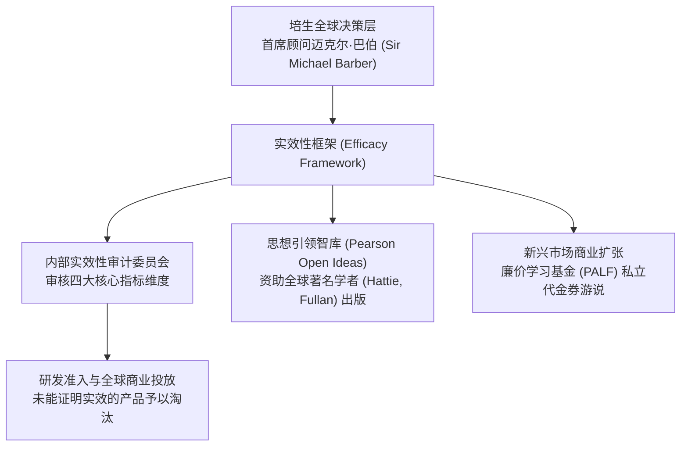

# Efficacy Framework

## 概念内涵与起源

**实效性框架（Efficacy Framework）**，亦称**培生实效性框架（Pearson Efficacy Framework）**，是全球最大的跨国教育出版与[[Comprehensive Education|综合教育]]服务财团培生集团（Pearson plc）于 2013 年正式推行的一套全球商业产品审计与质量问责体系。

该框架由培生首席教育顾问[[Michael Barber|迈克尔·巴伯]]爵士（Sir [[Michael Barber]]）一手设计并主导推进。作为新工党首相交付组（PMDU）与“交付学”（Deliverology）体系的奠基人，巴伯将公共行政部门的目标驱动因果问责理念全面移植至跨国商业财团的研发体系中。培生集团公开做出战略承诺：到 2018 年，培生在全球市场上所销售的全部数字化软件、教科书、测评系统与教师培训项目，都必须经过独立“实效性审计”（Efficacy Review），并向公众发布其在促进学生学习成效（Learning Outcomes）方面的可测量因果实证报告（[[Argument_ONeill_2016_Report|O'Neill et al., 2016]]，pp. 11, 77–81）。

在批判政策社会学与教育全球化视野中，实效性框架被视为跨国资本重构全球教育政策[[Discourse|话语]]的里程碑事件，标志着跨国出版巨头从单纯的“教材供应商”转向能够界定并垄断“何为有效教育”（What Works）的跨国[[Policy Entrepreneur|政策创业者]]。

---

## 运作机制：审计矩阵与智库互锁

实效性框架在跨国公司内部与外部[[Policy Network|政策网络]]中构建了精密的治理闭环：

### 1. 实效性审计的四大核心维度
培生要求所有商业产品在推向全球市场前，必须通过由实效性审计团队基于量规评定的四大维度审核：
1. **预期学习成效（Intended Outcomes）** 该产品是否明确界定了可测量的核心学生素养与学业进步指标；
2. **因果实证支持（Evidence Base）** 该产品的教学设计是否建立在严格的同侪评议研究、[[Randomised Controlled Trials|随机对照试验]]（RCT）或高置[[Reliability|信度]]实证数据之上；
3. **实施规划与保真度（Implementation Plan）** 是否为学校和教师提供了保障方案[[Implementation Fidelity|实施保真度]]（Implementation Fidelity）的标准化培训工具；
4. **交付能力与监测体系（Capacity to Deliver）** 是否有能力在实际教学现场持续收集学生的学习过程数据并动态反馈。

### 2. 外部学术背书与智库思想渗透
为树立客观、崇高的实证科学声誉，培生设立了由外部国际权威学者组成的实效性咨询委员会，并在出版物中大量致谢包括约翰·海蒂（[[John Hattie]]）与彼得·希尔（Peter Hill）在内的顶尖学者。同时，培生通过其全资设立的开放思想（Pearson Open Ideas）智库丛书，资助全球教育思想领袖（如[[Michael Fullan|迈克尔·富兰]]、海蒂等）撰写前沿政策报告，巧妙地将学术前沿探讨与培生自身倡导的数字化自适应系统、测评产品及实效标准深度绑定。

### 3. 支撑廉价私立教育的跨国扩张
实效性框架不仅用于欧美成熟市场的公立采购竞标，还被培生廉价学习基金（Pearson Affordable Learning Fund, PALF）作为开拓全球南方新兴市场的核心正当性工具。培生在加纳、肯尼亚、印度等国大举投资营利性连锁私立学校（如 Bridge International Academies），并援引实效性框架发布评估简报，声称其低成本流水线式教学相较于当地公费薄弱学校具有更高的成效，进而强力游说各国政府推行教育代金券（Vouchers）制度，将国家公共财政转移给私营办学财团。

---

## 政策社会学批判：技术理性壁垒与政府采购垄断

在批判教育社会学家[[Stephen Ball|斯蒂芬·鲍尔]]（[[Stephen Ball]]）与新西兰学者[[John O'Neill|约翰·奥尼尔]]等（[[Argument_ONeill_2016_Report|O'Neill et al., 2016]]）的研究中，实效性框架被解构为跨国资本推行行业垄断与意识形态霸权的高阶工具：

### 1. 打造跨国资本的“排他性技术壁垒”
实效性审计要求产品必须具备极为昂贵的因果实验数据、大规模追踪统计软件与持续数据采集基础设施。这一极高的合规门槛，实际上将绝大多数缺乏雄厚资本支持的本土中小型出版机构、草根教研团体以及公立大学[[Normal School|师范学院]]彻底挤出了竞争通道。跨国资本通过制定所谓的“科学实效标准”，成功构建了排他性壁垒，垄断了各级政府的公共采购大单。

### 2. 循证话语的商业霸权与工具理性异化
实效性框架假定教育过程的优劣可以被完全还原为标准化的数字涨落。在这种狭隘的[[Technical Rationality|技术理性]]（[[Technical Rationality]]）支配下：
- 能够被轻松量化测试的机械技能被置于优先地位，而无法短期量化的公民素养、批判反思与审美体验被边缘化；
- 跨国公司通过自我资助、自我审计、自我发布的闭环流程，将商业促销材料伪装成中立的科学循证报告（[[Evidence-Based Education]]），削弱了公众对教育商品化本质的警惕。

### 3. 公共教育主权的让渡
当国家教育部和公立学校系统普遍接受跨国公司的实效性框架作为采购的金标准时，公共教育改革的议程设置权已经悄然发生了制度性转移。国家不再自主定义什么是优良的教育，而是被动接受由跨国跨界咨询顾问与跨国集团所界定的“有效性”标准，导致普遍主义公共教育的民主政治属性被彻底置换为市场绩效逻辑。

---

## 关键引用

> [!citation-card] 培生的实效性审计与智库思想领导力策略
> 在首席教育顾问[[Michael Barber|迈克尔·巴伯]]爵士的领导下，培生推行了新的‘实效性’（Efficacy）倡议……该框架要求所有商业产品都必须出具提升学生学习成效的实证依据。与此同时，培生通过其‘开放思想’（Open Ideas）系列智库丛书，资助全球知名学者（包括致谢约翰·海蒂与彼得·希尔），将商业产品包装为无可辩驳的客观科学法则，并在全球范围内积极游说将公共教育经费转化为私立代金券。（[[Argument_ONeill_2016_Report|O'Neill et al., 2016, pp. 11]], 77–81）

---

## 条目关联

### 核心思想与主导人物
- [[Michael Barber]]
- [[John Hattie]]
- [[Stephen Ball]]

### 治理逻辑与分析透镜
- [[Evidence-Based Education]]
- [[Governing by Numbers]]
- [[Performance Indicators]]
- [[New Public Management]]
- [[Technical Rationality]]
- [[Discourse]]
- [[Policy Entrepreneur]]

### 组织与制度载体
- [[Educational Management Organisation]]
- [[Endogenous and Exogenous Privatisation]]
- [[Education Endowment Foundation]]

---

