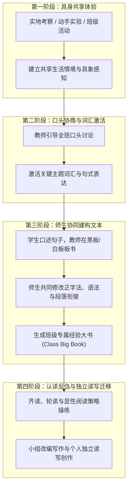

---

> [!def] Language Experience Approach
> 语言经验法（Language Experience Approach, LEA）是一种将学习者自身的真实生活经历与口语表达作为读写学习基底的[[Early Literacy Approaches|早期读写教学]]方法。该方法由 R. V. 艾伦（R. V. Allen, 1964）系统阐述，其核心命题在于将听、说、读、写有机融合，主张儿童从自身说出并由教师记录的文本开始阅读，从而在个人意义、语音与书面符号之间建立自然连接。在国家级课程政策中，该方法常被调整为“修正语言经验法”（Modified Language Experience Approach, MLEA），通过集体共享体验、同伴协商与结构化支架，支撑二语学习者的书面语发展。[[Argument_Chua_2011_CILP|(Chua, 2011, pp. 142–143)]]

> [!concept-lens] 概念透镜
> - **含义** 学习者的真实口头经验是阅读理解与书面写作的源头。阅读教学从儿童自身的言说记录展开，使书面语直接显现为自身思想的具象载体。
> - **用途** 适用于学前、低年级早期识字以及第二语言初学者。通过“经验图表”（Experience Charts）与小组共同写作，帮助学习者平滑跨越口语与学术书面语之间的认知鸿沟。
> - **边界** 语言经验法长于激发表达意愿、建立表意自信与自然识字；但在成体系的规则拼读教学与复杂跨学科文本的解构方面，需要与其他[[Explicit Teaching Strategies|显性教学策略]]互补。

> [!citation-card] 语言经验法的四大发展连续体
> 艾伦（Allen, 1964, p. 59）从儿童认知与语言发展的连续性出发，确立了语言经验法的底层逻辑：
>
> 1. **从思想到言说** 我能想的，就能说（*What I can think about, I can talk about.*）；
> 2. **从言说到记录** 我能说的，就能写（*What I can say I can write.*）；
> 3. **从记录到阅读** 我能写的，就能读（*What I can write, I can read.*）；
> 4. **从自我到他人** 我能读自己写的，也能读别人为我写的（*I can read what I can write and what other people can write for me to read.*）。
>
> 新加坡教育部在 [[STELLAR Program|STELLAR]] 课程中将其拓展为“修正语言经验法”（MLEA），通过“共同体验 $\to$ 课堂口头讨论 $\to$ 师生共建文本 $\to$ 个人独立写作”的四步循环，使经典经验法成功服务于标准化国家考试下的二语读写教学。([[Argument_Chua_2011_CILP|Chua, 2011, pp. 142–143]])

> [!boundary]- 概念边界
> - 不等于 **完全自由无序的儿童即兴涂鸦** — 语言经验法虽然以学生口语为基础，但高度依赖教师在共建板书过程中的规范化示范与正字法支架。
> - 不等于 **全盘否定系统技能的极端建构** — 修正语言经验法（MLEA）与大书共享阅读法（SBA）结合，兼具真实语境浸润与显性[[Reading Strategies|阅读策略]]和基础词汇教学。
> - 不等于 **[[Whole Language|全语言]]（Whole Language）** — 语言经验法诞生于 1960 年代，以学生自身口语[[Transcription in Qualitative Research|转录]]文本为核心；全语言成型于 1970 年代中后期，强调以真实优秀的专业儿童文学作品为核心，二者在证据谱系与教学载体上存在明确差异。

---

> [!contrast-table] 语言经验法、全语言与直接拼读法的对比
> | 对比维度 | 语言经验法 (LEA / MLEA) | 全语言 (Whole Language) | 系统直接拼读法 (Systematic Phonics) |
> | :--- | :--- | :--- | :--- |
> | **诞生时期** | 1960 年代初（以 Allen, 1964 为代表） | 1970 年代中后期（1976 年标志性兴起） | 20 世纪中叶（[[Behaviorism\|行为主义]]与[[Direct Instruction\|直接教学]]传统） |
> | **教学材料** | 学生自身口语经历转录的经验图表、师生共建文本 | 优秀的真实儿童文学大书、未分级完整绘本 | 人工编写的受控拼读读本、字母卡片与练习册 |
> | **学习路径** | 经历体验 $\to$ 口语讨论 $\to$ 师生共写 $\to$ 认读 | 宏观文学浸润 $\to$ 语境猜测 $\to$ 意义建构 | 音位意识 $\to$ 字音对应规则 $\to$ 机械拼读操练 |
> | **二语适应性** | 极高（MLEA 通过共享体验拉平先验背景差异） | 需大量优质语言输入支持，二语弱势生易遇瓶颈 | 规则清晰但易脱离语义语境，引发[[Rote Learning\|机械学习]] |

---

## 命题与机制

### 命题一：基于学习者真实口语经验的文本生成能够消除符号异化并确立学习所有权

传统识字教学往往直接将儿童抛入陌生的外在标准化文本中，容易引发读写恐惧与心理[[Alienation|异化]]。语言经验法通过[[Transcription in Qualitative Research|转录]]学生亲口说出的句子，确保了阅读材料中的概念、句法与词汇完全处于学习者的[[Zone of Proximal Development|最近发展区]]之内。

> [!evidence-grid-a|notitle]
> - 影响机制：当阅读材料源于学习者亲历的生活事件与自身言语时，儿童无需克服概念陌生的额外认知负荷，能够直接将精力聚焦于“口语声音”向“书面字形”的符号对应映射。
> - 理论支撑：艾伦（Allen, 1964）的四个连续体揭示了自我思想向他人交流文本转化的发生学规律；学习者通过阅读自己的言说，建立起对书面语言的掌控感与内在主体性。

### 命题二：二阶元分析中的时代错置与分类污染扭曲了早期识字实证效应

在当代[[Evidence-Based Education|循证教育]]与[[Meta-meta-analysis|二阶元分析]][[Document|文献]]中，语言经验法常被粗暴等同于[[Whole Language|全语言]]，导致实证证据库遭受了严重的分类污染与历史错位。

> [!critique-method] Stahl and Miller (1989) 与[[John Hattie|哈蒂]]可见学习中的分类混淆
> - **[[Steven Stahl|史蒂芬·斯塔尔]]的分类混淆** 斯塔尔与米勒（Stahl and Miller, 1989）在全语言[[Meta-analysis|元分析]]中，明知两者存在重要差异，却仍将它们强行合并为“全语言/语言经验法”计算[[Effect Size|效应量]]，导致 1960 年代（全语言尚未问世）的传统经验图表研究被算作全语言证据。
> - **后续修正与哈蒂的未纠遗漏** 斯塔尔等人在[[Cumulative Innovation|后续研究]]（Stahl et al., 1994）中明确承认将两者混为一谈是时代错误的（anachronistic），并在新研究中剔除了纯语言经验法文献。然而，[[John Hattie|约翰·哈蒂]]在《[[Visible Learning|可见的学习]]》中合成数据时，却直接沿用了 1989 年包含混淆数据的原始效应量。
> - **典型污染案例**Brazziel and Terrell (1962) 针对田纳西州 26 名低收入非裔一年级学童的[[Behaviorism|行为主义]]阅读准备训练，仅因教师使用了反映儿童分享的“经验图表”，就被贴上语言经验法标签，进而被算作全语言效应量。麦基与洛马斯（McGee & Lomax, 1990）与奥康纳（[[Argument_OConnor_2020_AJLL|O'Connor, 2020]]）明确指出，检验语言经验法的结果绝不能用于对全语言进行因果推论。

### 命题三：修正语言经验法（MLEA）与共享阅读的嵌合构成了国家二语读写工程的有效支架

在多语种与移民背景为主的教育体系中，原始语言经验法易受学生家庭背景与口语水平差异的制约。通过引入班级“共同体验”（Shared Experience）进行修正，能够拉平先验知识不均，为二语学习者提供强大的读写支架。

> [!case] 新加坡 [[STELLAR Program|STELLAR]] 课程中的修正语言经验法（MLEA）实践
> 新加坡教育部推行的“走向[[Active Learning|主动学习]]与阅读的英文学习”（STELLAR）改革将修正语言经验法作为核心支柱：
> - 实施架构：低年级（小一至小三）先由教师开展大书共享阅读法（SBA），激发语境兴趣并示范[[Reading Strategies|阅读策略]]；紧接着开展 MLEA，全班共同参与一项具体活动（如制作三明治、参观动物园、[[Observation Method|科学观察]]），随后经历“口语讨论 $\to$ 共同板书撰写 $\to$ 班级共读 $\to$ 个人独立写作”；
> - 政策效能：该模式消除了外在机械练习册导致的[[Rote Learning|死记硬背]]与应试倦怠，同时有力保障了国家统考质量，[[Primary School Leaving Examination|小学离校考试]]（[[Primary School Leaving Examination|PSLE]]）英文科及格率稳定维持在 97.5%–98.9% 的卓越区间。([[Argument_Chua_2011_CILP|Chua, 2011, pp. 142–144]])

> [!proposition-summary] 语言经验法核心命题推导
> | 命题阶段 | 核心机制 | 理论与循证依据 | 政策与实践意义 |
> | :--- | :--- | :--- | :--- |
> | **命题一：经验生成** | 自我言说转化为书面符号，降低符号异化 | Allen (1964) 四大连续体 | 保护早期识字者的[[Student Motivation\|学习动机]]与所有权 |
> | **命题二：辨析纠偏** | 解构元分析中的时代错置与概念混淆 | Stahl et al. (1994); [[Argument_OConnor_2020_AJLL\|O'Connor (2020)]] | 澄清实证证据库，避免因全语言争论误伤经验法 |
> | **命题三：修正支架** | 共享活动拉平先验鸿沟，协同板书打通二语写作 | 新加坡 STELLAR MLEA 实践 ([[Argument_Chua_2011_CILP\|Chua, 2011]]) | 为非母语国家基础教育提供制度化[[Paradigm\|范式]] |

---

## 演进脉络

> [!dev-timeline] 语言经验法的历史演进
> - **1960 年代 奠基与确立** R. V. Allen 提出语言经验法理论与四大发展连续体，作为替代传统商业分级读本（Basal Readers）的进步主义阅读方案。
> - **1970 年代–1980 年代 拓展与概念重叠** 广泛应用于学前教育与特殊教育；随着[[Whole Language|全语言]]运动崛起，二者在反对机械拼读操练的立场上形成联盟，但在教学材料选择上产生分歧。
> - **1989 年–1994 年 [[Meta-analysis|元分析]]争议与辨正**Stahl 与 Miller (1989) 的合并统计引发学界批判；Stahl et al. (1994) 正式承认分类时代错误，划清经验法与全语言的界线。
> - **2000 年代至今 修正语言经验法（MLEA）与二语工程化** 新加坡等国家将其进行制度化再设计，融入国家二语课程标准（[[STELLAR Program|STELLAR]]），实现大规模课堂应用。

---

## 争鸣与审思

> [!debates] 语言经验法的关键学术争鸣
> - **语言规范性 vs 儿童真实方言表达** 批评者担忧若完全记录儿童带有方言俚语或语法错误的口语，会阻碍标准书面语习得；经验法学者强调初学阶段意义表达优先，教师可在共建板书时进行温和的规范化引导，而非粗暴否定。
> - **经验识字 vs 系统拼读技能教学** 语音学派认为单纯依赖经验词汇无法建立系统的字母-字音对应[[Decodification|解码]]规则；现代平衡读写倡导者主张将经验法作为语义和动机支架，辅以适度的显性音位教学。

---

## 边界与局限

> [!warning|notitle]
> - **词汇与句式复杂度的天花板** 生成的文本受限于班级学生的口语词汇与日常经历，若长期局限于此，学童难以接触高级书面书面语与复杂的学科结构，必须配合优质文学大书阅读拓展。
> - **大[[Class Size|班额]]教学下的个体参与衰减** 在集体共建文本环节，表达活跃的学生容易主导板书内容，性格内向或语言发展迟缓的儿童可能沦为被动旁观者，需要教师细致分组与轮换提问。

---

## 关联图谱

> [!entry-map]
> - 上位[[Paradigm|范式]]：[[Early Literacy Approaches|早期读写教学]] · [[Constructivist Paradigm|建构主义]]
> - 核心关联概念：[[Whole Language|全语言]] · [[Reading Strategies|阅读策略]] · [[Rote Learning|机械学习]]对比
> - 政策实践与实证批判：[[Thinking Schools, Learning Nation|TSLN]] · [[Primary School Leaving Examination|PSLE]] · [[Argument_Chua_2011_CILP|Chua (2011) 新加坡 STELLAR 政策]] · Stahl [[Meta-analysis|元分析]]辨正
