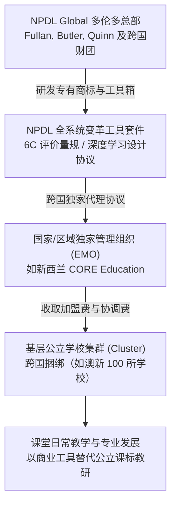

# New Pedagogies for Deep Learning

## 概念内涵与起源

**深度学习新教学法（New Pedagogies for Deep Learning, NPDL）**，亦称**深度学习全球伙伴关系（NPDL Global）**，是由加拿大教育学者[[Michael Fullan|迈克尔·富兰]]（[[Michael Fullan]]）、格雷格·巴特勒（Greg Butler）与乔安妮·奎因（Joanne Quinn），联合英特尔（Intel）、微软（Microsoft）、普罗米休斯（Promethean）等跨国科技企业以及[[OECD|经合组织]]（[[OECD]]）代表，于 2012 年在加拿大多伦多发起设立的全球性教育变革与教学法加盟网络。

该倡议在商标上将自身界定为“全球伙伴关系”（Global Partnership），其官方愿景是通过识别并推广能够有效培育 21 世纪[[21st Century Skills and Competencies Discourse|关键能力]]的创新教学模式，使每一位学生均能获得“深度学习”（Deep Learning）体验。然而，在批判政策社会学与教育政治经济学视角下，NPDL 亦被视为跨国教育企业、科技巨头与[[Policy Entrepreneur|政策创业者]]（[[Policy Entrepreneur]]）联手将公共教学实践包装为排他性商业特许工具（Proprietary Pedagogy）的代表性[[Paradigm|范式]]（[[Argument_ONeill_2016_Report|O'Neill et al., 2016]]）。

---

## 核心架构：6C 深度学习素养模型

NPDL 将深度学习界定为“使学生能够创造并运用新知识、并在真实复杂世界中实现意义建构的过程”，其[[Didaktik|教学理论]]支柱由著名的 **6C [[21st Century Skills and Competencies Discourse|核心素养]]框架（6Cs Deep Learning Competencies）** 构成：

| 核心素养维度 | 官方能力界定 | 教学与行为特征 |
|---|---|---|
| **[[Creativity\|创造力]]（Creativity）** | 提出新颖视角并付诸实践的能力 | 具备经济与社会创业意识、能够提出非常规问题、追求创新设计并勇于试错。 |
| **[[Critical Thinking\|批判性思维]]（Critical Thinking）** | 理性评估信息并有效解决复杂问题的能力 | 项目规划与管理、基于证据进行逻辑推演、辨别偏差并在模糊情境中决策。 |
| **沟通（Communication）** | 针对不同受众进行多模态有效表达的能力 | 掌握口头、书面与数字化视听叙述技能、具备倾听能力并能基于反馈动态调整交流方式。 |
| **协作（Collaboration）** | 在多元异质团队中有效运作并协同领导的能力 | 展现人际社交智能、能够协调群体冲突、承担团队共同责任并在协同中实现集体创造。 |
| **品格（Character）** | 面对挑战时保持坚毅、[[Learner Autonomy\|自主学习]]与道德责任的能力 | 具备坚韧不拔的意志品质、同理心、诚信素养、个人好奇心以及自我调控的[[Lifelong Learning\|终身学习]]习惯。 |
| **公民素养（Citizenship）** | 理解全球复杂互联并致力于可持续发展的责任感 | 尊重多元文化与历史遗产、具备全球视野、积极参与社区与生态关怀并追求社会公平。 |

在教学法实施层面，NPDL 主张通过重构四大教学支柱实现课堂转型：
1. **新型学习伙伴关系（Learning Partnerships）** 打破传统的师生单向讲授等级，构建师生、同伴与社群导师之间的协同共生关系；
2. **重塑学习环境（Learning Environments）** 打通物理教室与虚拟学习空间，建立安全且富有挑战性的探索氛围；
3. **数字技术的无缝融合（Leveraging Digital）** 不把技术作为炫目的辅助工具，而是作为学生开展知识探究、创意原型制造与全球协同的放大器；
4. **真实情境教学设计（Pedagogical Practices）** 以解决现实世界[[Wicked Problem|复杂社会难题]]（Real-world [[Problem Solving]]）为学习任务驱动。

---

## 运作机制：工具套件与特许加盟模式

与其他学术性[[Didaktik|教学理论]]不同，NPDL 采取了高度工业化与商业特许加盟（Commercial Franchising）的系统推进流程：

### 1. 全系统变革工具套件（Suite of Tools）
NPDL 为加盟学校提供标准化的知识产权工具，包括：
- **深度学习进展量表（Deep Learning Progressions）** 将 6C 能力分解为初学者、进阶者、[[Refined Mastery|精通]]者等具体行为观察锚点；
- **学习设计协议（Learning Design Collaborative Protocol）** 指导教师依据 NPDL 标准编写单元教案；
- **学校与集群自评工具箱（System/Cluster Self-Assessment Tools）** 按四级指标测定全校各学科的深度学习实施度。

### 2. 跨国集群收费与合约捆绑结构
根据梅西大学针对新西兰基础[[Endogenous and Exogenous Privatisation|教育私有化]]的实证审计记录（[[Argument_ONeill_2016_Report|O'Neill et al., 2016]]，pp. 41–43），NPDL 的市场扩张具有严密的合同约束与财政抽取特征：
- **准入门槛** NPDL 要求参与学校必须以集群（Cluster）形式集体加入，每个集群的最低规模原则上不少于 100 所学校。在 2014 年引入新西兰时，本土[[Educational Management Organisation|教育管理组织]]核心教育（CORE Education）将新西兰本地的 7 所中小学与澳大利亚维多利亚州的 80 所学校及塔斯马尼亚州的 20 所学校强行打包，凑足百校指标以建立跨国集群；
- **排他性年费** 加盟学校必须签订为期 3 年的排他性合约，每年向 NPDL 全球总部缴纳 2,000 美元（USD）的全球倡议会费，并向本土代理商（CORE Education）缴纳 3,000 新西兰元（NZD）的项目协调与技术支持费；
- **校内人力与经常性开支绑定** 学校必须专门配置建议为 0.2 FTE（全职等效）的专职教师或校级领导负责协调，并自行承担教师脱产参与 NPDL 集训的带薪代课开销以及参与特定商业研讨会（Special Events）的差旅支出。2016 年在新西兰基督城建立的 Kahukura NPDL 集群即涵盖了 8 所公立中小学与 20 所学前教育机构。

---

## 政策社会学批判：专有品牌化与资本汲取

在新西兰等国的教育政策实证研究中，NPDL 的模式引发了教育社会学家关于公立教育公共性与治理透明度的严肃批判：

### 1. 公共课标的专有化替代与学术话语套利
报告指出，NPDL 所宣称的 6C 能力，在本质上与新西兰教育部官方颁布的《[[The New Zealand Curriculum|新西兰课程]]标准》（The New Zealand Curriculum 2007）中的五大[[21st Century Skills and Competencies Discourse|核心素养]]（思维、使用语言符号与文本、自我管理、人际关系、参与和贡献）存在高度同质性。然而，跨国咨询公司与学者通过注册商业商标（TM），将本属于公共领域的课程概念重新包装为带有排他性专有权的产品，声称唯有购买其整套流程与软件套件方能真正“实现变革”。

### 2. 教育管理组织（EMO）对公共教研财政的垄断
在新西兰，NPDL 的落地全权由商业咨询机构 CORE Education 垄断代理。CORE Education 表面上是注册慈善信托旗下的非营利分支，实质上是一家高度依赖教育部公共采购合同的商业咨询公司。商业中介借助各学校享有的国家“教师专业学习与发展”（PLD）政府补贴，游说基层公立学校采购 NPDL 套件，使大量公共教育经费以会员费和咨询费的形式流入商业中介与跨国咨询集团手中，并未转化为基层公立师范机构的教研能力积淀。

### 3. 教师专业自主权的去专业化（De-professionalisation）
NPDL 虽然高举“教师作为变革主体”的旗帜，但通过标准化进展量规与规范化的设计协议，将复杂的教学艺术降格为对跨国商业量表的打卡与格式套用。教师的专业反思被框定在 NPDL 设定的词汇表之内，实质上服从于由跨国科技巨头与管理咨询专家制定的[[Technical Rationality|技术理性]]逻辑。

---

## 关键引用

> [!citation-card] 专有商标、跨国特许与公立学校集群的资金绑定
> NPDL 通过其商标将自身界定为一个‘全球伙伴关系’，并宣称致力于通过识别促进深度学习能力的教学法来改变学习……为了在新西兰推行 NPDL，CORE Education 将新西兰的 7 所学校与澳大利亚维多利亚州的 80 所及塔斯马尼亚州的 20 所学校联合打包（NPDL 全球集群的最低门槛为 100 所学校），并自此在新西兰进一步扩张。参与学校被强制要求签订为期三年的承诺协议，每年需缴纳 2,000 美元参与全球倡议，外加 3,000 新西兰元以覆盖本地协调支持成本，同时还需承担人员外出的代课支出与建议 0.2 FTE 的领导协调职数。（[[Argument_ONeill_2016_Report|O'Neill et al., 2016, pp. 24–25]], 42–43）

---

## 条目关联

### 核心创始人与思想源流
- [[Michael Fullan]]
- [[Surface and Deep Learning]]
- Whole System Change
- Capacity Building

### 跨国同构现象与商业品牌
- [[Visible Learning]]
- [[John Hattie]]
- [[Michael Barber]]
- [[Cult of the Guru]]

### 政策网络与治理载体
- [[Educational Management Organisation]]
- CORE Education
- [[Policy Entrepreneur]]
- [[Policy Network]]
- [[Teacher Professional Agency]]
- [[New Public Management]]

---

