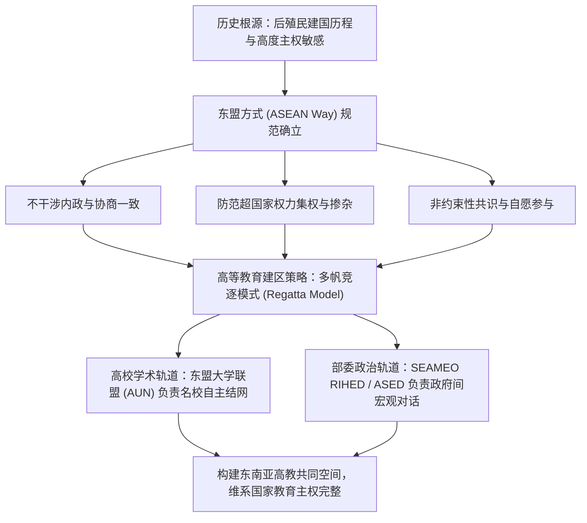

---

> [!def] ASEAN Way
> [[ASEAN|东盟]]方式（ASEAN Way）是[[ASEAN|东南亚国家联盟]]（Association of Southeast Asian Nations, ASEAN）在长期多边互动中确立的区域治理与外交规范；该规范以严格尊重国家主权、不干涉内部事务、非正式磋商、非对抗性沟通以及协商一致（Consensus-building）为根本准则。在高等教育及社会文化政策协调中，东盟方式表现为排斥设立具有法律拘束力或执法裁判权的超国家集权机构，主张依托自愿结网与功能性机构分工推进务实合作。[[Argument_Chou_2017_PolSoc|(Chou & Ravinet, 2017, p. 152)]]

> [!concept-lens] 概念透镜
> - **含义** 指向东南亚国家在多边多层治理中以维系国家独立主权为绝对红线、采用柔性协商化解分歧的制度化行为代码与规范文化。
> - **用途** 帮助研究者透视东南亚为何在经济与社会一体化进程中持续保持低度法制化与去中心化特征，解释其教育政策协调为何长期采取松散网络分工而非集权式制度整合。
> - **边界** 严格区别于具有强制约束力的[[EU|欧洲共同体]]一体化方法（Community Method）；东盟方式绝不包含将主权让渡给超国家行政法庭或独立官僚机构的法定机制。

> [!citation-card] 关键表述：东盟方式及其对组织分工的制度约束
> 与欧洲一体化及其总体上强调建立独立超国家机构并在各领域采纳约束性规则不同，东盟合作侧重于为成员国之间的建设性交流搭建平台并达成非约束性共识。这种被称为‘东盟方式’的合作风格，以非正式性、不干涉国家内部事务、非对抗性协商以及将协商一致作为主要决策模式为特征……受访者反复提及东盟方式及其历史遗产是造成东南亚[[Global Regionalisms|高等教育区域主义]]呈现出独特组织分工（即 [[ASEAN University Network|AUN]] 与 [[SEAMEO RIHED|RIHED]] 并立）的根本原因；这种方式反映了成员国普遍希望避免国家官员与东盟代表之间产生任何潜在的决策权力掺杂。[[Argument_Chou_2017_PolSoc|(Chou & Ravinet, 2017, p. 152)]]
>
> *Unlike European integration and its overall emphasis on establishing independent supranational institutions and adopting binding rules in a variety of sectors (higher education being an exception), ASEAN cooperation has been on developing platforms for constructive exchanges among its member states (Dosch, 2011) and generating non-binding consensus. Known as the ASEAN Way, this style of cooperation is characterised by informality, non-interference in national affairs, non-confrontational consultation and consensus building as the main mode of decision-making (Koga, 2010). ... Our interviewees repeatedly referred to the ASEAN Way, and the region's historical legacy, as responsible for the singular organisational division of labour – i.e. AUN and RIHED – for South-East Asian higher education regionalism. This approach reflects participating member states' general preference to prevent any potential co-mingling of decision-making powers between state officials and ASEAN representatives.*

> [!boundary]- 概念边界
> - **区分于 欧洲共同体一体化方法（Community Method）** 共同体方法依托[[European Commission|欧洲联盟委员会]]垄断立法提案权、欧洲议会审议及[[Court of Justice of the European Union|欧洲法院]]做出终审司法裁决；东盟方式坚持协商一致，任何单一成员国均对重大决议拥有事实否决权，不存在具有法律强制力的超国家执法实体。
> - **区分于 现实主义传统权力均势（Realist Balance of Power）** 传统权力均势依赖纯粹的军事同盟对峙与零和博弈；东盟方式包含了深厚的非正式外交社交礼仪、关系维持（Face-saving）与渐进信任构建等[[Constructivist Paradigm|建构主义]]规范维度。
> - **区分于 彻底无作为的消极隔离** 东盟方式专注于在不侵犯成员国宪制底线的前提下开展自愿协作、经验分享与技术互惠。

---

> [!contrast-table] 概念辨析
> | 维度 | 东盟方式（ASEAN Way） | 欧洲共同体方法（Community Method） | 威斯特伐利亚传统主权秩序（Westphalian Order） |
> |---|---|---|---|
> | **核心决策法则** | 协商一致（Consensus）、无投票表决 | 特定多数表决制（QMV）、法案强制实施 | 绝对主权独立、无超国家协调意愿 |
> | **规范导向** | 不干涉内政、非正式磋商、关系维护 | 规则法治化（Rule of Law）、权利让渡 | 国家利益至上、领土排他性边界维护 |
> | **治理机构形态** | 去中心化的分散功能网络、轮值主席制 | 拥有立法提案与执法垄断权的超国家官僚实体 | 各自独立的国家主权官僚机器 |
> | **高教政策实践** | AUN（名校结网）与 RIHED（部委平台）二元分立 | 欧洲联盟委员会主导的[[Open Method of Coordination\|开放协调法]]与量化监测基准 | 严格封闭的国内学制与排他性国家文凭管控 |

---

> [!feature] 核心要素
> - **不干涉国家内部事务（Principle of Non-Interference）** 成员国对近代殖民历史具有深刻的历史记忆，将国家主权防卫置于首位，坚决禁止多边机制评判或干预各国内部制度安排。[[Argument_Chou_2017_PolSoc|(Chou & Ravinet, 2017, p. 152)]]
> - **协商一致与非正式磋商（Consensus-Building and Informality）** 避免进行公开发生阵营对立的举手表决，倾向于在会前通过闭门非正式磋商化解矛盾，以最大公约数形成非约束性政治声明。[[Argument_Murray_Moxon-Browne_2013_JCMS|(Murray & Moxon-Browne, 2013, pp. 524–525)]]
> - **防范超国家权力掺杂（Prevention of Power Co-Mingling）** 严格警惕国际公务员或常设秘书处擅自攫取政策裁量权，坚决切断国家部委决策权威与超国家代理人混合决策的制度通道。
> - **双轨功能性组织分工（Dual-Track Functional Division of Labour）** 在高等教育领域体现为由[[ASEAN University Network|东盟大学联盟]]承担顶尖高校间的微观学术合作与学分试点，由[[SEAMEO RIHED|东南亚教育部长组织高教中心]]承担政府间宏观多边对话，两机构平行协作、互不统属。

> [!logic-map]- 东盟方式的规范生成与高教治理分工结构

---

> [!concept-proposition] 命题一｜[[ASEAN|东盟]]方式的协商一致与非干涉准则塑造了东南亚去中心化的多轨高教治理架构
> **区域外交准则对微观专业部门治理形态的制度塑造** 考察[[ASEAN|东盟]]宏观行为准则如何传导至教育领域，形塑去集权化的组织形态。

> [!claim] Chou, M.-H. and Ravinet, P.
> **治理准则决定去中心化分工体系** 周孟娴与宝琳·拉维内（Meng-Hsuan Chou & Pauline Ravinet）实证指出，东盟方式在东南亚高等教育领域的具体体现，根植于对建立集权型超国家管理机构的高度制度警惕。在不干预内政与非正式磋商原则的主导下，东南亚国家走出了一条立足项目载体、由成员国自愿参与（case-by-case）的多元网络路径；这一柔性治理形态使区域合作能够规避成员国之间巨大的体制与发展[[Heterogeneity|异质性]]，以务实兼容达成多边共识。[[Argument_Chou_2017_PolSoc|(Chou & Ravinet, 2017, pp. 151–154)]]

> [!claim] Dang, Q. A.
> **自愿协调机制对主权防卫与空间构建的平衡** 邓桂英（Que Anh Dang）指出，东盟方式的不干涉与协商一致规范直接孕育了高等教育领域的自愿协调（voluntary coordination）机制。东南亚国家将“趋同协调（harmonisation）”重塑为区别于欧洲强制一体化的非约束性政策话语，依托弱连接非正式网络在严格捍卫国家教育主权的前提下推进跨国学分互认与资格对齐，使东盟方式转化为支撑区域高等教育空间渐进建构的合法性规范基础。[[Argument_Dang_2017_ORE|(Dang, 2017, pp. 420–425)]]

---

> [!concept-proposition] 命题二｜主权防卫逻辑驱动区域功能机构形成二元分立以阻隔部委公权与跨国代理人的权力掺杂
> **防范超国家集权的组织隔离屏障** 揭示主权国家如何通过功能机构刻意分立，阻断跨国官僚机构向国内教育事务的权力渗透。

> [!claim] Chou, M.-H. and Ravinet, P.
> **组织二元分立防范官僚权力掺杂** 周孟娴与宝琳·拉维内的访谈研究揭示，东南亚高等教育合作中 [[ASEAN University Network|AUN]]（高校联盟）与 [[SEAMEO RIHED]]（政府间高教中心）的长期并立，是东盟方式在主权防卫逻辑下的自觉制度设计。成员国教育部委深恐超国家常设官僚机构借助一体化进程变相侵夺本国法定教育大权；通过将高校微观学术协作（AUN）与政府间宏观政策研讨（RIHED）严格剥离在两个平行机构内，成员国有效切断了部委官方决策权与东盟派驻代表权力发生混同（co-mingling）的潜在制度缝隙，从组织根基上捍卫了[[State Educational Sovereignty|国家教育主权]]。[[Argument_Chou_2017_PolSoc|(Chou & Ravinet, 2017, p. 152)]]

---

> [!concept-proposition] 命题三｜消极不干涉导致发展分立并诱发对外部新殖民力量的多边依附
> **去殖民反思与重塑** 揭示东盟方式早期防范干涉的主权防御机制如何在冷战与全球化进程中固化为国家优先的离散格局，进而为外部新殖民力量渗透提供缝隙。

> [!claim] Indrarajah, T.
> **消极不干涉内生碎片化依附风险** 蒂内什·因德拉拉贾（Tinesh Indrarajah）运用批判性政策分析指出，东盟方式确立的不干涉内政与协商一致准则，最初作为二战后新兴独立国家防范邻国过度干涉的正当反殖机制而确立。然而在冷战及后续发展竞争中，这一原则演化为向内看与国家利益绝对优先的自保心态，在客观上复刻了殖民时代的“分而治之”割裂状态。这种各自为战的离散格局，使东南亚高等教育难以形成强大的内生协作网络，反而对欧美与东亚外部大国的新殖民议程产生多边依附；亟需融入 [[Sejahtera]]、巴布亚社会生态学与 [[Kapwa]] 等本土哲学，推动东盟方式由消极互不干涉转向主动互助、资源再平衡与本土人才培育的去殖民新范式。[[Argument_Indrarajah_2026_NJCIE|(Indrarajah, 2026, pp. 4–13)]]

---

> [!contrast-table] 所有命题归纳
| 命题类型 | 核心指向 | 适用情境 | 代表学者 |
|---|---|---|---|
| **架构塑造机制** | 协商一致原则塑造了以自愿和项目为基础的去中心化合作形态 | 东南亚多边治理、区域公共政策分析 | [[Argument_Chou_2017_PolSoc\|Chou and Ravinet (2017)]]; [[Argument_Dang_2017_ORE\|Dang (2017)]]; Koga (2010) |
| **主权隔离机制** | 通过机构功能平行并立阻断超国家集权侵蚀国家法定权力 | [[Comparative Regionalism\|比较区域主义]]、行政权力防卫制度设计 | [[Argument_Chou_2017_PolSoc\|Chou and Ravinet (2017)]]; Narine (2008) |
| **去殖民重塑机制** | 消极不干涉的离散效应加剧外部依附，需依托本土哲学转向主动互助 | 高等教育去殖民化、地缘政治与区域公共治理 | [[Argument_Indrarajah_2026_NJCIE\|Indrarajah (2026)]]; Nkrumah (1965) |

---

> [!dev-timeline] 概念演变
- **1967 — 《曼谷宣言》签署与机制创立** 印度尼西亚、马来西亚、菲律宾、新加坡与泰国签署宣言创立东盟，正式确立不干预内政与和平共处的区域行为准则。
- **1976 — [[Treaty of Amity and Cooperation in Southeast Asia|《东南亚友好合作条约》]]法典化** 正式将主权平等、领土完整、不干预内政与协商一致上升为全域具有根本约束力的准则性共识。
- **1992–1993 — 高教领域双轨制度化确立** 东盟成立 AUN 推进名校自主学术结网，[[SEAMEO]] 重启 RIHED 推进政府间高教对话，东盟方式在教育部门确立起组织分工架构。
- **2007–2008 — [[ASEAN Charter|《东盟宪章》]]出台与主权共识再确认** 宪章虽赋予东盟国际法主体资格，但严格维系协商一致原则；同期 RIHED 报告重申坚持东盟方式、抵制照搬欧洲集权模型。
- **2015–至今 — 面向共同空间的务实自愿衔接** 在[[ASEAN Economic Community|东盟经济共同体]]（AEC）建成背景下，东盟方式保障了各国在维系主权的前提下以技术兼容推动高教共同空间建设。[[Argument_Chou_2017_PolSoc|(Chou & Ravinet, 2017, pp. 152–154)]]
- **2017 — 趋同协调话语与东盟方式高教实践结合** 邓桂英（[[Argument_Dang_2017_ORE|Dang, 2017]]）揭示趋同协调在东南亚被赋予积极内涵，作为东盟方式在高等教育领域的具体载体，依托弱连接非正式网络推进自愿渐进整合（pp. 422–425）。
- **2026 — 去殖民视角下的反思与重塑** 学界从认识论去殖民化视角反思东盟方式在高等教育治理中的局限，主张融入 Sejahtera 与 Kapwa 等本土哲学，以资源再分配与本土人才内生循环重构区域认同。[[Argument_Indrarajah_2026_NJCIE|(Indrarajah, 2026, pp. 12–15)]]

---

> [!debates|notitle] 学术争议
>
> > [!axis] 柔性协商的稳固韧性 vs 危机应对的制度效能
> > 探讨缺乏超国家裁判权与法律硬约束的东盟方式在深层危机面前是否具备有效的治理能力。
> >
> > - **批判立场（现实主义与制度主义学派）** 认为东盟方式的协商一致准则往往导致政策沦为最低公约数，缺乏硬性制裁使区域合作在面临地缘摩擦或深层利益分歧时陷入行动迟缓。[[Argument_Dang_2017_ORE|(Jones, 2010, cited in Dang, 2017, p. 421)]]
> > - **辩护立场（建构主义与柔性区域化学派）** 指出在体制与文化极端异质的多边环境中，柔性协商有效避免了成员国破裂，通过不设定强制裁判维护了长期的战略互信与和平合作环境。[[Argument_Dang_2017_ORE|(Stubbs, 2009; Dang, 2017, p. 421)]]

---

> [!warning|limits] 适用局限
> - **政策执行赤字风险** 协商一致形成的政治共识不具备国内司法强制力，合作成效高度依赖各成员国自觉推动国内法规调整，面临政策落地缓慢或落地悬空的风险。
> - **权力不平等下的弱者沉默** 在自愿参与原则下，教育资源薄弱的落后成员国可能因缺乏技术与财力支持而边缘化，加剧区域内部发展水平的不均衡。[[Argument_Dang_2017_ORE|(Dang, 2017, p. 425)]]

---

> [!entry-map] 条目关联
>
> | 条目 | 类型 | 关系 |
> |:-----|:-----|:-----|
> | [[ASEAN]] | 事实 | 孕育、践行并制度化确立东盟方式的核心区域组织。 |
> | [[ASEAN University Network]] | 事实 | 在东盟方式指导下由 30 所顶尖大学组成的务实学术结网轨道。 |
> | [[SEAMEO RIHED]] | 事实 | 在东盟方式指导下负责政府间宏观高教政策研讨与多边对话的轨道。 |
> | [[Southeast Asian Higher Education Common Space]] | 事实 | 在东盟方式原则下探索建立的非强制、多元包容的区域高教空间。 |
> | [[State Educational Sovereignty]] | 概念 | 东南亚国家在践行东盟方式时最为敏感且寸步不让的宪制主权底线。 |
> | [[Global Regionalisms\|Higher Education Regionalism]] | 概念 | 东盟方式在具体政策部门产生深远塑造作用的研究对象领域。 |
> | [[Sejahtera]] | 概念 | 支撑重塑东盟方式、推动全人身心平衡与本土人才培养的马来本土哲学。 |
> | [[Kapwa]] | 概念 | 支撑重塑东盟方式、推动平权协商与跨梯队资源分享的菲律宾本土伦理。 |
> | [[Epistemic Coloniality]] | 概念 | 东盟方式在高等教育领域面对外部依附时亟需消解的隐性知识霸权。 |
> | [[Comparative Regionalism]] | 理论 | 将东盟方式作为非西方区域一体化独特样本进行理论解析的分析框架。 |
> | [[Decolonial Geopolitics of Knowledge]] | 理论 | 提供批判性审视东盟方式地缘演进与知识自主权的宏观分析视角。 |

---

> [!evidence-grid-a|notitle] 相关研究索引
> - [[Argument_Chou_2017_PolSoc|Chou and Ravinet (2017)]] — 实证阐明东盟方式如何作为核心解释变量，驱动东南亚高等教育区域主义形成独特的 AUN-RIHED 双轨组织分工。
> - [[Argument_Dang_2017_ORE|Dang (2017)]] — 分析东盟方式在高等教育领域的趋同协调机制，揭示非正式协商与弱连接网络如何推动东南亚形成求同存异的区域教育认同。
> - [[Argument_Indrarajah_2026_NJCIE|Indrarajah (2026)]] — 从认识论去殖民化视角批判东盟方式消极不干涉对区域高教一体化的阻滞，提出融合本土哲学以推动跨国资源再分配的新范式。
> - [[Argument_Murray_Moxon-Browne_2013_JCMS|Murray and Moxon-Browne (2013)]] — 比较东盟常驻代表委员会与欧洲常设代表委员会，剖析东盟方式对微观外交官社交网络与裁量权的制约。
