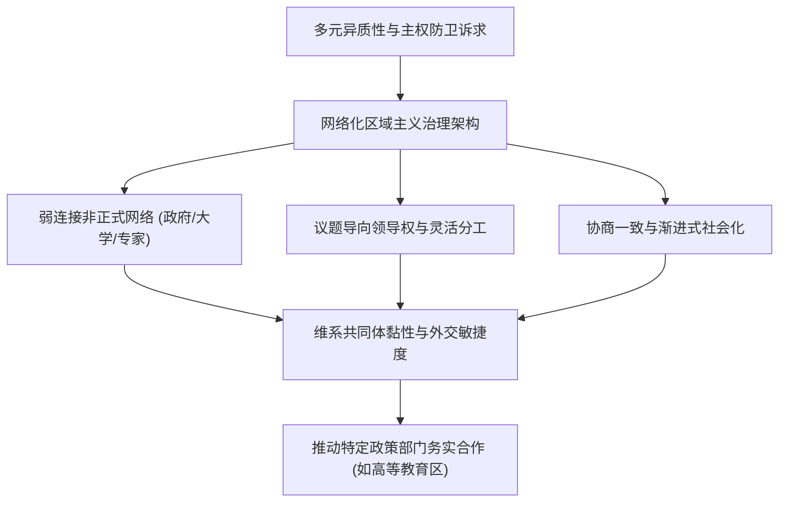

---

> [!def] Networked Regionalism
> 网络化区域主义（Networked Regionalism）是一种以去中心化网络结构、低度制度化约束与多元行动者协商互动为特征的柔性跨国治理形态。与建立在超国家实体、法定条约和裁判权之上的制度化区域主义（Institutional Regionalism）不同，网络化区域主义排斥紧密的科层层级与强制性制裁机制，依托涵盖政府官员、大学网络、智库学者与社会组织的非正式工作网络展开协调。通过发挥弱连接（Weak ties）在弥合多元群体与构筑战略互信中的功能，该模式使内部发展水平、政治制度与文化传统高度异质的成员国能够在应对外部地缘压力时保持外交敏捷性，以开放、包容和议题导向的领导权协同推进区域建构。[[Argument_Dang_2017_ORE|(Dang, 2017, pp. 420–421)]]

> [!concept-lens|notitle] 概念透镜
> - **含义** 强调以松散非正式关系网络与功能性协商替代具有超国家强制力的法定制度一体化。
> - **用途** 解释东南亚国家联盟（Association of Southeast Asian Nations, ASEAN）、东盟与中日韩（ASEAN+3）及亚欧会议（Asia-Europe Meeting, ASEM）为何能在成员国体制异质性极高且缺乏强制执行实体的条件下维持长期稳定合作。
> - **边界** 区别于拥有超国家立法与司法裁判权的欧洲式制度化区域主义，同时区别于完全缺乏多边规范基础的纯粹双边临时外交交易。

> [!citation-card] 约瑟夫·约论网络化区域主义与弱连接治理
> 网络化区域主义以行动者及其网络之间充斥的弱连接为核心特征。在网络化区域主义中，不存在紧密的科层层级；内部与外部的主要特征表现为磋商与协调。跨群体网络同时连接个人与组织（如政策共同体、商业团体、认知共同体与公民社会）。这种弱连接虽然柔性，却是连接多元群体并提升其协同行动能力的战略纽带；相比之下，法律约束性的强连接往往导致排他性小圈子的形成。
>
> *Yeo calls this 'networked regionalism', saturated with weak ties among actors and their networks. In a networked regionalism, there should be no tight hierarchy; consultation and coordination are the main internal and external features. Intergroup networks simultaneously connect persons and organisations... Such weak ties, although fragile, are strategic links that bridge diverse groups and increase their capability to act in concert; whereas strong ties (e.g. legally binding regional treaties) tend to form cliques.* [[Argument_Dang_2017_ORE|(Yeo, 2010, cited in Dang, 2017, p. 420)]]

> [!boundary]- 概念边界
> - 不等于 **制度化区域主义（Institutional Regionalism）** 制度化区域主义以[[EU|欧洲联盟]]为代表，追求通过让渡部分主权设立超国家行政法庭、统一执法机关与强制性规制法令；网络化区域主义坚持主权独立与自愿原则，依靠非约束性软法与协商共识推进合作。[[Argument_Dang_2017_ORE|(Dang, 2017, p. 420)]]
> - 不等于 **无序的传统双边外交互动** 网络化区域主义拥有多层次的常设多边对话轨道、联合工作组与定期部长级磋商，形成了持续运转的规范培育平台，具有跨国共同体属性。[[Argument_Dang_2017_ORE|(Dang, 2017, pp. 420–421)]]

---

> [!contrast-table|notitle] 概念辨析
> | 维度 | 网络化区域主义（Networked Regionalism） | 制度化区域主义（Institutional Regionalism） | 传统双边均势外交（Bilateral Balance of Power） |
> |---|---|---|---|
> | **组织结构** | 去中心化网络、轮值协调与平级工作组 | 科层制超国家官僚实体与司法仲裁机构 | 相互隔离的主权政府双边外交通道 |
> | **制度纽带** | 弱连接、非正式磋商与软法准则 | 强连接、成文条约与强制执法规章 | 国家利益契约或临时军事同盟协定 |
> | **决策机制** | 协商一致、照顾各方舒适度与避免表决对抗 | 特定多数表决制与超国家机构统一裁定 | 实力对比主导下的双边博弈与妥协 |
> | **适应情境** | 成员国政治、经济与文化高度异质的多边区域 | 成员国政治体制与发展阶段较为同质的区域 | 零和地缘安全竞争或大国势力范围博弈 |

---

> [!feature] 核心要素
> - **弱连接与非正式制度安排** 治理依托密集的高层会晤、联合工作组和咨询委员会维持，避免设立过度臃肿的超国家常设官僚机构，通过柔性连接保持参与各方的战略信任。[[Argument_Dang_2017_ORE|(Dang, 2017, p. 420)]]
> - **开放性与包容性取向** 治理框架保持向外看视角，成员资格与合作议程伴随实践发展保持演化弹性，允许不同发展梯队的成员按各自节奏自愿参与具体项目。
> - **议题导向的动态领导权** 合作中不存在单一永久主导大国，不同国家根据自身专业优势在特定议题领域牵头协调，降低不对称权力带来的支配顾虑。[[Argument_Dang_2017_ORE|(Dang, 2017, p. 421)]]
> - **规范共识的渐进社会化** 通过持续的政策对话与同行互动，促使行动者形成对自身与他者的共享理解，推动区域认同在实践中逐步深化。

> [!logic-map]- 要素关系

---

> [!concept-proposition] 命题一｜弱连接治理赋予异质性弱小国家在多边地缘博弈中维系集体能动性的制度弹性
> **弱连接对外部不对称依附的缓冲机制** 探讨去中心化的非正式协调网络如何帮助后发国家克服内部差异，在面对强邻与大国博弈时保持外交敏捷性。

> [!claim] Yeo, L. H. and Stubbs, R.
> **弱连接赋予异质性国家战略弹性** 约瑟夫·约（Lay Hwee Yeo）与理查德·斯塔布斯（Richard Stubbs）指出，网络化区域主义契合依赖外部市场且实力相对弱小的国家群体。东南亚国家面临宗教、语言、政体与经济发展水平的巨大悬殊，若强行推行成文条约与集中裁判机制，极易导致内部阵营分化乃至联盟瓦解。依托弱连接构筑的非正式协商网络，参与国能够在不过度让渡主权的前提下建立起互信防线，通过不设定过强规制制裁以避免集体破裂，同时通过不设定过弱关联以维系行动共识，在多边国际舞台中形成联合议价能力。[[Argument_Dang_2017_ORE|(Yeo, 2010; Stubbs, 2014, cited in Dang, 2017, pp. 420–421)]]

---

> [!concept-proposition] 命题二｜规范生成与渐进社会化在弱制度化治理中承担替代成文法律的秩序建构功能
> **非强制性互动对区域认同与利益认知的重塑机制** 探讨缺乏硬性制裁的多边网络如何依托日常实践与规范互动实现区域整合。

> [!claim] Dang, Q. A.
> **规范协商推动行动者转向适当性逻辑** 邓桂英（Que Anh Dang）基于社会建构主义视角指出，在网络化区域主义架构下，区域是由国家与社会行动者在规范互动中动态建构的产物。在弱制度化环境下，观念与话语具备显著的建构效能。通过在高密度会议与工作组中展开持续对话，行动者的行为动机逐步从纯粹计算得失的结果逻辑转向探寻适当行为方式的适当性逻辑。这种渐进的规范协商促进行动者形成新的自我与他者认知，推动松散合作体由单纯因地理邻近形成的自在区域演进为具备集体行动自觉的自为区域。[[Argument_Dang_2017_ORE|(Dang, 2017, pp. 418–421)]]

---

> [!contrast-table] 所有命题归纳
> | 命题类型 | 核心理论判定 | 适用分析情境 | 代表学者与文献 |
> |---|---|---|---|
> | **弱连接弹性机制** | 弱连接网络赋予异质性国家维系集体信任与灵活抵御大国压力的制度空间 | 发展中国家多边合作、非正式区域主义分析 | Yeo (2010); Stubbs (2014); [[Argument_Dang_2017_ORE\|Dang (2017)]] |
> | **规范社会化机制** | 持续的非正式协商推动行动者转向适当性逻辑，促进区域认同动态生成 | 建构主义区域整合、部门跨国政策协调 | Acharya (2014); [[Argument_Dang_2017_ORE\|Dang (2017)]] |

---

> [!dev-timeline] 概念演变
- **1973 年 — 格兰诺维特确立弱连接理论优势** 马克·格兰诺维特（Mark Granovetter）发表《弱连接的优势》，从社会网络分析角度论证松散的人际连接相较于高密度紧密小群体具备更强的跨界信息扩散与桥接信任能力。
- **2010 年 — 约瑟夫·约提炼网络化区域主义分析概念** 约瑟夫·约对比欧洲制度化整合与亚洲多边网络，正式确立网络化区域主义理论范畴，指出其开放性、包容性与议题导向领导权特征。
- **2014 年 — 斯塔布斯阐发弱者外交的制度化路径** 斯塔布斯系统分析东盟在大东亚区域建构中的核心领导地位，阐明弱制度化安排是弱小国家平衡周边大国影响的关键战略资产。
- **2017 年 — 邓桂英将概念拓展至高等教育政策部门** 邓桂英（[[Argument_Dang_2017_ORE|Dang, 2017]]）运用网络化区域主义透视东盟高教一体化、东盟与中日韩多边协作及亚欧会议教育进程，揭示非正式协商网络在趋同协调、社会化与双向互鉴机制中的具体运作。

---

> [!debates|notitle] 学术争议
>
> > [!axis] 柔性网络治理的稳固性 vs 解决实质危机的有效性
> > 探讨缺乏硬性法律约束的网络化区域主义是否足以解决复杂的区域争端与政策执行赤字。
> >
> > - **批判立场（现实主义与法制化学派）** 认为过于依赖非正式协商与协商一致容易导致合作沦为缺乏实质拘束力的议事场所，在面临地缘安全摩擦或深层经济利益冲突时难以形成果断决策。[[Argument_Dang_2017_ORE|(Jones, 2010, cited in Dang, 2017, p. 421)]]
> > - **辩护立场（建构主义与柔性区域化学派）** 指出在历史矛盾深厚且体制悬殊的多边环境中，过早推行成文强制法案反而会激化对立并导致机制破裂；网络化弱连接维持了长期的和平对话，其渐进累积的战略信任具备不可替代的长期稳定性。[[Argument_Dang_2017_ORE|(Stubbs, 2009; Dang, 2017, p. 421)]]

---

> [!warning|limits] 适用局限
> - **执行赤字与制度资源约束** 网络化区域主义高度依赖各成员国自觉推动国内立法转化，若成员国行政资源匮乏或国内政局变动，多边共识在落地执行层面易面临进度缓慢甚至悬空风险。
> - **异质性极端成员的话语边缘化** 在自愿参与原则下，发展资源匮乏的后进国家与资源充裕的领先国家可能同时在多边网络中陷入边缘沉默，加剧内部实际获益的不均衡。[[Argument_Dang_2017_ORE|(Dang, 2017, p. 425)]]

---

> [!entry-map] 条目关联
>
> | 条目 | 类型 | 关系 |
> |:-----|:-----|:-----|
> | [[ASEAN Way]] | 概念 | 支撑网络化区域主义运行的核心行为准则与规范文化。 |
> | [[Global Regionalisms]] | 概念 | 网络化区域主义在高等教育政策部门具体实践的研究领域。 |
> | [[Geopolitics]] | 概念 | 网络化区域主义旨在应对与平衡的外部大国不对称权力环境。 |
> | [[Mutual Learning]] | 概念 | 网络化多边平台中促进平等对话与打破规范单向输出的互动机制。 |
> | [[Constructivist Paradigm]] | 概念 | 阐释网络化治理中规范协商、弱连接与认同生成的理论透镜。 |
> | [[Comparative Regionalism]] | 理论 | 将网络化区域主义作为非欧洲区域一体化样本进行对比分析的理论。 |
> | [[ASEAN]] | 事实 | 践行网络化区域主义治理模式的核心区域多边组织。 |

---

> [!evidence-grid-a|notitle] 相关研究索引
> - [[Argument_Dang_2017_ORE|Dang (2017)]] — 结合社会建构主义与网络化区域主义视角，追踪东盟高等教育在趋同协调、东盟加三社会化及亚欧互学互鉴中的机制演变，实证阐明弱连接治理如何支撑东南亚由自在区域走向自为区域。
