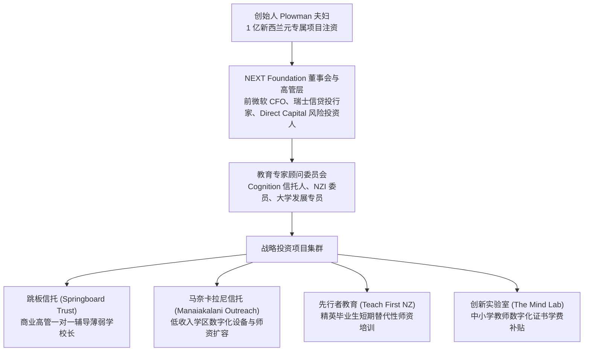

# NEXT Foundation

## 机构概况与战略定位

**内克斯特基金会（NEXT Foundation）**，通称 **NEXT 基金会**，是新西兰规模最大、运行机制最为激进的战略[[Venture Philanthropy|风险慈善]]（Venture Philanthropy）机构之一，总部设于新西兰奥克兰。

该基金会于 2014 年由新西兰著名企业家与商业慈善家尼尔·普洛曼（Neal Plowman）与安妮特·普洛曼（Annette Plowman）夫妇注资 1 亿新西兰元（NZD）设立。与新西兰绝大多数追求资本真实购买力代际永存的传统社区信托（如北方基金会，Foundation North）截然不同，NEXT 基金会确立了极其独特的 **“10 年内散尽本金”（Spend-down endowment equity over a decade）** 战略，计划在十年内将 1 亿新西兰元本金全额投放于教育和环境保护领域的重大高影响力项目（[[Argument_ONeill_2016_Report|O'Neill et al., 2016]]，pp. 36–38, 54–57）。

此外，基金会实行严格的“零行政管理经常性支出”（Zero [[Indirect Costs of Research|Overhead Costs]]）原则，规定 1 亿新西兰元资金必须 100% 用于受资助项目的直接研发与交付，包括首席执行官在内的核心运营团队薪酬均不由基金会本金列支，全部由创始人另行出资覆盖。

---

## 企业化治理与跨界金融网络

NEXT 基金会的执行团队与顾问架构高度体现了新自由主义金融资本与风险投资的治理逻辑：

### 1. 投行与商业高管主导的治理层
- **首席执行官** 比尔·科莫德（Bill Kermode），新西兰最大的本土私募股权与风险投资机构 Direct Capital 的创始合伙人；
- **投资与项目总监** 尤文·安德森（Ewen Anderson），前瑞士信贷第一波士顿（Credit Suisse First Boston）投资银行家、建筑巨头 Fletcher Building 与 Carter Holt Harvey 前高级副总裁；
- **董事会主席** 克里斯·利德尔（Chris Liddell），时任云计算企业 Xero 董事会主席，曾任通用汽车（General Motors）副董事长兼首席财务官、微软公司（Microsoft Corporation）首席财务官（CFO）。

### 2. 跨界教育政策顾问网络
基金会设立了深度融入新西兰国家决策中枢的教育咨询委员会：
- **玛格丽特·本德尔（Margaret Bendall）** 科[[Cognition Education|认知教育信托]]（[[Cognition Education]] Trust）现任信托人、[[Teach First New Zealand|新西兰先行者教育]]（[[Teach First New Zealand|TFNZ]]）高级顾问、新西兰学历认证局（NZQA）董事；
- **罗杰·弗朗斯（Roger France）** 奥克兰大学基金会前主席、迪尔沃斯学校（Dilworth School）信托人；
- **约翰·泰勒（John Taylor）** [[Partnership Schools Kura Hourua|新西兰特许学校]]委员会委员、亲市场智库[[New Zealand Initiative|新西兰倡议]]（NZI）核心成员、奥克兰大学资深发展顾问。

---

## 核心教育投资项目布局

NEXT 基金会在基础教育领域的投资完全遵循风险投资理念，强调“寻找高杠杆切入点”、“提供催化剂资金”（Catalyst for change）以及“追求可度量的量化[[Return on Investment|社会投资回报]]”（[[Return on Investment|Return on Investment]]）：

| 投资项目 | 合作实体与机制 | 资助功能与扩张逻辑 |
|---|---|---|
| **马奈卡拉尼推广倡议 （Manaiakalani Outreach）** | 联合[[Manaiakalani Education Trust\|马奈卡拉尼教育信托]]、三星电子与 Spark 基金会 | 提供数百万新西兰元扩展资金，将奥克兰塔马基（Tamaki）贫困学区的 1:1 Chromebook 数字化教学模式复制输出至基督城、西海岸及北地大区低收入公立学校，资助奥克兰大学开展量化实效评估。 |
| **跳板信托领导力项目 （[[Springboard Trust]]）** | 联合前麦肯锡合伙人与新西兰教育研究委员会（NZCER） | 全额资助低 decile 薄弱校校长参与战略领导力研修，由商业高管担任“能力伙伴”一对一介入学校三年战略规划。 |
| **先行者教育教师培养 （[[Teach First New Zealand]]）** | 与奥克兰大学教育学院及全球 Teach For All 合作 | 作为最高级别“贝壳杉资助方”（Kaitautoko Kauri），资助名校优秀非师范毕业生经过短期密集训练直接进入薄弱中学任教。 |
| **教师数字化研修补贴 （The Mind Lab by Unitec）** | 联合教育技术社会企业与国立理工学院（Unitec） | 设立专项奖学金，全额补贴公立中小学在职教师攻读数字化教育技术应用研究生证书（Postgraduate Certificate），加速数字化设备在公立课堂的渗透。 |

---

## 政策社会学批判：风险慈善对公共福利契约的瓦解

在教育政策社会学视角下，梅西大学学者[[John O'Neill|约翰·奥尼尔]]等（[[Argument_ONeill_2016_Report|O'Neill et al., 2016]]）将 NEXT 基金会的运作视为新西兰国家教育治理向“精算式[[Venture Philanthropy|风险慈善]]”（Actuarial Venture Philanthropy）转轨的晴雨表：

### 1. 以金融风投标准绑架公立学校办学目标
NEXT 基金会公开宣称：“我们直接与所资助机构的负责人建立深度伙伴关系，要求定期提交定性与定量报告，追求完全的坦诚与透明度。”这种模式打破了传统公益“赠款后不干预日常运营”的伦理边界，将公立学校受资助的前提同严格的商业里程碑（Milestones）考核挂钩，使学校为了争取外部资源而主动迎合金融资本对升学率与技术指标的偏好。

### 2. 加剧公立教育对私人资本的结构性依附
由于新西兰国家党联立政府主动将公共教育财政界定为“部分补贴”并鼓励学校寻求外部募捐，以 NEXT 为代表的超级基金会得以凭借数千万元的外部资本，直接成为推动数字化教学、校长研修与教师准入变革的主导力量。国家法定教育兜底义务由此被私人慈善的偏好所侵蚀，一旦十年散尽周期结束或基金会战略转向，依赖外部资本补贴的薄弱公立学校将面临严重的发展断崖。

---

## 关键引用

> [!citation-card] 风险资本运作与十年散尽式战略慈善
> 与通常追求资本代际永存的传统社区信托不同，NEXT 基金会采取了非同寻常的战略，即在十年之内将其全部 1 亿新西兰元的本金资产全额分配发放。其网站明确宣称：‘这笔一亿新西兰元的投资计划完全用于具体项目资助，NEXT 基金会自身不承担任何管理运营杂费，包括首席执行官的薪酬。’该基金会董事会与执行团队的专业背景极其清晰地折射出其金融[[Social Impact Investing|社会投资]]取向，汇聚了前通用汽车副董事长兼微软首席财务官、私人股权投资基金合伙人以及顶尖商法界的领袖人物。（[[Argument_ONeill_2016_Report|O'Neill et al., 2016, pp. 36–38]], 54–55）

---

## 相关条目网络

### 政策与制度机制
- [[Venture Philanthropy]]
- [[Social Impact Investing]]
- [[Policy Network]]
- [[Policy Entrepreneur]]
- [[Network Governance]]
- [[Return on Investment]]

### 资助与合作网络
- [[Springboard Trust]]
- [[Manaiakalani Education Trust]]
- [[Teach First New Zealand]]
- [[New Zealand Initiative]]
- [[Foundation North Māori and Pasifika Education Initiative]]

### 学术反思与理论透镜
- [[Stephen Ball]]
- [[John Hattie]]
- [[New Public Management]]

---

