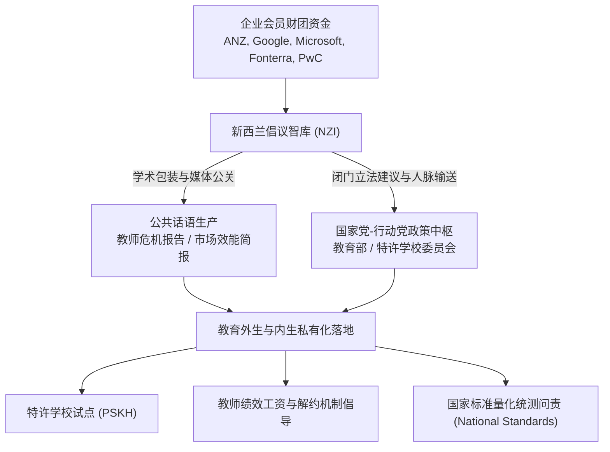

# New Zealand Initiative

## 机构概况与历史沿革

**新西兰倡议（The New Zealand Initiative, NZI）**，通称**新西兰倡议智库**，是新西兰最具影响力的亲市场（Pro-market）与自由意志主义（Libertarian）公共政策智库，总部设于新西兰惠灵顿。

该智库于 2012 年由两大颇具历史影响力的商业游说机构重组合并而成：
1. **新西兰[[Business Roundtable|商业圆桌会]]议（New Zealand Business Roundtable, NZBR）** 曾是 1980 年代末新西兰激进推行“罗杰经济学”（Rogernomics）与 1989 年“明日之校”改革（[[Tomorrow's Schools Reforms|Tomorrow's Schools]]）的核心企业智囊机构，主张彻底打破行政垄断并引入市场选择；
2. **新西兰研究所（New Zealand Institute）** 由商业领袖资助、聚焦长期国家经济繁荣与生产率增长的研究团体。

合并后的新西兰倡议智库积极进行品牌重塑，全面对标[[Centre for Independent Studies|澳大利亚独立研究中心]]（Centre for Independent Studies, CIS）以及英国政策交流智库（Policy Exchange），旨在摆脱传统“企业利益游说团”（Lobby Group）的刻板形象，自我定位为秉持严谨实证研究与思想领导力（Thought Leadership）的独立公共政策学术机构。

---

## 资助网络与商业财团背景

新西兰倡议智库的经费与治理结构呈现出高度纯粹的私营商业资本属性：

### 1. 企业会员与资助主体矩阵
智库完全依靠企业会员的年度会费与专属项目资助运营，其成员构成了新西兰最庞大的私营企业财团网络（[[Argument_ONeill_2016_Report|O'Neill et al., 2016]]，pp. 52–53）：
- **金融与专业服务机构** 澳新银行（ANZ）、新西兰银行（BNZ）、西太平洋银行（Westpac）、克雷格投资伙伴（Craig’s Investment Partners）、德勤（Deloitte）、普华永道（PwC）、安永（EY）、贝尔古利律师事务所（Bell Gully）、查普曼特里普律师事务所（Chapman Tripp）；
- **跨国科技与电信巨头** 谷歌（Google）、微软（Microsoft）、斯帕克电信（Spark New Zealand）、沃达丰（Vodafone）；
- **支柱工业与农业垄断企业** 恒天然乳业（Fonterra）、弗莱彻建筑（Fletcher Building）、新西兰航空（Air New Zealand）、莱恩啤酒（Lion）、新西兰炼油公司（Refining NZ）、帝国烟草（Imperial Tobacco）。

### 2. 跨界治理与政策旋转门
智库的教育委员会与董事会成员深度渗透至国家公共决策机构与名门公私立学校校董会。例如，智库核心顾问兼资深教育事务专员约翰·泰勒（John Taylor），同时出任新西兰教育部特许学校试点委员会（NZ Model of Charter Schools Committee）核心委员、奥克兰大学发展顾问，并曾长期担任著名私立名校国王学院（King's College）校长，构建起横跨智库、政界与精英办学机构的隐性[[Policy Network|政策网络]]。

---

## 在教育政策网络中的核心干预行动

在新西兰国家党（National Party）联立政府执政期间（2008–2017），新西兰倡议智库在新西兰公立基础教育的制度重构中扮演了关键[[Policy Entrepreneur|政策创业者]]角色：

### 1. 特许学校试点的立法倡导与辩护
新西兰倡议智库是新西兰引入特许学校（[[Partnership Schools Kura Hourua]], PSKH）的主要外部推手。智库撰写了一系列政策报告，援引美英特许学校（Charter Schools）与自由学校（Free Schools）的国际文献，主张打破公费公立学校的地域生源垄断，允许民间企业、信托基金会与部落实体依据商业合同设立免受国家课标与教师行业集体协议约束的特许学校。在特许学校遭遇新西兰教师工会（NZEI、PPTA）激烈抵制时，智库持续发布评估评论，为这一制度实验进行合法性辩护。

### 2. 倡导教师绩效工资与打破工会集体合同
智库多次发布针对新西兰公立教师人事制度的批判报告（例如《新西兰为何流失优秀教师？》），极力鼓吹打破以教龄为基础的全国教师统一薪资协议，主张引入私营企业管理模式，实行基于学生统测分数的教师[[Performance Pay|绩效工资]]制（Performance-related Pay），并赋予校长更便捷地开除所谓“低效教师”的行政裁量权。

### 3. 强化国家标准量化统测与择校数据公开
智库长期坚定支持推行基础教育“国家标准”（National Standards）与标准化统测工具，要求政府向家长全面公开各校按种族、阶层与学区的细分测验排行榜，通过强化消费者信息披露与家长用脚投票机制，倒逼公立学校展开市场竞争。

---

## 政策社会学批判：商业利益包装与民主问责削弱

在教育政治经济学与批判社会学视角下，以奥尼尔（[[Argument_ONeill_2016_Report|O'Neill et al., 2016]]）与[[Stephen Ball|斯蒂芬·鲍尔]]（[[Stephen Ball]]）为代表的学者对新西兰倡议智库的运作逻辑展开了深刻反思：

### 1. “非利益游说”的表象与意识形态霸权
智库在章程与公报中宣称：“我们是一家企业支持的研究机构，但我们不是利益游说团体；我们在政策辩论中引入亲市场视角，而不迎合具体公司利益……若没有新西兰倡议智库，这一代表国家长期繁荣的声音将不复存在。”

批判学者指出，这一表述是一种精密的合法化修辞策略：
- 智库将新自由主义对公共教育的商品化重构，伪装为超越党派利益的客观经济科学与“公共利益”；
- 实际上，其所大力推动的特许学校、校舍公私合作（[[Public-Private Partnership|PPP]]）、外包培训与教育软件采购，直接为为其出资的银行、建筑财团、跨国科技企业与咨询中介开辟了庞大的公费教育政府采购市场。

### 2. 闭门网络治理对公共民主协商的替代
新自由主义智库并不依赖公开的议会听证或面对基层教师群体的广泛民主商榷，而是借助跨界高层人脉网络、媒体专栏发声与非正式闭门研讨（Chatham House 规则），直接将政策文本嵌入政府法案草案。这一运作模式架空了新西兰传统公立教育赖以维系的工会集体协商与社区治理民主传统，使处于弱势地位的毛利、太平洋岛裔社区与基层教师群体在教育治理中的发言权进一步被边缘化。

---

## 关键引用

> [!citation-card] 亲市场智库的品牌重构与教育政策创业
> 在新西兰，自由意志主义‘亲市场’智库新西兰倡议（前身为新西兰[[Business Roundtable|商业圆桌会]]议）自 2012 年以来积极重塑品牌，向其澳大利亚的对标机构独立研究中心（CIS）靠拢。它将自身包装为一个研究与思想领袖型政策行动者，竭力将自身置于本土国家现代化与公立教育政策改革的[[Discourse|话语]]中枢……虽然其会员涵盖了新西兰主要跨国银行、电信与咨询财团，却声称自己在政策辩论中不代表任何具体行业利益，从而为特许学校与市场化问责提供了源源不断的政策正当性修辞。（[[Argument_ONeill_2016_Report|O'Neill et al., 2016, pp. 52–53]], 70–71）

---

## 相关条目网络

### 政策制度与倡导改革
- [[Partnership Schools Kura Hourua]]
- [[Endogenous and Exogenous Privatisation]]
- [[Tomorrow's Schools Reforms]]
- [[Teach First New Zealand]]

### 治理范式与分析框架
- [[Policy Network]]
- [[Policy Entrepreneur]]
- [[Network Governance]]
- [[New Public Management]]
- [[Performance Indicators]]
- [[Discourse]]

### 跨国思想与行动者
- [[Stephen Ball]]
- [[Michael Barber]]
- [[Venture Philanthropy]]

---

