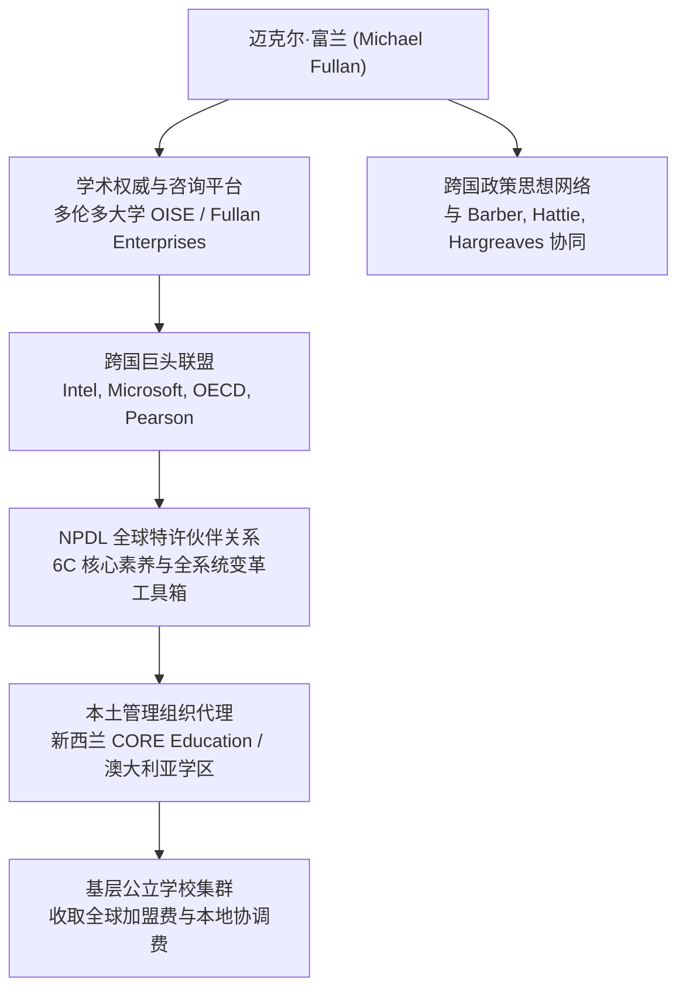

# Michael Fullan

## 简介

迈克尔·富兰（Michael Fullan，1940–）是加拿大著名教育社会学家、教育领导力与全系统[[Theory of Change|变革理论]]家，多伦多大学安大略教育研究院（Ontario Institute for Studies in Education, OISE）荣休教授及前院长，并担任咨询机构 Michael Fullan Enterprises 的首席执行官。

作为当代全球最具影响力的教育变革思想领袖之一，富兰开创了“教育变革动力学”（Dynamics of Educational Change）、“全系统变革”（Whole System Change）与“动能领导力”（Motion Leadership）理论框架，长期担任加拿大安大略省省长特聘教育顾问、英国与澳大利亚等国教育部战略顾问。自 2012 年起，富兰联合跨国科技公司与商业咨询中介发起[[New Pedagogies for Deep Learning|深度学习新教学法]]（New Pedagogies for Deep Learning, NPDL）全球伙伴网络，与约翰·海蒂（[[John Hattie]]）、[[Michael Barber|迈克尔·巴伯]]爵士（[[Michael Barber]]）并列为重塑多国公立教育政策与日常教学实践的三大跨国[[Policy Entrepreneur|政策创业者]]与思想领袖。

---

## 生平与职涯

- **学术奠基与制度领导** 富兰早年毕业于多伦多大学，获得社会学博士学位，长期深耕组织社会学与复杂系统理论在学校改进中的应用。1988 至 2003 年间担任多伦多大学安大略教育研究院院长，将其建设为全球教育政策与教师教育重镇。
- **政府政策中枢顾问** 2003 年起，富兰出任加拿大安大略省省长道尔顿·麦坚迪（Dalton McGuinty）的首席教育特别顾问，主导设计安大略省全系统教育改革战略，推动小学读写算能力提升与高中毕业率增长，使安大略省成为[[OECD|经合组织]]（OECD）推崇的系统改革标杆。
- **商业咨询与思想领袖转型** 创办个人咨询公司 Michael Fullan Enterprises，将学术[[Research Translation|研究转化]]为面向全球学校系统输出的领导力工作坊、数字评估工具与专有特许项目。
- **构建跨国教学法商业网络** 2012 年，富兰联合英特尔（Intel）、微软（Microsoft）、普罗米休斯（Promethean）等跨国科技企业及经合组织代表，在多伦多发起创立 [[New Pedagogies for Deep Learning|NPDL]] 全球伙伴计划，随后与培生集团（Pearson plc）智库合作出版专著，并依托各国私营中介与[[Educational Management Organisation|教育管理组织]]（如新西兰的 CORE Education）在全球建立付费学校集群。

---

## 主要著作与学术发展

富兰的学术出版呈现出从批判性组织社会学分析向高流动性、工具化咨询指南演进的典型轨迹：

1. **奠基期：教育变革复杂性分析**
   - 《教育变革的意义》（*The Meaning of Educational Change*, 1982/1991/2001/2007/2016，五版更新）：确立了变革是过程而非事件的核心命题，揭示了教师个人主观意义建构与客观政策制度之间的张力，成为教育变革领域的奠基之作。
   - 《变革的力量》（*Change Forces* 四部曲，1993–2005）：引入复杂性科学与混沌理论，论证自上而下的行政命令与自下而上的孤立首创均无法实现持久变革。
2. **转型期：领导力实务与行动指南**
   - 《领导力与可持续变革》（*Leadership and Sustainability*, 2005）与《动能领导力》（*Motion Leadership*, 2010/2013）：提出变革领导者应摆脱繁琐理论规划，通过敏捷行动与动能推进（motion）直接解决教学现场瓶颈。
3. **跨国商业合作期：深度学习专有品牌**
   - 《丰富矿脉：新教学法如何挖掘深度学习》（*A Rich Seam: How New Pedagogies Find Deep Learning*, 2014，与 Maria Langworthy 合著）：由培生开放思想（Pearson Open Ideas）丛书资助出版，系统确立 [[New Pedagogies for Deep Learning|NPDL]] 理论框架，完成学术[[Discourse|话语]]向跨国商业评测工具的转化。

---

## 核心理论与思想主张

### 1. 全系统变革与能力建设

富兰批评碎片化、项目驱动式的局部改良，倡导**全系统变革（Whole System Change）**
- **核心驱动力与错误驱动力** 富兰指出许多国家改革陷入了四大“错误驱动力”（Wrong Drivers）：严苛的惩罚性绩效问责、过度的个体主义评价、技术盲目崇拜以及碎片化孤立政策；主张转向四大“正确驱动力”（Right Drivers）：**能力建设（Capacity Building）**、**协作专业主义（Collaborative Professionalism）**、**教学驱动技术**以及**系统协同**。
- **三层协同架构** 系统变革必须实现宏观政府政策（State）、中观学区或集群（District/Cluster）与微观学校课堂（School）的纵向贯通与双向赋权。

### 2. 动能领导力（Motion Leadership）

动能领导力强调通过精简、积极的现场行动撬动群体行为改变：
- 领导者无需等待所有教职员工达成完全共识方才启动改革，而应通过解决具体微观难题创造积极动能（Positive Motion）；
- 依托同伴互动与团队协同实现规范的内部重塑，将外在改革要求内化为教师共同体的日常专业习惯。

### 3. 深度学习 6C 核心素养框架

在 [[New Pedagogies for Deep Learning|NPDL]] 架构下，富兰将面向 21 世纪的深度学习[[Operationalization|操作化]]为六项[[21st Century Skills and Competencies Discourse|关键能力]]（6Cs Deep Learning Competencies）：
- **[[Creativity|创造力]]（Creativity）** 具备经济与社会创业意识、提出新颖方案并付诸实施；
- **[[Critical Thinking|批判性思维]]（Critical Thinking）** 设计并管理项目、评估信息与论证逻辑；
- **沟通（Communication）** 针对多样受众与媒介展开高效叙述；
- **协作（Collaboration）** 作为团队成员协同工作并发挥领导力；
- **品格（Character）** 形成坚毅、同理心、道德责任感与[[Lifelong Learning|终身学习]]意愿；
- **公民素养（Citizenship）** 形成全球视野、理解多元文化并致力于环境与社会可持续发展。

---

## 影响路径与政策网络

富兰的理论影响力已高度融入当代新自由主义教育治理的跨国网络：

1. **跨界伙伴生态** 富兰的官方合作伙伴跨越官方机构与跨国商业财团，包括[[OECD|经合组织]]（OECD）、澳大利亚各州教育部、乌拉圭 Plan Ceibal 数字化项目，以及[[Michael Barber|迈克尔·巴伯]]爵士、肯·罗宾逊爵士（Sir Ken Robinson）与彼得·圣吉（Peter Senge）。
2. **本土代理落地机制** 在新西兰，富兰的 [[New Pedagogies for Deep Learning|NPDL]] 并非由官方教育部直接组织，而是全权委托本土[[Educational Management Organisation|教育管理组织]]（EMO）核心教育（CORE Education）作为官方独家代理商。CORE Education 将 NPDL 包装为按年收费的学校集群采购包，在新西兰基督城等地组建由公立学校组成的 Kahukura 集群，要求公立学校将公共教师研训经费（PLD）投入该专有项目的特许加盟中。

---

## 批判与学术争议

在批判政策社会学与教育政治经济学视野中，富兰从学术学者向跨国[[Policy Entrepreneur|政策创业者]]的演变引发了深刻学术争议：

### 1. 专有教学法的商品化与对公费教育的资本汲取

在新西兰梅西大学学者[[John O'Neill|约翰·奥尼尔]]等人的系统调研中（[[Argument_ONeill_2016_Report|O'Neill et al., 2016]]），富兰被确立为与约翰·海蒂并立的商业化政策创业典型：
- **公共课标的专有化替代** [[New Pedagogies for Deep Learning|NPDL]] 的 6C 体系在实质上与新西兰 2007 年国家官方课程（NZC）界定的[[21st Century Skills and Competencies Discourse|核心素养]]高度重合，但被富兰企业与跨国科技巨头包装为排他性的专有商标（Trademark）；
- **设立排他性收费门槛** 参与学校必须签署为期三年的协议，每年缴纳 2,000 美元全球倡议费与 3,000 新西兰元本地协调费，并为该项目专门配置 0.2 FTE 的校级领导职数与代课补偿。公立学校在财政紧缩背景下，将本用于基层教研的公共资金转交给了商业中介。

### 2. “教主崇拜”与管理主义话语套利

批判学者指出，富兰后期出版物呈现出显著的“管理顾问风格”（Guru Style）：
- 采用高度乐观、通俗且富于煽动性的商业营销修辞（如“动能”、“敏捷”、“撬动”），迎合了[[New Public Management|新公共管理]]体制下政府官员追求立竿见影政绩的心理；
- 其全系统变革框架往往假设各阶层学校具有同质化的组织生态，遮蔽了社会阶层、种族不平等与资本逻辑对薄弱校的结构性压迫。

---

## 关键引用

> [!citation-card] 思想领袖、跨国科技巨头与专有教学法商品化
> [[New Pedagogies for Deep Learning|深度学习新教学法]]全球倡议于 2012 年由迈克尔·富兰、格雷格·巴特勒、乔安妮·奎因以及来自英特尔、微软、[[OECD|经合组织]]与普罗米休斯的代表在加拿大多伦多创立。富兰是多伦多大学安大略教育研究院荣休教授与前院长。NPDL 通过其商标将自身界定为一个‘全球伙伴关系’，并宣称致力于通过识别促进深度学习能力的教学法来改变学习……然而，它通过排他性的集群收费结构与专有工具，将公费研训资源转化为跨国企业主导的特许加盟业务。（[[Argument_ONeill_2016_Report|O'Neill et al., 2016, pp. 24–25]]）

---

## 条目关联

### 上位理论与概念
- Whole System Change
- [[School Leadership]]
- Capacity Building
- [[Teacher Professional Agency]]

### 衍生方法与实践
- [[New Pedagogies for Deep Learning]]
- [[Surface and Deep Learning]]

### 政策网络与治理
- [[Policy Entrepreneur]]
- [[Policy Network]]
- [[Educational Management Organisation]]
- [[John Hattie]]
- [[Michael Barber]]
- CORE Education

---

